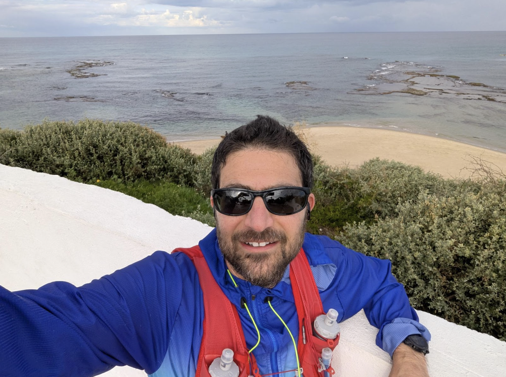
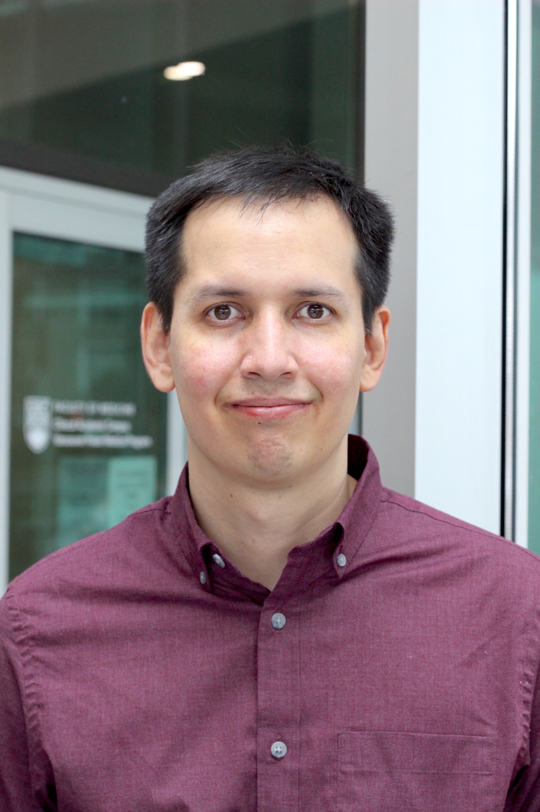

# Meet Your Faculty

### Instructors

#### Ido Hatam

>Principal Investigator  
Langara College  
Vancouver, BC, Canada
>
> --- ihatam@langara.ca

Dr. Ido Hatam holds a PhD in microbiology and biotechnology from the University of Alberta and serves as an Instructor in the Department of Biology and Bioinformatics program at Langara College, where he is also a Principal Investigator at the College's Applied Research Center. Dr. Hatam has developed multiple courses for the College's Bioinformatics program focused on using R-based tools to analyze high-throughput biological data. His research group uses bioinformatics tools to construct and analyze synthetic microbial communities, and specializes in "Guerrilla Bioinformatics" - generating value-added knowledge through meta-analysis of large, publicly available biological datasets.

#### Erin Pleasance (She/Her)

>Group Leader, Clinical Informatics  
Canada’s Michael Smith Genome Sciences Centre (GSC)   
Provincial Health Services Authority (PHSA)  
Vancouver, BC, Canada
>

Dr. Erin Pleasance is a Staff Scientist and Group Leader at Canada's Michael Smith Genome Sciences Centre at the Provincial Health Services Authority in BC. She completed her PhD in Medical Genetics at UBC in Vancouver, and a postdoctoral fellowship at the Wellcome Trust Sanger Institute, Cambridge, UK. Dr. Pleasance is currently involved in the Personalized OncoGenomics (POG) project, a multidisciplinary collaboration that integrates genomics and bioinformatics into personalized cancer care at BC Cancer. She has previously contributed to The Cancer Genome Atlas (TCGA), other National Cancer Institute sequencing initiatives, and the Cancer Genome Project in the UK, where she analysed some of the first cancer genomes.

### Teaching Assistants

#### Johnathan Wong (He/Him)

>PhD Candidate/Sessional Lecturer  
The University of British Columbia, BC Cancer Research Institute  
Richmond, BC, Canada
>
> --- johnathanwong4@gmail.com

Johnathan Wong is a PhD candidate in Bioinformatics and a Sessional Lecturer at the University of British Columbia. His research interests focus on genomics, genome assembly, and epigenomics. Outside of research, he is passionate about teaching, solving puzzles, and exploring hiking trails.

#### Miguel Prieto (He/Him)

>PhD Candidate in Health Sciences  
Center for Infectious Disease Genomics and One Health, Simon Fraser University  
Vancouver, B.C., Canada
>
> --- mprietog@sfu.ca

Miguel Prieto is a PhD candidate in Health Sciences at Simon Fraser University. He is a Medical Doctor trained in Colombia and has experience in public health and epidemiology, including an MSc in Experimental Medicine at UBC. His current research combines clinical data analysis with microbiome sequencing data analysis applied to chronic respiratory diseases.

### Sysadmin

#### Jiarui (Jerry) Li (He/Him)

>Research Support Analyst and Lead of Bioinformatics National Team (BNT)  
University of Alberta & Digital Research Alliance of Canada (DRAC)  
Edmonton, Alberta, Canada
>
> --- jiarui.li@ualberta.ca

Jiarui (Jerry) Li is a Research Support Analyst at the University of Alberta and the Lead of the Bioinformatics National Team (BNT) at the Digital Research Alliance of Canada (DRAC). He received his bachelor’s degree and Ph.D. in Genetics from Fudan University, China. Before joining the University of Alberta, he worked as a postdoctoral fellow and lecturer at Simon Fraser University, a lecturer at Shanghai University, Manager of the NGS Department at Applied Biological Materials Inc., and a Life Science Specialist at the University of British Columbia. He has broad experience in genetics, genomics, molecular biology, bioinformatics, and high-performance computing across both academic and industry settings.

### Facilitator

#### Tian Rabbani (She/Her)

>Regional Coordinator, CBH British Columbia  
Canadian Bioinformatics Hub, Simon Fraser University  
Vancouver, BC,  Canada 
>
> --- bc@bioinformatics.ca 

Tian completed her Master of Public Health in 2022 from Simon Fraser University and is currently a researcher and project lead at the Center for Infectious Disease Genomics and One Health (CIDGOH). She has been extensively involved in researching SARS-CoV-2 data-sharing through the Canadian COVID-19 Genomics Network (CanCOGeN), alongside leading efforts to understand metadata reporting in genomic epidemiology studies for outbreak and surveillance investigation. Her background in public health and knowledge in contextual data reporting intersect harmoniously to help inform current and future emergency response initiatives.

As British Columbia’s regional coordinator for the Canadian Bioinformatics Hub, Tian is passionate about and dedicated to connecting bioinformatics communities and groups across the province. She aims to grow, develop, and expand data science and bioinformatics tools and training materials for prospective or new professionals, as well as for those looking to advance in their current careers. Tian believes accessibility, access, and availability of these tools and training opportunities are the cornerstone of growing our bioinformatics communities across the region.
