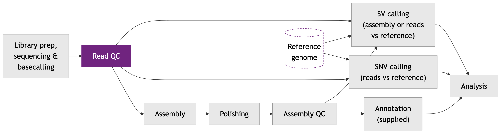

# Module 3

## Lecture

<object data="content-files/Module_3_HTG_Van-2611.pdf#toolbar=0navpanes=0" type="application/pdf" width="100%" height="600px">
  <p>Unable to render PDF. <a href="content-files/Module_3_HTG_Van-2611.pdf">Download the PDF</a>.</p>
</object>

<a href="content-files/Module_3_HTG_Van-2611.pdf" target="_blank" rel="noopener">Open slides in a new tab</a>

## Lab

*Garbage In, Garbage Out: Auditing Your Nanopore Reads*

### Introduction: Meet Your Dataset

For the next two days you will follow **one real dataset** from raw reads to variants. It is *BAL_1a*, a wild *Saccharomyces cerevisiae* (baker's yeast) isolate sequenced on an Oxford Nanopore MinION (run **ERR8562432**, R9.4.1 flow cell). The sequencing is not subsampled: you work with every read, as in a real project.

**The case.** For two days you are a detective. The suspect is a wolf (our isolate, *BAL_1a*): a wild yeast from rotten wood on Bawangling Mountain, Hainan, China. You compare it with a corgi (S288C, the lab-bred reference strain). Two questions run through the labs. Does the wolf differ in genes for **ethanol fermentation**? Does it differ in genes for **stress response**? First things first: is the evidence, the reads, good enough to use?

Today you do the first computational step, **quality control (QC)**: measuring how good the data are *before* you spend hours using them. By the end of this lab you will have:

- built your own project folders on the cluster and downloaded the data,
- run **sequali**, a QC tool for long reads, and read its report,
- thought through a read-filtering step (without running it),
- submitted the genome assembly job (Flye) that the next module's lecture will explain.

The lab has these parts:

- **Part 0:** where we are, and the anatomy of a Slurm script
- **Part 1:** the `nano` routine, and your project folders
- **Part 2:** download the reads and the reference
- **Part 3:** check that your tools work
- **Part 4:** run sequali on the raw reads
- **Part 5:** copy the report to your laptop and read it
- **Part 6:** think it through, filtering
- **Part 7:** submit the assembly, then lunch
- **Bonus:** short-read QC in R (optional)

#### Where we are in the workflow



This lab covers the highlighted stage, **read QC**.

### Your Paths

All scripts use these locations. Everything under `WORK` is yours alone, so nobody can overwrite your files. Everything else belongs to the instructor and is shared read-only.

| Name | Value | Notes |
|---|---|---|
| `WORK` (yours) | `/scratch/$USER/yeast_workshop` | `$USER` is your cluster user name. Script 01 creates `data/`, `results/ERR8562432/`, `scripts/` and `logs/` inside it. |
| Conda (the instructor's) | `source /project/60004/shared/conda/bin/activate <env>` | Environments: `flye_env`, `medaka_env`, `crossmap_env`, `sequali_env` |
| BUSCO image (used in Lab 4) | `/project/60004/shared/containers/busco.sif` | Run through Apptainer; script 03 checks that it works |
| Reference FASTA | `$WORK/data/Saccharomyces_cerevisiae.R64-1-1.dna.toplevel.fa` | You download it in script 02 |
| Fallback results | `/project/60004/shared/fallback/` | Used if a job fails. |

::: {.callout type="red" title="**Read this once**"}
A **script** (`.sh` file) is a text file of commands. In this lab you copy each script from this page, save it with `nano`, and run it. Some scripts run on the **login node** (the computer you land on when you log in; only quick jobs go here) with `bash`. Others go to a **compute node** (where the real work happens) through **Slurm** with `sbatch`. Every step below tells you which one to use.
:::

### Part 0: Where We Are and How a Script Is Built

You met Slurm in the orientation. Here is the anatomy once more, using a tiny example. **You do not need to run this one.**

**`anatomy_example.sh`**

```bash
#!/bin/bash
#SBATCH --job-name=anatomy
#SBATCH --account=def-sponsor00
#SBATCH --cpus-per-task=2
#SBATCH --mem=4000M
#SBATCH --time=0:10:00

# This is a comment. The shell ignores it.
echo "Hello from $(hostname)"
```

::: {.callout type="blue" collapsible="true" title="What each argument does"}
`#SBATCH` lines and set-up: see Lab 3, script 04. The `#SBATCH` lines are also explained in the bullets below and in Question 2. This box covers only what is specific to this example.

| Argument | What it does | Why this value |
|---|---|---|
| `#!/bin/bash` | The first line, starting with `#!`, names the program that runs the file (the "shebang"). | All scripts in this lab are bash scripts.  |
| `echo "Hello from $(hostname)"` | `echo` prints text. `hostname` prints the name of the computer; `$( )` pastes its output into the text.  | A harmless command, so you can see which computer ran the job. |

:::

- Line 1, `#!/bin/bash`, is the **shebang**: it says "run this file with the bash shell".
- Lines starting with `#SBATCH` are requests to **Slurm**: CPUs, memory (`--mem`), maximum run time (`--time`) and your account. Slurm reads them *before* it runs anything.
- Other lines starting with `#` are comments, notes for humans.
- The remaining lines are the commands that run.

Every script in this lab also starts with the same few lines after the `#SBATCH` block: `set -e` (stop at the first error, so one failure does not hide behind later output), `WORK=...` (where your project lives) and `cd "$WORK"` (go there). Each script ends with `echo` lines that print the names of the files it made.

**Question 1:** In the example, how much memory and how much time does the job request? What do you expect to happen if the job needs more of either?

::: {.callout type="blue" collapsible="true" title="Answer"}
It requests 4000 MB of memory (`--mem=4000M`) and 10 minutes (`--time=0:10:00`), with 2 CPUs. Slurm enforces these limits: a job that runs past its time or memory is stopped (cancelled) by Slurm, and the log shows a time-limit or out-of-memory message. That is why each script asks for a bit more than it should need.
:::

**Question 2:** The line `#SBATCH --cpus-per-task=2` and the line `# This is a comment` both start with `#`. Why does Slurm treat them differently?

::: {.callout type="blue" collapsible="true" title="Answer"}
Slurm scans the top of the script for lines that start exactly with `#SBATCH` and treats them as resource requests. The shell sees every `#` line as a comment and ignores it, so the `#SBATCH` lines do nothing when you run the script with `bash`; only `sbatch` reads them.
:::

### Part 1: The `nano` Routine and Your Project Folders

#### Step 1: Save a script with `nano`

**`nano`** is a simple text editor that runs inside the terminal. You will use the same four moves for every script in this workshop.

1. In the terminal, type `nano 01_setup_folders.sh` and press Enter. An empty file opens.
2. Copy the script from this page (the copy button at the top right of each block) and paste it into the terminal: **right-click** or **Ctrl+Shift+V** (Cmd+V on a Mac). Plain Ctrl+V does not paste in most terminals.
3. Save with **Ctrl+O**, then press **Enter** to confirm the name. Exit with **Ctrl+X**.
4. Run it. A script that runs on the **login node** is run with `bash`:

**`run on the login node`**

```bash
bash 01_setup_folders.sh
```

Every script we ask you to run on the login node is run this way, with `bash`. Compute jobs are submitted with `sbatch` instead, for example `sbatch 04_sequali_raw.sh`.

After you submit a job, `squeue -u $USER` shows your jobs (`PD` = pending, `R` = running; an empty list means it finished). When it is done, read the log with `less /scratch/$USER/yeast_workshop/logs/<name>_<jobid>.out` (press `q` to quit `less`).

::: {.callout type="red" title="**Where do I save the scripts?**"}
Work from your home folder for now. Script 01 creates `$WORK/scripts/`, so after you run it, save later scripts there: `cd /scratch/$USER/yeast_workshop/scripts` and then `nano ...`. Every script uses full paths, so it works from any folder.
:::

#### Step 2: Create your folders (login node)

- **What:** makes your project folder and its sub-folders.
- **Why:** every later script reads and writes in these folders. The `logs/` folder must exist *before* any job is submitted, because Slurm writes its log files there.
- **Expected output:** the list of folders printed at the end.

::: {.callout type="red" title="**Login node**"}
Run with `bash`, not `sbatch`.
:::

**`01_setup_folders.sh`**

```bash
#!/bin/bash
# 01_setup_folders.sh
# Creates your personal project folders. Run on the login node with: bash 01_setup_folders.sh

# Stop at the first error
set -e

# Your project folder (the cluster fills in $USER with your user name)
WORK=/scratch/$USER/yeast_workshop

# mkdir -p: create a folder and any missing parent folders; no error if it exists
mkdir -p "$WORK/data"                 # downloaded reads and reference
mkdir -p "$WORK/results/ERR8562432"   # everything the tools produce
mkdir -p "$WORK/scripts"              # your saved scripts
mkdir -p "$WORK/logs"                 # Slurm writes job logs here

# Go to the project folder and show what we made
cd "$WORK"
echo "Created these folders in $WORK:"
ls -d data results/ERR8562432 scripts logs
```

::: {.callout type="blue" collapsible="true" title="What each argument does"}
Set-up lines (`set -e`, `WORK=`, `cd`): see Lab 3, script 04.

| Argument | What it does | Why this value |
|---|---|---|
| `mkdir -p` | `-p`: no error if the folder already exists, and make parent folders as needed. | Safe to rerun; the first `mkdir -p` also creates `/scratch/$USER/yeast_workshop` itself, and `results/ERR8562432` creates `results/` on the way.  |
| `ls -d data results/ERR8562432 scripts logs` | `-d`: list the folders themselves, not their contents. | Prints just the four folder names, so you can see they exist.  |

:::

### Part 2: Downloading the Data

#### Step 1: Download the reads and the reference (login node)

- **What:** downloads the ONT reads (ERR8562432) from the European Nucleotide Archive (ENA), then the yeast reference genome (strain S288C, version R64-1-1, from Ensembl release 113), and unpacks the reference.
- **Why:** the reads are what we sequenced. The **reference genome** is an existing assembly that we use as a coordinate system for later steps and for judging our own assembly.
- **Expected output:** `ERR8562432.fastq.gz` (a few hundred MB) and `Saccharomyces_cerevisiae.R64-1-1.dna.toplevel.fa` in `data/`.

::: {.callout type="red" title="**Login node**"}
Downloads need internet, which compute nodes may not have. Run this one with `bash`, not `sbatch`. In the workshop cluster test run (2026-10-18) it took about 8 minutes, almost all of it the reads file (7 min 35 s; the reference took 2 s). It will take longer if the whole class downloads at once. Wait for the prompt to come back.
:::

**`02_download_data.sh`**

```bash
#!/bin/bash
# 02_download_data.sh
# Downloads the ONT reads and the S288C reference. Run on the login node with: bash 02_download_data.sh

set -e
WORK=/scratch/$USER/yeast_workshop
cd "$WORK"

# --- 1. The reads (already gzip-compressed on the server, so we keep the .gz) ---
# wget: download a file
# -nc : do not download again if the file is already here
# -P  : the folder to save into
wget -nc -P "$WORK/data/" https://ftp.sra.ebi.ac.uk/vol1/fastq/ERR856/002/ERR8562432/ERR8562432.fastq.gz

# Check that the reads arrived intact. md5sum computes a "fingerprint" of the file;
# it must match the fingerprint ENA publishes for this file. You should see "OK".
# If you see "FAILED", the download was damaged: delete the file (rm) and run this script again.
echo "af1f71de672a351b259811f3dacf678b  $WORK/data/ERR8562432.fastq.gz" | md5sum -c -

# --- 2. The reference genome ---
wget -nc -P "$WORK/data/" https://ftp.ensembl.org/pub/release-113/fasta/saccharomyces_cerevisiae/dna/Saccharomyces_cerevisiae.R64-1-1.dna.toplevel.fa.gz

# gunzip: unpack the .gz file into plain text (a FASTA file) that later tools read
# -f: overwrite quietly if an unpacked copy already exists
gunzip -f "$WORK/data/Saccharomyces_cerevisiae.R64-1-1.dna.toplevel.fa.gz"

# Show the files and their sizes
echo "Downloaded files:"
ls -lh "$WORK/data/"
```

::: {.callout type="blue" collapsible="true" title="What each argument does"}
`set -e`, `WORK=`, `cd`: see Lab 3, script 04.

| Argument | What it does | Why this value |
|---|---|---|
| `wget` | Downloads a file from a web address (a "non-interactive network retriever"). | Run on the login node, because compute nodes may not have internet (Part 2). |
| `-nc` | `--no-clobber`: skip downloads that would download to existing files. | Rerunning the script does not download the big file again. |
| `-P "$WORK/data/"` | `--directory-prefix`: save files into this folder. | Puts both files in your `data/` folder wherever you run the script from. |
| `https://...` addresses | The file to fetch (wget takes one or more URLs). | The reads come from ENA (run ERR8562432); the reference is yeast R64-1-1 from Ensembl release 113 (Part 2 text). |
| `md5sum -c -` | `-c`: read checksums from the given file(s) and check them. A file name of `-` means "read from standard input", so it reads the line piped in. | The line holds ENA's published fingerprint and the path of your file. `OK` means your copy is intact (see the "Check for OK" note below). |
| &#124; (pipe) | Each command reads the previous command's output: the pipe connects them. See script 04. | Feeds the `echo` line into `md5sum`.  |
| `gunzip -f` | `-f`, `--force`: force overwrite of the output file. | Safe to rerun: an unpacked copy that already exists is replaced quietly. |
| `ls -lh` | `-l`: long listing; `-h`: print sizes like 1K, 234M, 2G. | Question 3 asks you to compare the file sizes.  |

:::

::: {.callout type="red" title="**Check for \"OK\"**"}
The script prints `ERR8562432.fastq.gz: OK` when the reads arrived intact. In a test download the file arrived at full size but damaged; only this check caught it. If you see `FAILED`, run `rm /scratch/$USER/yeast_workshop/data/ERR8562432.fastq.gz` and then `bash 02_download_data.sh` again.
:::

**Question 3:** Compare the sizes of the two files in `data/`. The reads file ends in `.gz` and the reference does not. What does `.gz` mean? The reference is about 12 million letters long, so roughly how big would you expect that plain-text file to be?

::: {.callout type="blue" collapsible="true" title="Answer"}
`.gz` means the file is compressed with **gzip**, like a zip file: it is smaller on disk and most QC and assembly tools read it directly. `ls -lh` shows the reads file as about 424M (ENA lists 443.7 MB; `-h` uses 1,024-based units). The reference FASTA is plain text with about one byte per letter, so about 12 MB for a roughly 12 Mb genome. The reads file is far larger because it holds about 448 million bases plus a quality character for each base.
:::

### Part 3: Can I Reach My Tools?

- **What:** asks the tools you will use in the next labs to report their version. Most cluster modules (samtools, bcftools, minimap2, snpEff) are not checked. QUAST is checked because it needs an older software environment (StdEnv/2020).
- **Why:** it is much cheaper to find a missing tool now than in the middle of a job. A tool that is reachable prints a version or a help line; a problem shows as `command not found`.
- **Expected output:** one version line per tool. Messages from `module` and `conda` about loading are normal.

Software reaches you in three ways, and this script uses all three:

- A **module** is software the cluster administrators have installed; you switch it on with `module load`.
- A **conda environment** is a private bundle of software that you switch on with `source .../activate <name>`.
- A **container (Apptainer)** is a sealed, ready-made software package that runs through `apptainer exec`.

::: {.callout type="red" title="**Login node**"}
Run with `bash`, as in Part 1. These checks take seconds, and no data are processed.
:::

**`03_check_tools.sh`**

```bash
#!/bin/bash
# 03_check_tools.sh
# Asks each tool for its version. Run on the login node with: bash 03_check_tools.sh
# We do NOT use "set -e" here, so one missing tool does not stop the other checks.

WORK=/scratch/$USER/yeast_workshop
cd "$WORK"

# Each group is in ( ... ) so that the tools it loads do not interfere with the next group.

echo "=== Conda tools ==="
( source /project/60004/shared/conda/bin/activate sequali_env && sequali --version )
( source /project/60004/shared/conda/bin/activate flye_env    && flye --version )
( source /project/60004/shared/conda/bin/activate medaka_env  && medaka --version )
# CrossMap and paf2chain live in crossmap_env; we print the first lines of their help
( source /project/60004/shared/conda/bin/activate crossmap_env && CrossMap --help | head -n 3 )
( source /project/60004/shared/conda/bin/activate crossmap_env && paf2chain --help | head -n 3 )

echo "=== QUAST (a cluster module) ==="
( module load StdEnv/2020 gcc/9.3.0 quast/5.2.0 && quast.py --version )

echo "=== Container tool (BUSCO, run through Apptainer) ==="
( module load StdEnv/2023 apptainer/1.4.5 && apptainer exec /project/60004/shared/containers/busco.sif busco --version )

echo "Done. Any line saying 'command not found' or an error means that tool needs fixing: tell an instructor."
```

::: {.callout type="blue" collapsible="true" title="What each argument does"}
`set -e` is deliberately absent here (see the script's comment). `WORK=` and `cd`: see Lab 3, script 04.

| Argument | What it does | Why this value |
|---|---|---|
| `( ... )` around each line | The commands inside run in a subshell; variable assignments made there do not remain after it finishes. | Keeps one tool's settings from leaking into the next check.  |
| `&&` | The command on the right runs if, and only if, the one on the left succeeded. | Only asks for a version if the environment was switched on.  |
| `source .../activate <env>` | `source` runs the commands in a file in the current shell. The `activate` file switches on a conda environment. See the box under script 04. | Names: `sequali_env`, `flye_env`, `medaka_env`, `crossmap_env` (the "Your Paths" table). The environments are the instructor's and read-only for you.  |
| `--version` | Prints the program's version number and exits (shown in the `sequali`, `flye`, `quast.py` and `busco` help texts). | A tool that answers is reachable; `medaka --version` is run the same way. |
| `--help | head -n 3` | `--help` prints a tool's usage text. `head -n 3` (`--lines`) prints only the first 3 lines. | CrossMap and paf2chain print long help; three lines are enough to show they run. |
| `module load StdEnv/2020 gcc/9.3.0 quast/5.2.0` | `module load` switches on cluster-installed software; several can be listed. `StdEnv/2020` is an older (deprecated) standard environment; it uses GCC 9.3.0 as its default. | QUAST still needs this older environment (Part 3 text). |
| `module load StdEnv/2023 apptainer/1.4.5` | As above. `StdEnv/2023` is the newer standard environment (default GCC 12.3.0). | Apptainer runs the BUSCO image. |
| `apptainer exec <image> busco --version` | `apptainer exec <container> <command>` runs a command inside a container. | `busco.sif` is the image the instructor built (see "Your Paths"); BUSCO runs from it in Lab 4. |

:::

::: {.callout type="green" collapsible="true" title="Independence bonus: reading a tool's help"}
Optional, and outside the lab's time. Every command-line tool can describe itself. This works like typing `?` in R: you ask the tool, and it prints its own manual page. On the login node, try it with Flye:

**`read Flye's help (type in the terminal, login node)`**

```bash
( source /project/60004/shared/conda/bin/activate flye_env && flye --help )
```

Here is a short excerpt of what Flye 2.9.6 prints (cut down; the real output is longer):

```
usage: flye (--pacbio-raw | --pacbio-corr | --pacbio-hifi | --nano-raw |
	     --nano-corr | --nano-hq ) file1 [file_2 ...]
	     --out-dir PATH

	     [--genome-size SIZE] [--threads int] [--iterations int]
	     ...
  --nano-raw path [path ...]
                        ONT reads with odler chemistries, pre R9 Guppy5
                        (10-20% error)
  --nano-hq path [path ...]
                        ONT R10 reads, aka Q20 (<3% error). For R9 Guppy5+,
                        increase --read-error slightly
  -g size, --genome-size size
                        estimated genome size (for example, 5m or 2.6g)
```

(The typo "odler" is in Flye's own text.)

**How to read it**

- The **usage line** (the first lines) shows how to write the command. By convention, words in `[square brackets]` are optional; words outside brackets are required. Here you must give one read type from the parenthesis `( ... | ... )`, your read file(s), and `--out-dir`. `--genome-size`, `--threads` and `--iterations` are optional. 
- Below the usage line, each option is listed with a short description. An option written as `-g size, --genome-size size` has a short name (`-g`) and a long name (`--genome-size`) that mean the same thing. 
- The **pair to compare** is `--nano-raw` and `--nano-hq`. The help says `--nano-raw` is for "ONT reads with older chemistries, pre R9 Guppy5 (10-20% error)", and `--nano-hq` is for "ONT R10 reads, aka Q20 (<3% error)". Our reads are R9.4.1, and we do not know which basecaller made them, so the deciding clue is the error rate: `--nano-raw` expects 10-20% errors and `--nano-hq` under 3%. In Part 5 you will see where ours sit. Script 06 uses `--nano-raw`, as its comment says.
- `--genome-size` takes an estimate such as `5m` or `2.6g`. Yeast is about 12 million bases, so script 06 gives `12m`.

**Two more definitions** (they add to the one-liners in Part 3)

- A **conda environment** is a folder that holds a specific set of programs (packages) installed into it; changing one environment does not affect the others, and you switch one on with `activate`. The conda documentation says activation puts the environment's folder at the front of the list of places the shell searches for commands, and that this lasts only for your current terminal session. That is why script 03 puts each check in its own `( ... )`, and why the command above is wrapped in one. 
- A **container image** packages a program together with the software it needs, so it runs the same way on a laptop or on a cluster; Apptainer stores it as a single file (ours ends in `.sif`). You do not add it to the search path. Instead you name the image and the command to run inside it: `apptainer exec <container> <command>`, as in script 03 for BUSCO. **Docker** is the tool people commonly use to build and run such images on their own computers; **Apptainer** is built for shared clusters, where you run the container as your own user, with no extra privileges. 

:::

::: {.callout type="blue" title="**What to expect**"}
Seven tools reply (sequali, Flye, medaka, CrossMap, paf2chain, QUAST, BUSCO). If one fails, raise your hand now; do not wait for the job that needs it. The BUSCO line may first print `WARNING: While bind mounting '/scratch:/scratch': destination is already in the mount point list`. It is harmless: the version number follows it.
:::

### Part 4: The Audit with sequali

#### Step 1: Run sequali on the raw reads

- **What:** **sequali** is a QC tool for long reads. It reads the whole FASTQ file and writes an HTML report with read counts, read lengths, quality scores and more.
- **Why:** this is the audit. Before assembling, we need to know how many reads and bases we have, how long the reads are, and how accurate they are.
- **Expected output:** a folder `results/ERR8562432/sequali/` containing an `.html` report (named `ERR8562432.fastq.gz.html`) and a data file (`ERR8562432.fastq.gz.json`). It takes about a minute.

Save as `04_sequali_raw.sh` in your `scripts/` folder with `nano`, as in Part 1.

**`04_sequali_raw.sh`**

```bash
#!/bin/bash
#SBATCH --job-name=sequali_raw
#SBATCH --account=def-sponsor00
#SBATCH --cpus-per-task=4
#SBATCH --mem=8000M
#SBATCH --time=0:30:00
#SBATCH --output=/scratch/%u/yeast_workshop/logs/%x_%j.out
#SBATCH --error=/scratch/%u/yeast_workshop/logs/%x_%j.err
set -e
WORK=/scratch/$USER/yeast_workshop
cd "$WORK"

# Activate the conda environment that contains sequali
source /project/60004/shared/conda/bin/activate sequali_env

# Folder for the report
mkdir -p "$WORK/results/ERR8562432/sequali"

# sequali: long-read QC
# --outdir : where to save the HTML report
# --threads: how many CPUs to use (the number Slurm gave us)
sequali \
  --outdir "$WORK/results/ERR8562432/sequali" \
  --threads $SLURM_CPUS_PER_TASK \
  "$WORK/data/ERR8562432.fastq.gz"

echo "Finished. Report files:"
ls -lh "$WORK/results/ERR8562432/sequali/"
```

::: {.callout type="blue" collapsible="true" title="What each argument does"}
This box explains the `#SBATCH` options and set-up lines shared by every later script. Later boxes only cover new arguments.

| Argument | What it does | Why this value |
|---|---|---|
| `#!/bin/bash` | See the box under the anatomy example. | - |
| `#SBATCH --job-name=sequali_raw` | `-J, --job-name`: a name for the job. It appears with the job ID when you list running jobs. If you give none, the script's file name is used. | A short, readable name. It also becomes part of the log file names through `%x`. |
| `#SBATCH --account=def-sponsor00` | `-A, --account`: charge the resources used by this job to this account. The account is an arbitrary string. | The workshop account. |
| `#SBATCH --cpus-per-task=4` | `-c, --cpus-per-task`: tells Slurm the job needs this many processors. Without it, Slurm tries to give one. | sequali can use several threads (see `--threads` below). 4 is a modest request.  |
| `#SBATCH --mem=8000M` | `--mem`: the real memory the job needs per node. The default unit is mebibytes; a suffix such as `M` or `G` changes the unit. | Generous for a QC pass over the reads.  |
| `#SBATCH --time=0:30:00` | `-t, --time`: a limit on the total run time (hours:minutes:seconds). When the limit is reached, the job's processes are stopped. | sequali took 18 s in the workshop cluster test run, so 30 minutes is a large margin.  |
| `#SBATCH --output=.../%x_%j.out` and `--error=.../%x_%j.err` | `-o, --output` and `-e, --error`: send what the script prints (standard output) and its error messages (standard error) to the named file. If you give neither, both go to one file called `slurm-<jobid>.out`. | Two separate files make errors easy to find. The `logs/` folder is the one script 01 created. |
| `%u`, `%x`, `%j` | Filename symbols: `%u` is the user name, `%x` the job name, `%j` the job ID. | `/scratch/%u/...` puts your log in your own folder; `%x_%j` gives names like `sequali_raw_12345.out` that never overwrite each other. |
| `set -e` | Exit immediately if a command exits with a non-zero status (bash `help set`). | One failure does not hide behind later output.  |
| `WORK=/scratch/$USER/yeast_workshop` | `name=value` stores a value in a variable. `$USER` is your user name. | Every later path starts from `$WORK`, so scripts do not depend on where you run them.  |
| `cd "$WORK"` | `cd` changes the shell's working directory to the folder given. | Starts every script from a known place.  |
| `source /project/60004/shared/conda/bin/activate sequali_env` | `source` runs the commands in a file in the current shell. The `activate` file switches on the conda environment: it puts the environment's folder at the front of the list of places searched for commands, and runs any activation scripts in it. | sequali lives in the instructor's `sequali_env`. Calling `activate` by its full path lets a script switch on the environment without any start-up files.   |
| `module load StdEnv/2023 gcc/12.3 ...` (used in script 03 and the bonus) | `module load` switches on cluster-installed software; several can be listed on one line. A `StdEnv` module is a standard software environment (a compiler plus related modules). | Software is loaded after its standard environment (see the bonus script, which loads `StdEnv/2023` first).  |
| `$SLURM_CPUS_PER_TASK` | A variable Slurm sets in the job: the number of CPUs requested per task. It is set only if `--cpus-per-task` was given. | Passes the CPUs you asked for to the tool, so the two numbers agree. |
| `mkdir -p "$WORK/results/ERR8562432/sequali"` | `-p`: no error if the folder exists; make parent folders as needed. | The report folder exists before sequali writes to it.  |
| `\` at the end of a line | A backslash before a newline continues the command on the next line. | Splits one long command into readable lines.  |
| &#124; (pipe) and `>` | The pipe connects commands: each reads the previous command's output. `>` sends output to a file; the file is created, or emptied if it exists. | First used in scripts 02, 03 and 05; explained here once.  |
| `sequali --outdir DIR` | `--outdir`: output directory for the report files (default: the current folder). | The HTML and JSON reports go into your `results/` folder. By default they are named after the input file: `ERR8562432.fastq.gz.html` and `.json`. |
| `--threads $SLURM_CPUS_PER_TASK` | `-t, --threads`: number of threads to use (default 2). If more than one, an extra thread decompresses the gzip file. | Uses the 4 CPUs you asked for (plus one extra thread for reading the `.gz` file). |
| `.../ERR8562432.fastq.gz` | The input file (FASTQ or uBAM; compressed formats are supported and detected automatically). | The raw reads you downloaded in script 02. |

:::

Submit it and check that it is running:

**`submit and check (type in the terminal)`**

```bash
cd /scratch/$USER/yeast_workshop/scripts
sbatch 04_sequali_raw.sh
squeue -u $USER
```

When the job leaves the `squeue` list, check the end of the log with `less /scratch/$USER/yeast_workshop/logs/sequali_raw_<jobid>.out`. At the end you should see the file listing. If it says `Error`, look at the matching `.err` file.

::: {.callout type="red" title="**If your job failed**"}
Copy a finished report folder from the fallback location and carry on with the questions. Tell an instructor so we can find out why.

**`copy the fallback report`**

```bash
cp -r /project/60004/shared/fallback/sequali /scratch/$USER/yeast_workshop/results/ERR8562432/
```
:::

### Part 5: Copying the Report to Your Laptop and Reading It

The HTML report lives on the cluster; you want to open it in your browser. Do Step 1 first, then the questions in Step 2. **`scp`** (secure copy) copies a file between computers over SSH.

::: {.callout type="red" title="**Run this on your laptop, not on the cluster**"}
Open a **new terminal window on your laptop** (Terminal on a Mac; PowerShell or Windows Terminal on Windows 10/11). Do not use the window where you are logged in to the cluster.
:::

The command has the form `scp  from  to`. The dot at the end means "into the folder I am in now".

**`scp_example (run on your laptop)`**

```bash
# Replace:  YOUR_USER     with your cluster user name
#           (the cluster's address is cbw.c3.ca)
scp YOUR_USER@cbw.c3.ca:/scratch/YOUR_USER/yeast_workshop/results/ERR8562432/sequali/ERR8562432.fastq.gz.html .
```

`YOUR_USER` is a **placeholder**: type your own cluster user name. The cluster's host name is `cbw.c3.ca`. Enter your cluster password when asked (nothing appears as you type; that is normal). Then double-click the downloaded `.html` file to open it in your browser.

::: {.callout type="blue" title="**Windows**"}
If `scp` is not available, use **MobaXterm** (drag and drop in its left-hand file panel) or **WinSCP** (a two-pane window: the cluster on one side, your laptop on the other). Navigate to `/scratch/YOUR_USER/yeast_workshop/results/ERR8562432/sequali/` and drag the `.html` file across.
:::

#### Step 2: Read the report

Two QC terms to keep in mind before you look:

- A **Phred quality score (Q)** says how likely a base is wrong: Q = −10 × log₁₀(probability of error). **Q10** means 90% correct, **Q20** 99%, **Q30** 99.9%.
- The **mean read quality** is a read's average quality. It is best computed by averaging the *error probabilities* and converting back, not by averaging the Q numbers, because a few very bad bases matter more than the Q average suggests.
- The **read length distribution** is how many reads there are of each length (a histogram). It shows whether the library is mostly long reads or full of short fragments.
- The **read N50** is the length such that half of all bases sit in reads at least that long. sequali shows it in the **Contiguity** table of its "Sequence length distribution" section.

Open the report in your browser and answer Questions 4-9.

**Question 4:** In sequali's summary table, how many reads (Total reads) and bases (Total bases) are there, and what is the Mean length? Check the mean by dividing the bases by the number of reads. Given a yeast genome of about 12 Mb, roughly how many times is each base covered (the **coverage**)?

::: {.callout type="blue" collapsible="true" title="Answer"}
Total reads 22,964; Total bases 448,028,488; Mean length 19,510 bp (test run of this lab's script, sequali 1.0.1, 2026-10-11; your numbers should match). Check: 448,028,488 ÷ 22,964 = 19,510 bp. Coverage = total bases ÷ genome size = 448 Mb ÷ about 12 Mb, so roughly **37×**. If your counts differ, the download may be incomplete: tell an instructor.
:::

**Question 5:** In the "Per sequence average quality scores" histogram, where is the peak? What percentage of reads are at or above Q10 and at or above Q20 (see the table above the plot)? Convert the peak Q to a percentage accuracy using the Q10 = 90%, Q20 = 99% rule. What kinds of errors will remain in an assembly built from these reads?

::: {.callout type="blue" collapsible="true" title="Answer"}
The histogram peaks at **Q9** (43.6% of reads). 10.4% of reads are at or above Q10, and **none** reach Q20 (test run of this lab's script, sequali 1.0.1, 2026-10-11; your numbers should match). Q9 means about a 13% chance that a base is wrong, so roughly 87% accuracy, or about 1 error in every 8 bases. These are older (2017-18) R9.4.1 reads, far less accurate than Illumina reads (Q30 and above) or current ONT chemistry.

Why the averaging matters: sequali averages each read's *error probabilities*, as we do. If you averaged the Q numbers instead, the median read would look like Q13 rather than Q9, and 97% of reads would appear to be at or above Q10 instead of 10% (checked on all 22,964 reads).

What stays in an assembly: random errors are outvoted when many reads cover the same position, but **systematic** errors, mainly insertions and deletions in homopolymers (runs of the same base), recur across reads and so are not simply outvoted. That is why polishers such as medaka use trained models (Module 4).
:::

**Question 6:** In the "Sequence length distribution" section, what is the read N50 (Contiguity table)? Is it larger or smaller than sequali's mean length, and why?

::: {.callout type="blue" collapsible="true" title="Answer"}
Read N50 = **31,865 bp** (N90 10,459 bp; median read length 14,801 bp) (test run of this lab's script, sequali 1.0.1, 2026-10-11; your numbers should match). It is larger than the mean length (19,510 bp) because N50 is weighted by bases: half of all bases sit in reads of 31.9 kb or longer, so the long reads, which carry most of the bases, pull it up, while the many shorter reads pull the mean down. A read N50 this far above the length of yeast's common repeats (for example the Ty retrotransposons, about 6 kb) is good news for assembly, because long reads can span repeats.
:::

**Question 7:** Look at the plot of quality along the read (position in read on the x-axis). Is quality stable from the start of the reads to the end, or does it change? Compare this with what you learned about Illumina reads on day 1.

::: {.callout type="blue" collapsible="true" title="Answer"}
Quality is essentially **flat** along the reads, at a mean of about Q8 to Q8.5 (test run of this lab's script, sequali 1.0.1, 2026-10-11; your numbers should match). It is slightly lower in the first ~25 bases, and lower again in the last few dozen bases of each read (visible in the plot anchored to the read end). The far right of the plot is noisy because very few reads are longer than 100 kb. There is no steady decline toward the 3′ end as in Illumina reads, where the strands in each cluster drift out of step (phasing) cycle after cycle. For ONT, the useful view is the spread of quality *between* reads (Question 5), not a 3′ drop.
:::

**Question 8:** In "Per position N content", what is the highest percentage of N at any position? What is an N, and what would a high N count tell you about the reads?

::: {.callout type="blue" collapsible="true" title="Answer"}
**0%**: there is not a single N in the 448 Mb (test run of this lab's script, sequali 1.0.1, 2026-10-11; your numbers should match). An **N** is an ambiguous base, a position where the basecaller could not decide between A, C, G and T. ONT basecallers always output a base; when they are unsure, the uncertainty shows up as a low quality score instead of an N. Many Ns (more common in short-read data) would make reads suspect and point to a problem with the run or basecalling.
:::

**Question 9:** Look at the nucleotide (A, C, G, T) proportions along the reads and at the GC content. Are the proportions steady along the reads? Is the GC content near what we expect for *S. cerevisiae*, about 38% (the GC of the polished assembly, 38.16%; QUAST `report.txt`, benchmark run)?

::: {.callout type="blue" collapsible="true" title="Answer"}
The proportions are steady along the reads: A ≈ 31%, T ≈ 31.5%, C ≈ 19%, G ≈ 18% (test run of this lab's script, sequali 1.0.1, 2026-10-11; your numbers should match). A ≈ T and C ≈ G, as expected for a double-stranded genome, at levels set by yeast's GC content (not 25% each). The read GC content is **37.2%**, with a single peak near 37%. That is within about 1% of the assembly's 38.16%, so there is no sign of contamination. Extra peaks, or a peak far from about 38%, would suggest DNA from another organism.
:::

### Part 6: Think It Through: Filtering

#### Why "filter, don't trim"

QC tells you what you have. The next question is whether to clean the reads. Two ways to do it:

- **Trimming** cuts parts off reads (for example, low-quality ends). It shortens reads, and length is the main advantage of long reads.
- **Filtering** removes whole reads that are too short or too poor. For long reads the usual philosophy is: **filter, don't trim**.

A common tool is **filtlong**. Below is a typical command. **You will not run it today.** Read it and answer three questions.

::: {.callout type="red" title="**Do not run this**"}
This is for reading and thinking only. Do not save or submit it.
:::

**`05_filtlong_example.sh (DO NOT RUN)`**

```bash
# --min_length 1000 : discard reads shorter than 1,000 bp
# --keep_percent 90 : keep the best 90% of the data (measured in bases); discard the rest.
#                     filtlong ranks reads by a score that combines length and quality
# | gzip > ...      : compress the filtered reads into a new file
filtlong --min_length 1000 --keep_percent 90 \
  /scratch/$USER/yeast_workshop/data/ERR8562432.fastq.gz | gzip > /scratch/$USER/yeast_workshop/data/ERR8562432_filtered.fastq.gz
```

::: {.callout type="blue" collapsible="true" title="What each argument does"}
`#SBATCH` lines and set-up: see Lab 3, script 04. This script has none: it is for reading only.

| Argument | What it does | Why this value |
|---|---|---|
| `filtlong` | Filters long reads, keeping the best ones. Output goes to the screen (stdout). | A typical example.  |
| `--min_length 1000` | Discard any read shorter than this length. (The README's own example writes it as `1kb`.) | 1,000 bp is the example value. Question 10 asks what it removes from our reads.  |
| `--keep_percent 90` | Throw out the worst 10% of reads. This is measured in bases, not in number of reads, so it throws out the worst 10% of read bases. | Used to show that "10%" of bases removes a third of the reads (Question 10).  |
| `\` at the end of a line | See script 04. | - |
| `input.fastq.gz` (the path to `ERR8562432.fastq.gz`) | The long reads to filter (must be FASTQ). | The reads from script 02.  |
| &#124; `gzip > ...filtered.fastq.gz` | Filtlong writes the filtered reads to the screen; piping to `gzip` compresses them, and `>` saves them to a file, which keeps the file small. See script 04 for the pipe and `>`. | This file is never made in the lab: the script is not run.  |

:::

One more fact: the ENA record for ERR8562432 shows that the submitted file was `BAL_1a.porechop.fq.gz`. The file name shows the reads were **already adapter-trimmed** with **Porechop** (a tool that removes adapters, the synthetic sequences added during library prep) before upload. So adapter trimming is probably done, and filtering is the only cleaning decision left.

**Question 10:** Look at your sequali read-length and quality plots. What would `--min_length 1000 --keep_percent 90` remove from this dataset?

::: {.callout type="blue" collapsible="true" title="Answer"}
Run on these reads, the command keeps **15,526 of 22,964 reads** (403,265,810 bp) (test run of this lab's script, filtlong 0.3.1, 2026-10-11; your numbers should match). So:

- **Under 1,000 bp:** only 399 reads (1.7% of reads, 0.06% of bases). The length cut alone removes almost nothing.
- **`--keep_percent 90`:** removes 10% of the *original* bases (about 45 Mb), but that is **7,438 reads, a third of all reads**. Reads are ranked by a score that combines length and quality, so most of what goes are shorter reads.

`--keep_percent` counts bases, not reads, which is why "10%" removes a third of the reads.
:::

**Question 11:** What would an assembly gain from filtering, and what would it lose?

::: {.callout type="blue" collapsible="true" title="Answer"}
Gain: a cleaner input, since the worst reads (short and low quality) are removed, and in some cases less run time and fewer misleading reads. Lose: coverage. We have about 37×, and removing 10% of the bases leaves about 33×. Low-quality reads also still carry information that a consensus can use: their errors are mostly outvoted by the other reads covering the same position. With coverage this high, the loss is small. The decision is a trade-off, not a rule.
:::

**Question 12:** In this lab we assemble the *raw* reads and do not filter. Why is that a reasonable choice here?

::: {.callout type="blue" collapsible="true" title="Answer"}
Three reasons: the reads are already adapter-trimmed (Porechop, judging by the file name); coverage is only about 37×, so every base we throw away costs us; and the assembler (Flye) is built to cope with noisy reads, with polishing afterwards to fix errors. Filtering is worth considering when coverage is much higher or when sequali shows a large group of very short or very poor reads. Keeping everything also keeps the lab simple and the data complete, which suits a workshop.
:::

### Part 7: Submit the Assembly, Then Lunch

You now have reads you trust enough to use. The next step, **assembly**, rebuilds the genome from the reads. **Flye** is the assembler. It is the slowest job of the workshop (about 20 minutes on its own; longer when the whole class runs at once), so you submit it now and the Module 4 lecture, after lunch, explains what it did.

- **What:** runs Flye on your raw reads.
- **Why:** this gives us the draft genome (contigs) that we will polish, evaluate and annotate in Lab 4.
- **Expected output:** `results/ERR8562432/assembly/` containing `assembly.fasta`, `assembly_info.txt` and `flye.log`.

Why `--nano-raw`? It is the Flye setting for standard ONT reads with a fairly high error rate (ours peak at about Q9, roughly 13% errors), whereas `--nano-hq` is meant for newer, higher-accuracy reads. Flye's own help (version 2.9.6) describes `--nano-raw` as "ONT reads with older chemistries, pre R9 Guppy5 (10-20% error)" and `--nano-hq` as "ONT R10 reads, aka Q20 (<3% error)".

**`06_flye_assembly.sh`**

```bash
#!/bin/bash
#SBATCH --job-name=flye_assembly
#SBATCH --account=def-sponsor00
#SBATCH --cpus-per-task=8
#SBATCH --mem=16000M
#SBATCH --time=1:00:00
#SBATCH --output=/scratch/%u/yeast_workshop/logs/%x_%j.out
#SBATCH --error=/scratch/%u/yeast_workshop/logs/%x_%j.err
set -e
WORK=/scratch/$USER/yeast_workshop
cd "$WORK"

# Activate the conda environment that contains Flye
source /project/60004/shared/conda/bin/activate flye_env

# flye: de novo assembler for long reads
# --nano-raw   : the reads are standard (not high-accuracy) Oxford Nanopore reads
# --iterations 3 : three rounds of Flye's own internal polishing
# --genome-size 12m : the expected genome size, about 12 million bases
# --threads    : number of CPUs (the number Slurm gave us)
# --out-dir    : where to write the results
flye --nano-raw "$WORK/data/ERR8562432.fastq.gz" \
  --iterations 3 \
  --genome-size 12m \
  --threads $SLURM_CPUS_PER_TASK \
  --out-dir "$WORK/results/ERR8562432/assembly/"

echo "Assembly finished. Main outputs:"
echo "$WORK/results/ERR8562432/assembly/assembly.fasta"
echo "$WORK/results/ERR8562432/assembly/assembly_info.txt"
echo "$WORK/results/ERR8562432/assembly/flye.log"
```

::: {.callout type="blue" collapsible="true" title="What each argument does"}
`#SBATCH` lines and set-up: see Lab 3, script 04. This box covers only new arguments and the values that differ.

| Argument | What it does | Why this value |
|---|---|---|
| `--cpus-per-task=8` | Number of processors requested (see script 04). | The allocation used in the workshop cluster test run. Each workshop node has 8 CPUs, so one Flye job uses a whole node and 8 assemblies run at a time. |
| `--mem=16000M` | Memory requested (see script 04). | In the workshop cluster test run (2026-10-18) Flye used a peak of 11,454,936 KB (about 10.9 GB, 70% of the 16000M requested) with 8 CPUs; 16000M leaves a margin of about 30%. |
| `--time=1:00:00` | Run-time limit (see script 04). | Assembly took 20 min 29 s with these 8 CPUs in the workshop cluster test run (2026-10-18); one hour leaves a wide margin. |
| `source .../activate flye_env` | See script 04. | Flye lives in the instructor's `flye_env` (version 2.9.6). |
| `flye` | Assembles long reads into a genome using repeat graphs. | The assembler used in the workshop pipeline. |
| `--nano-raw` | Read type: "ONT reads with odler [sic] chemistries, pre R9 Guppy5 (10-20% error)". | `--nano-raw` is the instructor's choice for these reads; the cluster benchmark used `--nano-hq`, and `--nano-raw` was run locally. Our reads have about 13% errors (Question 5), inside the 10-20% range. See the Independence bonus under script 03. |
| `"$WORK/data/ERR8562432.fastq.gz"` | The input reads; FASTA or FASTQ, uncompressed or gzip-compressed. | The reads from script 02, used as they are (not filtered; see Question 12). |
| `--iterations 3` | `-i, --iterations`: number of polishing iterations (default 1). | Three rounds of Flye's own polishing, as in the workshop pipeline. |
| `--genome-size 12m` | `-g, --genome-size`: estimated genome size, for example `5m` or `2.6g`. | Yeast is about 12 million bases. |
| `--threads $SLURM_CPUS_PER_TASK` | `-t, --threads`: number of parallel threads (default 1). | Uses the 8 CPUs Slurm gave us (see script 04). |
| `--out-dir ".../assembly/"` | `-o, --out-dir`: output directory. It is required (it has no brackets in the usage line). | The `assembly/` folder under your results. |

:::

Submit it, then check that it is running (`R` under `ST`):

**`submit and check (type in the terminal)`**

```bash
cd /scratch/$USER/yeast_workshop/scripts
sbatch 06_flye_assembly.sh
squeue -u $USER
```

::: {.callout type="blue" title="**Before you leave for lunch**"}
- `squeue -u $USER` shows your Flye job as `PD` or `R`.
- `PD` (pending) for a while is normal: the cluster runs 8 assemblies at a time (one per node). With the whole class, the last assemblies finish about an hour after submission, or a little more (the estimate ignores slow-down from shared disk).
- You do not need to wait for it: it keeps running while you eat.
:::

::: {.callout type="red" title="**If your job failed**"}
Look at the `.err` file in `logs/`. If Flye did not finish by the start of Lab 4, tell an instructor. The finished assembly can be copied from the fallback location:

**`copy the fallback assembly`**

```bash
cp -r /project/60004/shared/fallback/assembly /scratch/$USER/yeast_workshop/results/ERR8562432/
```
:::

### Before You Go to Lunch: Checklist

::: {.callout type="red" title="Important"}
1. `01_setup_folders.sh` and `02_download_data.sh` ran without error, and `data/` holds two files.
2. `04_sequali_raw.sh` finished and you have seen the report.
3. `06_flye_assembly.sh` is submitted and shows in `squeue -u $USER`.
:::

### What's Next

You now know how many reads you have, how long and how accurate they are, and what filtering would change. With reads you can trust, the next step is to rebuild the wolf's genome. Flye is assembling your genome while you eat. After lunch, Module 4 explains how assembly works, and in Lab 4 you will polish the assembly, measure its quality with QUAST and BUSCO, and explore its annotation.

### Bonus: Short-Read QC

::: {.callout type="green" title="**Time permitting**"}
This part is optional. You keep access to the cluster for two weeks after the workshop, so you can come back to it later.
:::

Everything above used long reads. **Illumina short reads** have a different quality profile, and a different tool is used for them. This optional section uses **ShortRead**, an R package from Bioconductor, on the small paired-end example files that come with the package (R1 and R2 are the two ends of each DNA fragment). These example reads are **not** from our yeast. They are human (HeLa cell line) RNA-seq reads from an Illumina Genome Analyzer II (ENA ERR127302), a standard demonstration set chosen because it is small and shows the typical Illumina quality pattern. The R code is inside the script, so you do not write any R yourself.

- **What:** reads the example FASTQ files and draws three plots as PNG images: quality per cycle (position in the read), base composition per cycle, and the distribution of read quality.
- **Why:** short-read quality typically falls toward the 3′ end of the read, and the first cycles can show unusual base composition (in this RNA-seq set, the classic bias of random-hexamer priming).
- **Expected output:** PNG files in `results/shortread_qc/`. Well under a minute (23 s in the workshop cluster test run).

Save as `bonus_shortread_qc.sh` in your `scripts/` folder with `nano`, as in Part 1, then submit it:

**`submit and check (type in the terminal)`**

```bash
cd /scratch/$USER/yeast_workshop/scripts
sbatch bonus_shortread_qc.sh
squeue -u $USER
```

**`bonus_shortread_qc.sh`**

```bash
#!/bin/bash
#SBATCH --job-name=shortread_qc
#SBATCH --account=def-sponsor00
#SBATCH --cpus-per-task=2
#SBATCH --mem=4000M
#SBATCH --time=0:15:00
#SBATCH --output=/scratch/%u/yeast_workshop/logs/%x_%j.out
#SBATCH --error=/scratch/%u/yeast_workshop/logs/%x_%j.err
set -e
WORK=/scratch/$USER/yeast_workshop
cd "$WORK"

# Load R with the Bioconductor packages (includes ShortRead).
# StdEnv/2023 and gcc/12.3 must be loaded with it.
module load StdEnv/2023 gcc/12.3 r-bundle-bioconductor/3.21

# Folder for the plots; pass its path to R through an environment variable
export OUT="$WORK/results/shortread_qc"
mkdir -p "$OUT"

# Rscript - reads R code from the lines between <<'EOF' and EOF
Rscript - <<'EOF'
suppressPackageStartupMessages(library(ShortRead))
out <- Sys.getenv("OUT")

# The example FASTQ files that ship with the ShortRead package
fq_dir <- system.file(package = "ShortRead", "extdata/E-MTAB-1147")
files  <- list.files(fq_dir, pattern = "fastq.gz$", full.names = TRUE)
print(files)

for (f in files) {
  name <- sub("\\.fastq\\.gz$", "", basename(f))
  fq   <- readFastq(f)                     # read the whole file

  # Quality scores as a table: one row per read, one column per cycle (position)
  q <- as(quality(fq), "matrix")

  # Plot 1: quality at each cycle (box = middle 50% of reads); dashed line = Q30
  png(file.path(out, paste0(name, "_quality_by_cycle.png")), width = 900, height = 600)
  boxplot(q, outline = FALSE, ylim = c(0, 42), xlab = "Cycle (position in read)",
          ylab = "Phred quality (Q)", main = paste(name, "- quality by cycle"))
  abline(h = 30, col = "red", lty = 2)
  dev.off()

  # Plot 2: base composition at each cycle (percent of A, C, G, T, N)
  ab   <- alphabetByCycle(sread(fq))[c("A", "C", "G", "T", "N"), ]
  perc <- 100 * sweep(ab, 2, colSums(ab), "/")
  png(file.path(out, paste0(name, "_base_composition.png")), width = 900, height = 600)
  matplot(t(perc), type = "l", lty = 1, lwd = 2, col = c("green3", "blue", "black", "red", "grey"),
          xlab = "Cycle (position in read)", ylab = "Percent of reads",
          main = paste(name, "- base composition"))
  legend("topright", legend = c("A", "C", "G", "T", "N"), lty = 1, lwd = 2,
         col = c("green3", "blue", "black", "red", "grey"))
  dev.off()

  # Plot 3: mean quality of each read, averaged as error probabilities (not as Q values)
  rq <- -10 * log10(rowMeans(10^(-q/10), na.rm = TRUE))
  png(file.path(out, paste0(name, "_read_quality.png")), width = 900, height = 600)
  hist(rq, breaks = 40, xlab = "Mean read quality (Q, averaged as error probabilities)", ylab = "Number of reads",
       main = paste(name, "- read quality"))
  dev.off()
}
EOF

echo "Finished. Plots:"
ls -lh "$OUT"
```

::: {.callout type="blue" collapsible="true" title="What each argument does"}
`#SBATCH` lines and set-up: see Lab 3, script 04. This box covers only new arguments.

| Argument | What it does | Why this value |
|---|---|---|
| `--cpus-per-task=2`, `--mem=4000M`, `--time=0:15:00` | See script 04. | The job ran in 23 s in the workshop cluster test run. 2 CPUs and 4000M are the instructor's "safe minimal defaults" for very fast steps; 15 minutes is a wide margin. |
| `module load StdEnv/2023 gcc/12.3 r-bundle-bioconductor/3.21` | Switches on the cluster's R with the Bioconductor packages (see script 04 for `module load`). The Alliance wiki says `StdEnv/2023` uses GCC 12.3.0 by default. | Per the comment in the script, `StdEnv/2023` and `gcc/12.3` must be loaded with it. The cluster loads this module line without errors (R 4.5.0, ShortRead 1.66.0). |
| `export OUT=...` | `export` marks a variable for automatic export to the environment of commands run afterwards (here, R). | R reads the path from `OUT`, so the folder is named once.  |
| `Rscript - <<'EOF' ... EOF` | `Rscript` runs R code without opening R; the file name `-` means "read the code from standard input". `<<'EOF'` is a here-document: the lines up to `EOF` become that standard input. | Keeps the R code inside one script, so you write no R yourself.  |
| `readFastq(f)` | Reads a FASTQ file (or all matching files in a folder) into one R object holding the sequences and their quality scores. | Reads each example file whole. |
| `sread(fq)`, `quality(fq)` | Accessors that give the read sequences and the quality scores of that object. | The plots need the base letters and the quality scores. |
| `alphabetByCycle(...)` | Counts how many times each letter appears at each cycle (position) across all reads, as a table. | Gives the A/C/G/T/N counts behind the base-composition plot. |
| `list.files(..., pattern = "fastq.gz$")` | `pattern`: only file names that match this regular expression are returned, here names ending in `fastq.gz`. | Finds the example FASTQ files.  |
| `system.file(package = "ShortRead", ...)` | Finds the full file names of files inside an installed R package. | Locates the example files shipped inside ShortRead.  |
| `png`, `boxplot`, `matplot`, `hist` | `png` opens a PNG image file for drawing. `boxplot` draws box-and-whisker plots. `matplot` plots the columns of one matrix against the columns of another. `hist` computes and draws a histogram. | Their roles are in the script's comments.  |
| `abline`, `legend` | `abline` adds straight lines through the current plot. `legend` adds a legend. | The dashed Q30 line and the base-composition key.  |
| `sweep`, `rowMeans` | `sweep` returns an array obtained by sweeping out a summary statistic. `rowMeans` forms row means of numeric arrays. | Used to turn counts into percentages and to average per read.  |
| `mkdir -p`, `ls -lh` | See scripts 04 and 02. | - |

:::

Copy the PNGs to your laptop with `scp`, as in Part 5, from the **laptop** terminal (`YOUR_USER` is the same placeholder):

**`scp_example (run on your laptop)`**

```bash
# The quotes stop your laptop's shell (zsh on a Mac) from trying to expand the * itself
scp 'YOUR_USER@cbw.c3.ca:/scratch/YOUR_USER/yeast_workshop/results/shortread_qc/*.png' .
```

**Question 13:** In the quality-by-cycle plot, around which cycle does the **bottom of the box** (the worst quarter of reads) drop below the dashed Q30 line? Is the drop earlier and sharper in R1 or R2?

::: {.callout type="blue" collapsible="true" title="Answer"}
The bottom of the box (25th percentile) drops below Q30 at about cycle 63 in R1 and about cycle 57 in R2, so R2 is earlier and sharper. The medians stay above Q30 (R1 ends at Q33, R2 at Q31). (From a test run of this script, 2026-10-11; the plots agree.) Illumina quality declines toward the 3′ end as the strands in each cluster drift out of step (phasing). R2 is usually worse than R1. A study across many labs and instruments found that longer DNA fragments are a major reason (Tan et al. 2019, *Scientific Reports*).
:::

**Question 14:** Compare R1 and R2 in the read-quality histogram. Which has more low-quality reads, and what would you do with that information?

::: {.callout type="blue" collapsible="true" title="Answer"}
R2 has more low-quality reads. With the mean read quality averaged as error probabilities (as in this plot), 30.4% of R2 reads are below Q20, against 24.2% of R1 reads (20,000 reads per file; from a test run of this script, 2026-10-11). A simple average of the Q values hides much of this: it puts only 9.9% (R2) and 4.8% (R1) below Q20, because a few very bad bases weigh far more as error probabilities than as Q numbers. For short reads, trimming the low-quality 3′ ends or removing poor reads is standard before alignment or assembly, because Illumina reads are short and trimming costs little.
:::

**Question 15:** Look at the base-composition plot. Is the percentage of A, C, G and T flat across cycles? What do any bumps at the start of the read suggest?

::: {.callout type="blue" collapsible="true" title="Answer"}
The composition is not flat for about the first 12 cycles, then it is flat at roughly A 22%, C 27%, G 28% and T 22%. N stays at or below 0.9% at every cycle (from a test run of this script, 2026-10-11). These example reads are human RNA-seq, and the bias in the first ~12 cycles is the classic pattern of random-hexamer priming during library prep, not a property of the genome. A rise in N at some cycle would point to a sequencing problem at that cycle.
:::
