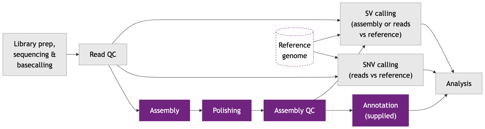

# Module 4

## Lecture

<object data="content-files/Module_4_HTG_Van-2611.pdf#toolbar=0navpanes=0" type="application/pdf" width="100%" height="600px">
  <p>Unable to render PDF. <a href="content-files/Module_4_HTG_Van-2611.pdf">Download the PDF</a>.</p>
</object>

<a href="content-files/Module_4_HTG_Van-2611.pdf" target="_blank" rel="noopener">Open slides in a new tab</a>

## Lab

*From Draft Contigs to a Genome You Can Trust*

### Introduction: From a Draft to a Genome You Can Trust

At the end of Lab 3 you submitted **Flye**, which assembled your reads into a draft genome. This lab picks up from that job. You will:

- read Flye's own report on the draft,
- **polish** the draft with **medaka**, to correct the base errors that remain,
- explore the **annotation** (the list of genes) that we supply for this genome,
- judge the polished assembly with **QUAST** and **BUSCO**, two evaluation tools.

Everything is the same real, non-subsampled dataset (run **ERR8562432**, the wild yeast isolate *BAL_1a*).

The question today: can you rebuild the wolf's genome (our isolate, *BAL_1a*) one piece per chromosome? The yeast telomere-to-telomere study (ScRAP) assembled this same isolate into 16 nuclear contigs; compare yours with that.

The lab has these parts:

- **Part 0:** check that your Flye job finished
- **Part 1:** read the Flye report
- **Part 2:** polish with medaka
- **Part 3:** explore the supplied annotation (while medaka runs)
- **Part 4:** QUAST, how contiguous is it?
- **Part 5:** BUSCO, how complete is it?
- **Part 6:** wrap-up
- **Bonus:** align your assembly to the reference and look at it in IGV (optional)

#### Where we are in the workflow



This lab covers the highlighted stages: **assembly** (your Flye result), **polishing**, **assembly QC** and **annotation** (supplied, not run).

### Your Paths

The same table as in Lab 3, with the extra locations this lab uses. Everything under `WORK` is yours alone. Everything else is in the workshop's shared project folder and is read-only.

| Name | Value | Notes |
|---|---|---|
| `WORK` (yours) | `/scratch/$USER/yeast_workshop` | Created by script 01 in Lab 3 |
| Conda (the instructor's) | `source /project/60004/shared/conda/bin/activate <env>` | This lab uses `medaka_env` |
| BUSCO image | `/project/60004/shared/containers/busco.sif` | Run through Apptainer (`module load StdEnv/2023 apptainer/1.4.5`) |
| BUSCO lineage data | `/project/60004/shared/databases/busco_downloads/` | Read by BUSCO in offline mode (compute nodes may have no internet) |
| Apptainer temporary and cache folders | `$WORK/apptainer_tmp`, `$WORK/.apptainer_cache` | Your own folders; the script creates them |
| Reference FASTA | `$WORK/data/Saccharomyces_cerevisiae.R64-1-1.dna.toplevel.fa` | Downloaded in Lab 3 (script 02) |
| Supplied annotation | `/project/60004/shared/supplied/annotations/ERR8562432_funannotate.gff3` and `ERR8562432_eggnog.annotations` | Read-only. It describes the **instructor's** benchmark assembly, not yours (see Part 3) |
| Fallback results | `/project/60004/shared/fallback/` | Used if a job fails. |

::: {.callout type="red" title="**Login node or compute node?**"}
As in Lab 3: scripts and commands marked **login node** run with `bash` (or are typed directly), and compute jobs are submitted with `sbatch`. Save each script with `nano` in `/scratch/$USER/yeast_workshop/scripts/`, exactly as in Lab 3 (paste, Ctrl+O, Enter, Ctrl+X).
:::

### Part 0: Did Your Assembly Finish?

Flye was submitted at the end of Lab 3 and usually takes about 20 minutes (20 min 29 s in the workshop cluster test run, alone on the node; longer when the whole class runs at once). These commands only look at files, so they are safe on the login node. Type them in the terminal.

**`check the Flye job (type in the terminal)`**

```bash
# Is the job still in the queue? (an empty list means it is no longer running)
squeue -u $USER

# Did it produce its files?
ls -lh /scratch/$USER/yeast_workshop/results/ERR8562432/assembly/
```

You should see `assembly.fasta`, `assembly_info.txt` and `flye.log` (and some other files and folders). If the job is still `R` (running), wait a few minutes; if it is `PD` (pending), the cluster is busy.

::: {.callout type="red" title="**If your job failed**"}
Look at the end of the newest `.err` file in `logs/` and tell an instructor. Meanwhile, copy a finished assembly from the fallback location (the shared fallback folder) and carry on:

**`copy the fallback assembly`**

```bash
cp -r /project/60004/shared/fallback/assembly /scratch/$USER/yeast_workshop/results/ERR8562432/
```
:::

### Part 1: Reading the Flye Report

Flye ends its log with a summary of the assembly, and writes a table with one line per contig. A **contig** is one continuous stretch of assembled sequence with no gaps. Look at both. Type these in the terminal.

**`read the Flye report (type in the terminal)`**

```bash
# The last lines of the log: Flye's summary of the final assembly
tail -n 12 /scratch/$USER/yeast_workshop/results/ERR8562432/assembly/flye.log

# One line per contig: name, length, coverage and whether Flye thinks it is circular
# (cut -f1-4 keeps the first four columns; column -t lines them up)
cut -f1-4 /scratch/$USER/yeast_workshop/results/ERR8562432/assembly/assembly_info.txt | column -t
```

Three terms before the questions:

- **N50** works as it did for reads in Lab 3: half of all assembled bases sit in contigs at least this long. A bigger N50 means a less fragmented assembly. Flye calls the contigs "fragments".
- **N90** is the same idea for 90% of the bases. **L50** is the number of contigs that make up that first half.
- **Coverage** (depth) is the average number of reads covering each base: total bases divided by genome size.

The yeast reference genome has 17 sequences: 16 chromosomes plus the mitochondrial genome. Its total length is 12,157,105 bp (12.16 Mb; the `.fai` index of the reference FASTA).

**Question 1:** What is the total length of your assembly? How does it compare with the 12.16 Mb of the reference?

::: {.callout type="blue" collapsible="true" title="Answer"}
**11,928,913 bp** (`flye.log`, "Total length") (workshop cluster test run, 2026-10-18, Flye 2.9.6-b1802, 8 CPUs; yours may differ slightly). Benchmark expectation: about 11.9 Mb (the benchmark assembly, built with `--nano-hq`, is 11,903,233 bp; QUAST `report.txt`), which is about 98% of the reference. A draft that is a little shorter is normal: repeats, the repeated ribosomal DNA and chromosome ends are hard to assemble, so some sequence is left out. The total also agrees with the 12 Mb estimate we gave Flye (Flye uses that estimate for its settings; it does not force the assembly to that size). 
:::

**Question 2:** How many contigs did Flye produce? The genome has 16 chromosomes plus a mitochondrial genome: what would a perfect assembly give, and what do you see in the contig table?

::: {.callout type="blue" collapsible="true" title="Answer"}
**18 contigs** (`flye.log`, "Fragments"; 18 rows in `assembly_info.txt`) (workshop cluster test run, 2026-10-18, Flye 2.9.6-b1802, 8 CPUs; yours may differ slightly): only one more than a perfect 17. Benchmark expectation: 19 contigs (QUAST `report.txt`). A perfect assembly would have 17 (16 chromosomes plus the mitochondrial genome), so 19 is very close: one chromosome (XII in the benchmark) is in more than one piece. In the contig table, the largest contigs are chromosome-sized (hundreds of kb to over 1 Mb), and the mitochondrial genome is a small contig (in the benchmark, 74,871 bp against 85,779 bp in the reference; alignment to the reference, `asm_vs_ref` answer-key data). Compared with the fragmented draft you will see in Part 5 (431 contigs), this is excellent. For comparison, ScRAP's own assembly of this isolate (made with SMARTdenovo) has 16 nuclear contigs and 32 telomeres (O'Donnell et al. 2023, Supp. Table 1). ScRAP counts nuclear chromosomes only, so compare its 16 with your contig count minus the mitochondrial contig. **For the case:** the wolf's genome comes back almost one piece per chromosome (in the benchmark, every chromosome except XII, which breaks at the rDNA), close to ScRAP's telomere-to-telomere assembly of the same isolate.
:::

**Question 3:** What is the N50 of your assembly? What does it tell you about how fragmented the genome is?

::: {.callout type="blue" collapsible="true" title="Answer"}
**791,821 bp** (`flye.log`, "Fragments N50") (workshop cluster test run, 2026-10-18, Flye 2.9.6-b1802, 8 CPUs; yours may differ slightly). Benchmark expectation: an N50 of about 793 kb (792,903 bp in the benchmark polished assembly; QUAST `report.txt`). It means half of the assembled bases are in contigs of 793 kb or longer. The yeast chromosomes are 0.23 to 1.5 Mb long, so an N50 of this size means that most chromosomes were assembled in one or a few pieces. Your number may differ slightly from the benchmark.
:::

**A note on repeating the run:** Flye is not fully deterministic. Your totals may differ slightly, and your contig names will likely differ from the ones in this lab.

**Question 4:** What is the mean coverage that Flye reports? Compare it with the coverage you calculated in Lab 3 (Question 4). Why does enough coverage matter for an assembly?

::: {.callout type="blue" collapsible="true" title="Answer"}
**37×** (`flye.log`, "Mean coverage") (workshop cluster test run, 2026-10-18, Flye 2.9.6-b1802, 8 CPUs; yours may differ slightly). Benchmark expectation: about 37×, the same as the Lab 3 calculation (448 Mb of reads ÷ about 12 Mb; ENA ERR8562432). Flye needs every position covered by several overlapping reads: coverage lets the reads outvote each other's errors (systematic errors, such as those in homopolymers, can survive the vote, which is why we polish) and bridge the gaps between neighbouring pieces. With long reads, 30-50× is a good depth for a small genome like yeast (Module 4 lecture). **Repeating the run:** when the instructors ran the same script twice on the same node, the second assembly was 11,893,241 bp instead of 11,928,913 bp (35,672 bp, or 0.3%, shorter), with an N50 of 791,818 instead of 791,821 bp; both had 18 contigs and 37× coverage (workshop cluster test run, 2026-10-23).
:::

### Part 2: Polishing with medaka

#### Why polish?

Flye's assembly is built from reads that are only about 87% accurate (Lab 3, Question 5). Flye's own three internal polishing rounds (`--iterations 3`) fix many errors, but some remain, mostly **indels** (small insertions or deletions) in **homopolymers** (runs of the same base). **Polishing** corrects them with the reads: the reads are aligned to the draft, and at each position the reads "vote" for the base that most of them support (the **consensus**). **medaka** does the voting with a trained neural-network model instead of a simple majority, because it has learned how nanopore errors look.

- **What:** runs medaka on your assembly, with your raw reads.
- **Why:** correct the base errors in the draft before we measure its quality.
- **Expected output:** `results/ERR8562432/polishing/consensus.fasta`, the polished assembly. It runs for about 3-9 minutes.

The `-m` option names the medaka **model**. `r941_min_sup_g507` stands for reads from an R9.4.1 flow cell on a MinION, basecalled in the "sup" (super-accurate) mode with Guppy 5.0.7. It is the closest R9.4.1 MinION model medaka offers; which basecaller produced our reads is not recorded in the file. 

Save as `07_medaka_polish.sh` in your `scripts/` folder with `nano`, as in Lab 3, and submit it.

**`07_medaka_polish.sh`**

```bash
#!/bin/bash
#SBATCH --job-name=medaka_polish
#SBATCH --account=def-sponsor00
#SBATCH --cpus-per-task=4
#SBATCH --mem=12000M
#SBATCH --time=0:30:00
#SBATCH --output=/scratch/%u/yeast_workshop/logs/%x_%j.out
#SBATCH --error=/scratch/%u/yeast_workshop/logs/%x_%j.err
set -e
WORK=/scratch/$USER/yeast_workshop
cd "$WORK"

# Activate the conda environment that contains medaka
source /project/60004/shared/conda/bin/activate medaka_env

# medaka_consensus: polish an assembly using the reads
# -i : the reads
# -d : the draft assembly from Flye
# -o : the folder for the results (medaka creates it)
# -t : number of CPUs (the number Slurm gave us)
# -m : the medaka model (R9.4.1 flow cell, MinION, "sup" basecalling)
medaka_consensus \
  -i "$WORK/data/ERR8562432.fastq.gz" \
  -d "$WORK/results/ERR8562432/assembly/assembly.fasta" \
  -o "$WORK/results/ERR8562432/polishing/" \
  -t $SLURM_CPUS_PER_TASK \
  -m r941_min_sup_g507

echo "Polishing finished. Main output:"
echo "$WORK/results/ERR8562432/polishing/consensus.fasta"
```

::: {.callout type="blue" collapsible="true" title="What each argument does"}
`#SBATCH` lines and set-up: see Lab 3, script 04. Only new arguments are listed here.

| Argument | What it does | Why this value |
|---|---|---|
| `medaka_consensus` | The medaka program that polishes an assembly: "Assembly polishing via neural networks", optimized to work with the Flye assembler. | Flye made the draft, medaka corrects its remaining base errors (see "Why polish?"). |
| `-i "$WORK/data/ERR8562432.fastq.gz"` | `-i`: the input basecalls, a FASTA or FASTQ file (required). | The raw reads you downloaded in Lab 3. |
| `-d "$WORK/results/ERR8562432/assembly/assembly.fasta"` | `-d`: the input assembly in FASTA format (required). | Flye's draft from Lab 3. |
| `-o "$WORK/results/ERR8562432/polishing/"` | `-o`: the output folder (default: `medaka`). | Puts the results in your `results/` folder; the polished assembly is `consensus.fasta` in it (the default file prefix is `consensus`). |
| `-t $SLURM_CPUS_PER_TASK` | `-t`: number of threads used to create features (default: 1). | Passes the 4 CPUs Slurm gave the job. |
| `-m r941_min_sup_g507` | `-m`: the medaka model (default: `r1041_e82_400bps_sup_v5.2.0`). The names of all available models are listed by `medaka tools list_models`. | The model for R9.4.1 MinION reads basecalled in "sup" mode (see Part 2 text). It is in the cluster's model list (medaka 2.2.2), and the run log shows medaka using it.  |
| Fallback: the same command **without** `-m` (troubleshooting box) | Without `-m`: "If not provided, an automatic choice will be attempted based on the contents of the input file." | When the automatic choice cannot read the model from the reads, medaka falls back to its default model, `r1041_e82_400bps_sup_v5.2.0` in medaka 2.2.2 (see the troubleshooting box).  |
| `rm -rf .../polishing` (troubleshooting box) | `rm` removes files. `-r`: remove folders and their contents recursively. `-f`: ignore nonexistent files and never ask. | Medaka's `-f` option (force overwrite) is not used; the old results are removed instead, because without `-f` medaka reuses existing outputs.  |

:::

**`submit and check (type in the terminal)`**

```bash
cd /scratch/$USER/yeast_workshop/scripts
sbatch 07_medaka_polish.sh
squeue -u $USER
```

Go on to Part 3 while it runs. Check the log later with `less /scratch/$USER/yeast_workshop/logs/medaka_polish_<jobid>.out`.

::: {.callout type="orange" title="**Troubleshooting: \"model not found\", \"model could not be downloaded\" or another error about the model**"}
The `-m` version above is the one that ran in the workshop cluster test run (2026-10-18). If the `.err` file in `logs/` complains about the model, open the script (`nano 07_medaka_polish.sh`), delete the line `-m r941_min_sup_g507` **and** the backslash `\` at the end of the line above it (the `-t` line), save, and submit again. Before you resubmit, remove the partly finished results, because medaka reuses what it finds: `rm -rf /scratch/$USER/yeast_workshop/results/ERR8562432/polishing`. The command then reads as follows. Without `-m`, medaka tries to read the basecaller model from the read names; our reads do not record it, so medaka falls back to its default model (`r1041_e82_400bps_sup_v5.2.0`), which is made for newer R10.4.1 flow cells. The polishing still runs, but it is not matched to our reads.

**`medaka command without -m (replaces the medaka_consensus command in 07_medaka_polish.sh)`**

```bash
medaka_consensus \
  -i "$WORK/data/ERR8562432.fastq.gz" \
  -d "$WORK/results/ERR8562432/assembly/assembly.fasta" \
  -o "$WORK/results/ERR8562432/polishing/" \
  -t $SLURM_CPUS_PER_TASK
```
:::

::: {.callout type="red" title="**If your job failed**"}
Tell an instructor. You can copy a finished polished assembly from the fallback location (the shared fallback folder) and carry on:

**`copy the fallback polishing results`**

```bash
cp -r /project/60004/shared/fallback/polishing /scratch/$USER/yeast_workshop/results/ERR8562432/
```
:::

### Part 3: Exploring the Supplied Annotation (While Medaka Runs)

Annotation takes hours, so we do not run it here. **Annotation** has two parts:

- **Structural annotation** says *where* the genes are: a **gene model** is a predicted gene structure (gene, mRNA, exons, coding sequence). We supply the result of **funannotate**, a gene-prediction pipeline. In yeast, most genes have no introns (about 5% do) and genes are packed closely, so prediction is easier than in larger eukaryotes. 
- **Functional annotation** says *what* the genes do. We supply the result of **eggNOG-mapper**, which compares each predicted protein with a database of gene families (families of **orthologs**, genes in different species that descend from one ancestral gene) and transfers the best-matching gene's name and function.

::: {.callout type="red" title="**These files describe the instructor's assembly, not yours**"}
The annotation was made on the benchmark polished assembly (contig names such as `contig_1`). Your own assembly has its own contigs, so the coordinates and contig names in these files will not match yours. For learning how to read an annotation this does not matter.
:::

The structural annotation is a **GFF3** file: a tab-separated text file with one feature per line, like an address book for the genome. Its nine columns are:

| Column | Name | Example |
|---|---|---|
| 1 | seqid (the contig) | `contig_1` |
| 2 | source (the program) | `funannotate` |
| 3 | type (what kind of feature) | `gene`, `mRNA`, `exon`, `CDS`, `tRNA` |
| 4-5 | start, end | `2782`, `3705` |
| 6 | score | `.` (none) |
| 7 | strand | `+` or `-` |
| 8 | phase | `.` or 0, 1, 2 (reading frame of a CDS) |
| 9 | attributes | `ID=FUN_000001;` (and `Parent=`, `product=`) |

These commands only read the files, so you can type them on the login node while medaka runs. A `|` (pipe) sends the output of one command into the next. `head -n 12` shows the first 12 lines. `grep -v '^#'` removes the comment lines that start with `#`. `cut -f3` keeps column 3. `sort | uniq -c` counts how many times each different value appears.

**`explore the structural annotation (type in the terminal)`**

```bash
# 1. The first lines of the file
head -n 12 /project/60004/shared/supplied/annotations/ERR8562432_funannotate.gff3

# 2. How many features of each type (column 3)?
grep -v '^#' /project/60004/shared/supplied/annotations/ERR8562432_funannotate.gff3 | cut -f3 | sort | uniq -c

# 3. How many lines say product=hypothetical protein?
grep -c 'product=hypothetical protein' /project/60004/shared/supplied/annotations/ERR8562432_funannotate.gff3

# 4. The pieces (exons and CDS) of one gene model: contig, type, start, end
grep 'Parent=FUN_003391-T1;' /project/60004/shared/supplied/annotations/ERR8562432_funannotate.gff3 | cut -f1,3,4,5
```

**Question 5:** Which feature types does the file contain, and how many of each? How do the numbers of `gene`, `mRNA` and `tRNA` lines relate to each other? There are 14,159 `CDS` lines for 6,191 `mRNA` lines, about 2.3 per gene; a gene without introns would have just one. Is that what you expect for yeast, and what could explain it? (Hint: think about BUSCO's internal stop codons in Part 5.) To see a concrete case, look at the output of the fourth command above, which shows the pieces of `FUN_003391-T1`, eggNOG's best match for the well-known gene ADH1.

::: {.callout type="blue" collapsible="true" title="Answer"}
6,443 `gene`, 6,191 `mRNA`, 252 `tRNA`, 14,411 `exon` and 14,159 `CDS` lines (targeted counts on `ERR8562432_funannotate.gff3`). 6,191 + 252 = 6,443: every gene is either a protein-coding gene (it has an `mRNA`) or a tRNA gene (a gene for a transfer RNA). A **CDS** (coding sequence) is the part of an exon that is translated into protein. A gene split by introns gets one exon line and one CDS line per piece.

The mismatch is the point of the question. Only about 5% of yeast genes have introns, yet about two-thirds of the predicted models (4,019 of 6,191) have more than one CDS piece, and many of the implied introns are very short (some only 10-30 bp). The ADH1 model, for example, is predicted in 2 CDS pieces (contig_10:910,903-911,054 and 911,252-912,284), although ADH1 is not expected to contain an intron.  The most likely explanation (an inference, not proven) is the small errors left in the assembly: a missing or extra base in a homopolymer shifts the reading frame, and the gene predictor can "repair" the frame by adding a short intron across the error. BUSCO shows the same problem from another side: 157 complete genes contain internal stop codons. To confirm it, you would compare these models with the S288C annotation or polish with accurate short reads. The lesson: an annotation is only as good as the assembly under it, so always compare it with what you know about the species. 
:::

**Question 6:** The third command counts the lines with `product=hypothetical protein`. What is the number, and how does it compare with the number of `mRNA` lines? Why does the structural annotation not tell you what these genes do?

::: {.callout type="blue" collapsible="true" title="Answer"}
6,191, the same as the number of `mRNA` lines (targeted `grep -c`, `ERR8562432_funannotate.gff3`): every predicted protein-coding gene is labelled "hypothetical protein". Structural annotation finds *where* genes are, from sequence signals; it does not know *what* the protein does. The function comes from the second step, functional annotation.
:::

Now the functional annotation, an eggNOG-mapper table. Its columns include `#query` (column 1, the protein, named like the gene with `-T1`), `seed_ortholog` (2), `COG_category` (7), `Description` (8) and `Preferred_name` (9, the gene name).

**`explore the functional annotation (type in the terminal)`**

```bash
# 1. The header line and the first two records, showing columns 1, 2, 8 and 9 only
grep -v '^##' /project/60004/shared/supplied/annotations/ERR8562432_eggnog.annotations | head -n 3 | cut -f1,2,8,9

# 2. How many proteins have a row? (lines that do not start with #)
grep -vc '^#' /project/60004/shared/supplied/annotations/ERR8562432_eggnog.annotations

# 3. How many have a gene name (column 9 is not "-")?
grep -v '^#' /project/60004/shared/supplied/annotations/ERR8562432_eggnog.annotations | cut -f9 | grep -vc '^-$'
```

**Question 7:** What is the first protein, `FUN_000001-T1`, according to eggNOG? What does its `seed_ortholog` column say about how that name was found? How many proteins have a row in the file, and how many of those have a gene name?

::: {.callout type="blue" collapsible="true" title="Answer"}
`FUN_000001-T1` is **ARR3**, an arsenite transporter of the plasma membrane required for resistance to arsenic compounds. Its seed ortholog is `4932.YPR201W`: the best match in the eggNOG database is the *S. cerevisiae* gene YPR201W (4932 is the taxonomy number of *S. cerevisiae*), and eggNOG-mapper copies that gene's name and description to our protein. The function is thus **inferred from orthology**, not shown experimentally in this isolate. The file has **6,092** rows, of which **4,302** have a gene name (targeted counts, `ERR8562432_eggnog.annotations`). Many genes have a description but no name (1,790 rows have a description but no name; 29 have neither). The 99 proteins that are in the GFF3 but not in this file (6,191 − 6,092) found no match in eggNOG, so they get no row and stay unannotated.
:::

### Part 4: QUAST, the Accountant

Check that medaka finished (`squeue -u $USER` is empty and `ls -lh /scratch/$USER/yeast_workshop/results/ERR8562432/polishing/` shows `consensus.fasta`) before you continue.

**QUAST** (QUality ASsessment Tool) counts: how many contigs, how long, what N50. Because we also give it the **reference genome**, it can compare the assembly with S288C and report **misassemblies**: places where the assembly disagrees with the reference in the order or orientation of sequence. A misassembly is either an assembly error or a *real* structural difference of this isolate; QUAST cannot tell which.

#### Step 1: Run QUAST

- **What:** runs QUAST on the polished assembly, with the reference.
- **Why:** to measure contiguity (N50, number of contigs) and agreement with the reference.
- **Expected output:** a folder `results/ERR8562432/quast/` with `report.html`, `report.txt` and other files. It takes about 2 minutes.

**`08_quast.sh`**

```bash
#!/bin/bash
#SBATCH --job-name=quast
#SBATCH --account=def-sponsor00
#SBATCH --cpus-per-task=8
#SBATCH --mem=8000M
#SBATCH --time=0:15:00
#SBATCH --output=/scratch/%u/yeast_workshop/logs/%x_%j.out
#SBATCH --error=/scratch/%u/yeast_workshop/logs/%x_%j.err
set -e
WORK=/scratch/$USER/yeast_workshop
cd "$WORK"

# QUAST is a cluster module (it needs the older StdEnv/2020 software stack)
module purge
module load StdEnv/2020 gcc/9.3.0 quast/5.2.0

# Remove an old result folder, so a rerun starts clean
rm -rf "$WORK/results/ERR8562432/quast"

# quast.py: assembly statistics
# -o        : the folder for the report
# --threads : number of CPUs (the number Slurm gave us)
# -r        : the reference genome, to look for misassemblies
# last item : the polished assembly to evaluate
quast.py \
  -o "$WORK/results/ERR8562432/quast/" \
  --threads $SLURM_CPUS_PER_TASK \
  -r "$WORK/data/Saccharomyces_cerevisiae.R64-1-1.dna.toplevel.fa" \
  "$WORK/results/ERR8562432/polishing/consensus.fasta"

echo "QUAST finished. Main outputs:"
echo "$WORK/results/ERR8562432/quast/report.txt"
echo "$WORK/results/ERR8562432/quast/report.html"
```

::: {.callout type="blue" collapsible="true" title="What each argument does"}
`#SBATCH` lines and set-up: see Lab 3, script 04. Only new arguments are listed here.

| Argument | What it does | Why this value |
|---|---|---|
| `module purge` | `purge`: unload all modules (the `module --help` page). | Starts from a clean set of modules, so an older choice does not clash with the QUAST modules. |
| `module load StdEnv/2020 gcc/9.3.0 quast/5.2.0` | `module load` switches on cluster software (see Lab 3, script 04). `StdEnv/2020` is the third version of the Alliance's standard software environment; it uses GCC 9.3.0 as its default and is listed as deprecated. | QUAST is installed under the older environment, so `StdEnv/2020` is loaded here instead of `StdEnv/2023`. |
| `rm -rf "$WORK/results/ERR8562432/quast"` | `rm` removes files. `-r`: remove folders and their contents recursively. `-f`: ignore nonexistent files and never ask. | A rerun starts clean; `-f` means no error on the first run, when the folder does not exist yet.  |
| `quast.py` | The QUAST program: "Quality Assessment Tool for Genome Assemblies". | It counts contigs and N50 and compares the assembly with a reference. |
| `-o "$WORK/results/ERR8562432/quast/"` | `-o, --output-dir`: the directory where all result files are stored. | Puts `report.txt` and `report.html` in your `results/` folder. |
| `--threads $SLURM_CPUS_PER_TASK` | `-t, --threads`: maximum number of threads (default: 25% of the CPUs). | Uses the 8 CPUs Slurm gave the job. |
| `-r "$WORK/data/Saccharomyces_cerevisiae.R64-1-1.dna.toplevel.fa"` | `-r`: the reference genome file. | With a reference QUAST can report misassemblies and genome fraction (Question 9). The workshop pipeline ran QUAST without `-r`; this is an addition. |
| last item: `.../polishing/consensus.fasta` | `<files_with_contigs>`: the assembly (or assemblies) to evaluate. | The polished assembly from script 07. |

:::

**`submit and check (type in the terminal)`**

```bash
cd /scratch/$USER/yeast_workshop/scripts
sbatch 08_quast.sh
squeue -u $USER
```

BUSCO (Part 5) takes longer than QUAST, so you can save and submit script 09 right away, too, and read your QUAST results while it runs.

::: {.callout type="red" title="**If your job failed**"}
Tell an instructor, then copy a finished report from the fallback location (the shared fallback folder):

**`copy the fallback QUAST report`**

```bash
cp -r /project/60004/shared/fallback/quast /scratch/$USER/yeast_workshop/results/ERR8562432/
```
:::

#### Step 2: Copy the report to your laptop

Read the numbers in the terminal with `less /scratch/$USER/yeast_workshop/results/ERR8562432/quast/report.txt` (press `q` to quit), or copy the whole report folder and open `report.html` in your browser. Run `scp` on your **laptop**, as in Lab 3 (`YOUR_USER` is the same placeholder as in Lab 3 and the host is `cbw.c3.ca`; Windows users can use MobaXterm or WinSCP).

**`scp_example (run on your laptop)`**

```bash
# -r copies a whole folder
scp -r YOUR_USER@cbw.c3.ca:/scratch/YOUR_USER/yeast_workshop/results/ERR8562432/quast .
```

Then open `quast/report.html`. The table has the same numbers as `report.txt`.

**Question 8:** What is the N50 of the polished assembly in the QUAST report? Compare it with the N50 Flye reported in Part 1 (Question 3). Does polishing change the N50? Why or why not?

::: {.callout type="blue" collapsible="true" title="Answer"}
**791,821 bp before polishing (`flye.log`) and 792,905 bp after (QUAST 5.2.0)** (workshop cluster test run, 2026-10-18, with `-m r941_min_sup_g507`). Polishing barely changes N50, because it corrects bases, not the order of the contigs; it does lower the indel rate (727.6 → 627.87 indels per 100 kbp; QUAST 5.2.0 on the unpolished and polished assemblies). Benchmark expectation: an N50 of about 793 kb (792,903 bp in the benchmark polished assembly; QUAST `report.txt`, benchmark run without `-r`), essentially the same as Flye's. Polishing corrects individual bases; it does not join or split contigs, so contig lengths and the N50 hardly change. What changes is the *accuracy* of the sequence, which N50 cannot show. That is why we also run BUSCO.
:::

**Question 9:** Look for the number of misassemblies (and misassembled contigs) in the QUAST report. What is it? Is a misassembly necessarily a mistake of the assembler?

::: {.callout type="blue" collapsible="true" title="Answer"}
**137 misassemblies**, with all 18 contigs flagged, plus 138 local misassemblies; genome fraction 94.9% (QUAST 5.2.0 with `-r`, workshop cluster test run, 2026-10-18; the benchmark assembly gives 132). That many is expected for a wild isolate about 1% different from S288C: QUAST cannot tell an assembly error from a real structural difference (Lab 6 looks at real SVs). A misassembly means that parts of one contig align to the reference in a different order, orientation or chromosome. It may be a true assembly error, for example two repeats joined wrongly. It may equally be a **real structural variant**: this wild isolate really can differ from the lab strain S288C. QUAST only compares with the reference and cannot decide which. To decide, you would check whether individual reads span the junction (Lab 6 returns to this). Some of these "misassemblies" may be places where the wolf's genome really differs from the corgi's (S288C, the reference). Lab 6 checks one such place.
:::

### Part 5: BUSCO, the Biologist

QUAST says how contiguous the assembly is. It does not say whether the *content* is right. **BUSCO** (Benchmarking Universal Single-Copy Orthologs) looks for a fixed set of genes that nearly every member of a lineage has exactly once. Here the lineage is `saccharomycetes_odb12`, with 2,319 genes. Each gene is reported as:

- **Complete (C)**: found in full. Complete genes are split into **single-copy (S)** and **duplicated (D)**.
- **Fragmented (F)**: only part of the gene was found.
- **Missing (M)**: not found.

C = S + D, and C + F + M = 100%. BUSCO also notes how many complete genes contain an **internal stop codon** (a premature "stop" signal inside the gene).

- **What:** runs BUSCO 6.1.0 on the polished assembly in a container (Apptainer).
- **Why:** to check that the assembly contains the genes it should, and that they are intact.
- **Expected output:** a folder `results/ERR8562432/busco/` with a `short_summary...txt` file. It takes about 3-12 minutes.

Two details of the script: BUSCO runs `--offline` (the compute node does not download the gene set; it reads it from the workshop's shared project folder), and `-o` is a path relative to `WORK`, which is why the script goes to `$WORK` first.

When BUSCO starts, the `.err` log in `logs/` may show the line `WARNING: While bind mounting '/scratch:/scratch': destination is already in the mount point list`. It is harmless: the cluster's Apptainer module already makes that folder visible inside the container, and the job still finishes normally.

**`09_busco.sh`**

```bash
#!/bin/bash
#SBATCH --job-name=busco
#SBATCH --account=def-sponsor00
#SBATCH --cpus-per-task=8
#SBATCH --mem=8000M
#SBATCH --time=0:30:00
#SBATCH --output=/scratch/%u/yeast_workshop/logs/%x_%j.out
#SBATCH --error=/scratch/%u/yeast_workshop/logs/%x_%j.err
set -e
WORK=/scratch/$USER/yeast_workshop
cd "$WORK"

# Apptainer needs a temporary folder and a cache folder that you can write to
export APPTAINER_TMPDIR="$WORK/apptainer_tmp"
export APPTAINER_CACHEDIR="$WORK/.apptainer_cache"
mkdir -p "$APPTAINER_TMPDIR" "$APPTAINER_CACHEDIR"

# Load Apptainer (the container program)
module purge
module load StdEnv/2023 apptainer/1.4.5

# Remove an old BUSCO result folder, so a rerun starts clean
rm -rf results/ERR8562432/busco

# apptainer exec ... busco: run BUSCO inside the container
# --bind /scratch:/scratch : make /scratch visible inside the container
# -i : the polished assembly
# -l : the gene set (lineage): Saccharomycetes, 2,319 genes
# -o : the output folder (relative to the current folder, $WORK)
# -m genome : the input is a genome assembly
# --cpu : number of CPUs (the number Slurm gave us)
# -f : overwrite old results
# --offline --download_path : read the gene set from the shared folder, no internet needed
apptainer exec --bind /scratch:/scratch /project/60004/shared/containers/busco.sif busco \
  -i "$WORK/results/ERR8562432/polishing/consensus.fasta" \
  -l saccharomycetes_odb12 \
  -o results/ERR8562432/busco/ \
  -m genome \
  --cpu $SLURM_CPUS_PER_TASK \
  -f \
  --offline \
  --download_path /project/60004/shared/databases/busco_downloads/

echo "BUSCO finished. Look for short_summary files in:"
echo "$WORK/results/ERR8562432/busco/"
```

::: {.callout type="blue" collapsible="true" title="What each argument does"}
`#SBATCH` lines and set-up: see Lab 3, script 04. Only new arguments are listed here.

| Argument | What it does | Why this value |
|---|---|---|
| `export APPTAINER_TMPDIR="$WORK/apptainer_tmp"` and `export APPTAINER_CACHEDIR="$WORK/.apptainer_cache"` | `export` marks a variable so that programs started by the shell can see it (bash `help export`). The two Apptainer variables name its temporary and its cache folder.  | The script comment says Apptainer needs a temporary folder and a cache folder that you can write to; these are inside your own `WORK`.  |
| `mkdir -p "$APPTAINER_TMPDIR" "$APPTAINER_CACHEDIR"` | Makes the two folders (see Lab 3, script 04, for `mkdir -p`). | They must exist before Apptainer uses them. |
| `module purge` | See the box for script 08. | Starts from a clean set of modules. |
| `module load StdEnv/2023 apptainer/1.4.5` | `module load` switches on cluster software (see Lab 3, script 04). | Apptainer is the container program; the version is the one installed on the workshop cluster. |
| `rm -rf results/ERR8562432/busco` | See the box for script 08. | A rerun starts clean. |
| `apptainer exec <image> <command>` | Usage: `apptainer exec [exec options...] <container> <command>`: the container, then the command to run in it.  | Runs `busco` from the container image `busco.sif`, so no BUSCO install is needed. |
| `--bind /scratch:/scratch` | `-B, --bind`: a user-bind path specification `src[:dest[:opts]]`, where src and dest are the outside and inside paths. If dest is not given it equals src. | Makes `/scratch` (your files, the shared lineage data and the image) visible at the same path inside the container. |
| `-i "$WORK/results/ERR8562432/polishing/consensus.fasta"` | `-i, --in`: the input sequence file in FASTA format; it can be an assembled genome. | The polished assembly from script 07. |
| `-l saccharomycetes_odb12` | `-l, --lineage_dataset`: the name of the BUSCO lineage to use. | The gene set for Saccharomycetes (2,319 genes, see Part 5). |
| `-o results/ERR8562432/busco/` | `-o, --out`: a short name for the run; output folders and files are labelled with it. The output location is set with `--out_path` (default: the current working directory). | Relative to the current folder, which is why the script goes to `$WORK` first. |
| `-m genome` | `-m, --mode`: the BUSCO analysis mode. Valid modes: `geno` or `genome` (genome assemblies, DNA), `tran` or `transcriptome`, `prot` or `proteins`. | The input is a genome assembly. |
| `--cpu $SLURM_CPUS_PER_TASK` | `-c N, --cpu N`: the number of threads/cores to use. | Uses the 8 CPUs Slurm gave the job. |
| `-f` | `-f, --force`: force rewriting of existing files; required when output files with the same name already exist. | A rerun overwrites old results. |
| `--offline` | Indicates that BUSCO cannot attempt to download files. | Compute nodes may have no internet; the gene set is read from the shared folder. |
| `--download_path /project/60004/shared/databases/busco_downloads/` | `--download_path`: the local file path for storing BUSCO dataset downloads. | With `--offline`, this is where BUSCO looks for the lineage data kept in the workshop's shared project folder. |

:::

**`submit and check (type in the terminal)`**

```bash
cd /scratch/$USER/yeast_workshop/scripts
sbatch 09_busco.sh
squeue -u $USER
```

When it finishes, print the summary:

**`read the BUSCO summary (type in the terminal)`**

```bash
cat /scratch/$USER/yeast_workshop/results/ERR8562432/busco/short_summary*.txt
```

::: {.callout type="red" title="**If your job failed**"}
Tell an instructor, then copy the finished results from the fallback location (the shared fallback folder):

**`copy the fallback BUSCO results`**

```bash
cp -r /project/60004/shared/fallback/busco /scratch/$USER/yeast_workshop/results/ERR8562432/
```
:::

For contrast, here is the same pipeline (Flye, medaka, QUAST without a reference, BUSCO) run on an older dataset, ERR1539006, with early nanopore chemistry (R7.3), which gave much noisier reads. These values are fixed results from the benchmark run.

| | Our R9.4.1 dataset (ERR8562432) | Older R7.3 dataset (ERR1539006) |
|---|---|---|
| Contigs | 19 | 431 |
| N50 | 792,903 bp | 28,584 bp |
| Total length | 11.90 Mb | 10.07 Mb |
| BUSCO complete (C) | see Question 10 | 43.7% |
| BUSCO missing (M) | see Question 10 | 53.7% |

**Question 10:** What are the C, S, D, F and M percentages for your assembly (and n, the number of genes searched)? Is this a complete assembly? How does it compare with the older R7.3 dataset, and what does the contrast show?

::: {.callout type="blue" collapsible="true" title="Answer"}
Workshop cluster test run on the polished assembly from script 07 (BUSCO 6.1.0, `saccharomycetes_odb12`; `short_summary.specific.saccharomycetes_odb12.busco.txt`; your numbers should match closely): **C:99.7%** [**S:95.0%**, **D:4.6%**], **F:0.0%**, **M:0.3%**, n = 2,319. That is 2,311 complete genes and only 0.3% missing, so the assembly is essentially complete in gene content. The R7.3 assembly has C:43.7% (S 43.4%, D 0.3%), F 2.6%, M 53.7% (QUAST `report.txt` and `short_summary`, ERR1539006): more than half of the genes are missing, even though that assembly is about 10 Mb long, close to the genome size. The contrast shows that read quality matters: older, noisier reads give broken genes and a fragmented assembly (431 contigs, N50 28.6 kb), and BUSCO catches this even when the total length looks reasonable.
:::

**Question 11:** About 4% of the genes are "duplicated" (D). What could that mean?

::: {.callout type="blue" collapsible="true" title="Answer"}
Workshop cluster test run: D = 4.6%, which is 107 genes (`short_summary`). Two kinds of explanation: (1) **biological**: the isolate really carries two copies of that gene, for example **paralogs** (genes related by an ancient duplication), or a region copied in this isolate; (2) **technical**: the assembly contains the same stretch of the genome twice, for example a repeated region assembled into two contigs. BUSCO alone cannot separate them. You would check where the two copies lie, and compare with the reference. Compare with the older assembly: its D was only 0.3%, but that is because most of its genes were missing. 
:::

**Question 12:** BUSCO notes that some complete genes contain internal stop codons. How many, and what does this tell you about the remaining errors in the assembly?

::: {.callout type="blue" collapsible="true" title="Answer"}
Workshop cluster test run: **155 of the 2,311 complete BUSCOs (E = 6.7%)** contain an internal stop codon (`short_summary`). A real gene should not have a stop codon in the middle. The likely cause is a residual error from the nanopore reads, mostly an insertion or deletion in a homopolymer, which shifts the reading frame and creates a stop. So even after Flye and medaka, a small number of base errors remain, which BUSCO exposes although N50 and the gene count cannot. Polishing with accurate short reads (a **hybrid** approach) would fix many of them. Be careful, though: BUSCO's own gene alignments are imperfect, and a few flagged genes may be real pseudogenes.  Also, the June benchmark assembly (the supplied one) was polished without `-m`, so with medaka's default model (`r1041_e82_400bps_sup_v5.2.0` in medaka 2.2.2) for newer R10.4.1 flow cells; part of the remaining errors may come from that mismatch.
:::

### Part 6: Wrap-Up

::: {.callout type="red" title="**Checklist**"}
1. Flye finished and you read its report (Part 1).
2. `07_medaka_polish.sh` finished: `polishing/consensus.fasta` exists.
3. You explored the supplied GFF3 and eggNOG files (Part 3).
4. `08_quast.sh` and `09_busco.sh` finished, and you read both reports.
:::

What you learned: the assembly is **contiguous** (QUAST: few contigs, high N50), **complete** (BUSCO: 99.7%) and **mostly accurate**, with some residual homopolymer errors. The supplied annotation turned the sequence into a list of genes with names and functions.

Day 3 builds on this lab. In **Lab 5** we find SNVs by comparing reads with the reference. In **Lab 6** we look for structural differences between this assembly and the reference, which is where QUAST's misassemblies come back.

### What's Next

You now have a polished, evaluated and annotated genome. Day 3: base by base, where does the wolf differ from the corgi? It starts with variant calling (Module 5), which compares reads with the reference.

::: {.callout type="green" collapsible="true" title="After the workshop: practice with short reads"}
Illumina short reads of this same isolate exist: ENA run **ERR8603864** (HiSeq 2000, paired-end, 150-bp reads). We did not use them in the workshop because of time. If you want practice after the workshop, compare three genomes:

- a short-read assembly (SPAdes),
- the long-read assembly (Flye, as in this lab),
- the long-read assembly polished with short reads (Polypolish or pypolca).

The cluster stays open for two weeks after the workshop, and you can move the data to a DRAC cluster. The commands for this exercise are not provided here.
:::

### Bonus: Align Your Assembly to the Reference and Look at It in IGV

::: {.callout type="green" title="**Optional, outside the lab time**"}
You keep access to the cluster for two weeks after the workshop, so you can do this later. Lab 6 reuses its output (the script is the same), so doing it now saves a step tomorrow.
:::

**QUAST** gave you numbers. Here you *see* where your contigs sit on the yeast chromosomes. You **align** the assembly to the reference (find where each contig matches the reference), and open the result in **IGV** (the Integrative Genomics Viewer, from Module 1-2).

- **What:** aligns the polished assembly to the S288C reference with **minimap2**, sorts the alignment with **samtools** and indexes it. A **BAM** is the binary file that stores an alignment; sorting orders it by position and the **index** (`.bai`) lets IGV jump to any region. The script also indexes the reference (`.fai`) for IGV.
- **Why:** to see the chromosome-by-chromosome structure of the assembly, including breaks, and find large differences.
- **Expected output:** `results/ERR8562432/asm_vs_ref/asm_vs_ref.sorted.bam` and `.bai`, and `Saccharomyces_cerevisiae.R64-1-1.dna.toplevel.fa.fai` next to the reference. It takes under a minute.

The preset `-x asm10` tells minimap2 that the two genomes differ by about 1%. We chose it because this isolate differs from S288C by about 1% in single-base substitutions (about 108,000 substitutions over 12.16 Mb; Lab 5 finds them), and minimap2's manual recommends `asm10` for about 1% divergence and `asm5` only for much closer genomes. `--cs` and `-r2k` are settings recommended by the SVIM-asm tool we use in Lab 6.

Save as `align_assembly_to_reference.sh` and submit it.

**`align_assembly_to_reference.sh`**

```bash
#!/bin/bash
#SBATCH --job-name=align_asm
#SBATCH --account=def-sponsor00
#SBATCH --cpus-per-task=4
#SBATCH --mem=8000M
#SBATCH --time=0:20:00
#SBATCH --output=/scratch/%u/yeast_workshop/logs/%x_%j.out
#SBATCH --error=/scratch/%u/yeast_workshop/logs/%x_%j.err
set -e
WORK=/scratch/$USER/yeast_workshop
cd "$WORK"

# minimap2 aligns sequences; samtools sorts and indexes the result
module purge
module load StdEnv/2023 gcc/12.3 minimap2/2.30 samtools/1.22.1

REF="$WORK/data/Saccharomyces_cerevisiae.R64-1-1.dna.toplevel.fa"
ASM="$WORK/results/ERR8562432/polishing/consensus.fasta"
OUT="$WORK/results/ERR8562432/asm_vs_ref"
mkdir -p "$OUT"

# minimap2: align the assembly (ASM) to the reference (REF)
# -a        : write a SAM text alignment (the | sends it straight to samtools)
# -x asm10  : preset for assembly-to-reference with about 1% difference
# --cs -r2k : settings recommended for SVIM-asm (used in Lab 6)
# -t        : number of CPUs (the number Slurm gave us)
# samtools sort: order the alignments by position and write a BAM file
minimap2 -a -x asm10 --cs -r2k -t $SLURM_CPUS_PER_TASK "$REF" "$ASM" \
  | samtools sort -o "$OUT/asm_vs_ref.sorted.bam" -

# Index the BAM (.bai) and the reference (.fai) so that IGV can read them
samtools index "$OUT/asm_vs_ref.sorted.bam"
samtools faidx "$REF"

echo "Alignment finished. Main outputs:"
echo "$OUT/asm_vs_ref.sorted.bam"
echo "$OUT/asm_vs_ref.sorted.bam.bai"
echo "$REF.fai"
```

::: {.callout type="blue" collapsible="true" title="What each argument does"}
`#SBATCH` lines and set-up: see Lab 3, script 04. Only new arguments are listed here.

| Argument | What it does | Why this value |
|---|---|---|
| `module purge` | See the box for script 08. | Starts from a clean set of modules. |
| `module load StdEnv/2023 gcc/12.3 minimap2/2.30 samtools/1.22.1` | `module load` switches on cluster software (see Lab 3, script 04). | The standard environment first, then the two tools at the versions installed on the workshop cluster. |
| `REF=`, `ASM=`, `OUT=` | `name=value` stores a value in a variable (see Lab 3, script 04). | Short names for the three paths used below, so each path is written once. |
| `minimap2 -a` | `-a`: output in the SAM format (PAF by default). | `samtools` reads SAM from the pipe and writes a BAM. |
| `-x asm10` | `-x`: a preset, always applied before other options. `asm5`/`asm10`/`asm20`: assembly-to-reference mapping for about 0.1%/1%/5% sequence divergence. | About 1% difference between this isolate and S288C (see the text above the script). |
| `--cs` | `--cs[=STR]`: output the `cs` tag (`short` if STR is absent). | Recommended for SVIM-asm, used in Lab 6 (see the text above the script). |
| `-r2k` | `-r NUM[,NUM]`: chaining/alignment bandwidth and long-join bandwidth (default 500,20000). `2k` means 2,000. | Recommended for SVIM-asm, used in Lab 6.  |
| `-t $SLURM_CPUS_PER_TASK` | `-t INT`: number of threads (default 3). | Uses the 4 CPUs Slurm gave the job. |
| `"$REF" "$ASM"` | minimap2 usage: `minimap2 [options] <target.fa> [query.fa]`. | The reference is the target and the assembly is the query. |
| &#124; (pipe) | Sends the output of one command into the next (see Lab 3, script 04). | The SAM goes straight into `samtools sort` without a temporary file. |
| `samtools sort -o "$OUT/asm_vs_ref.sorted.bam" -` | `sort` sorts alignments (by position in the default setting). `-o FILE`: write the final output to FILE rather than standard output. The `-` at the end names the input.  | A sorted BAM is what IGV and the index need. |
| `samtools index "$OUT/asm_vs_ref.sorted.bam"` | `index`: makes an index of a BAM file. `-b, --bai`: BAI-format index (the default). | The `.bai` lets IGV jump to any region.  |
| `samtools faidx "$REF"` | `faidx <file.fa>`: index a FASTA file; the index is `file.fa.fai` by default. | The `.fai` lets IGV read the reference.  |

:::

**`submit and check (type in the terminal)`**

```bash
cd /scratch/$USER/yeast_workshop/scripts
sbatch align_assembly_to_reference.sh
squeue -u $USER
```

#### Copy the files to your laptop and open IGV

First gather the files into one folder on the cluster, then copy that folder to your laptop in one go, so you type your password once. The folder holds the BAM, its index, the reference and its index (IGV finds the index only if it sits next to the file).

On the **cluster** (login node):

**`gather the IGV files (type in the cluster terminal)`**

```bash
mkdir -p /scratch/$USER/yeast_workshop/igv_lab4
cp /scratch/$USER/yeast_workshop/results/ERR8562432/asm_vs_ref/asm_vs_ref.sorted.bam* /scratch/$USER/yeast_workshop/igv_lab4/
cp /scratch/$USER/yeast_workshop/data/Saccharomyces_cerevisiae.R64-1-1.dna.toplevel.fa* /scratch/$USER/yeast_workshop/igv_lab4/
ls -lh /scratch/$USER/yeast_workshop/igv_lab4
```

Then, from a **laptop** terminal (`YOUR_USER` is the same placeholder as before and the host is `cbw.c3.ca`):

**`scp_example (run on your laptop)`**

```bash
# -r copies a whole folder, so you type your password once
scp -r YOUR_USER@cbw.c3.ca:/scratch/YOUR_USER/yeast_workshop/igv_lab4 .
```

In IGV: **Genomes > Load Genome from File** and choose the reference `.fa`; then **File > Load from File** and choose `asm_vs_ref.sorted.bam`. IGV hides alignments when you view a very wide region. Before you start, open **View > Preferences > Alignments**, set **Visibility range threshold (kb)** to `2000` and click Save (the file holds only about 160 alignments, so this is fast). Then pick a chromosome in the drop-down (`IV`, `XII`). Each contig appears as a long "read" aligned to the chromosome. A contig broken into several blocks (a primary alignment plus supplementary ones, which are the other parts of the same contig) appears as several separate blocks along the chromosome.

**Question 13:** Go to chromosome **IV**. How many contigs cover it? Does it extend over the whole chromosome?

::: {.callout type="blue" collapsible="true" title="Answer"}
**One** contig, in both assemblies we aligned: `contig_2` in the workshop cluster test run (1,471,392 bp polished, on the reverse strand; the primary alignment is IV:18,684-383,147, with 12 supplementary alignments, and together they span IV:3,140-1,525,226) and `contig_2` in the benchmark assembly (1,471,382 bp, reverse strand, also spanning IV:3,140-1,525,226 of the 1,531,933 bp chromosome; minimap2 2.30, `-a -x asm10 --cs -r2k`). The name of your contig may differ: look for the largest contig. In IGV it appears as a chain of blocks (in the benchmark assembly 1 primary and 12 supplementary alignments), with breaks at, for example, IV:384,006, 519,725 and 646,879 (benchmark and cluster run alike): places where the isolate differs from S288C or where the alignment stops in divergent sequence. Near the right end you may see one short, faint alignment (mapping quality 0) from another contig: a repeat shared between chromosome ends. The first ~3 kb at the left end are not covered. In the benchmark assembly the contig is about 51 kb shorter than the reference stretch it covers, so some sequence is missing relative to S288C. Your own assembly's contig name and break positions can differ a little. Module 6 tests these blocks with an SV caller.
:::

**Question 14:** Which chromosome is split into more than one contig, and where is the first break? Is a break an error?

::: {.callout type="blue" collapsible="true" title="Answer"}
**XII** is the only chromosome in more than one contig, in both assemblies we aligned (the mitochondrial genome is a single contig, too). In the workshop cluster test run, XII is in **2 pieces**: `contig_15` (XII:5.7-451.4 kb) and `contig_14` (from 451.4 kb: short rDNA pieces at 451.4-468.9 kb, then 489.8 kb to 1,062.1 kb); 15 other nuclear chromosomes + the mitochondrion + 2 pieces of XII = 18 contigs. In the benchmark assembly XII is in **3 pieces**, giving 16 nuclear + mitochondrial = 17 contigs plus 2 extra pieces of XII = 19: contig_4 (XII:5.7-468.9 kb), contig_5 (490.5-1,002.6 kb) and contig_11 (1,002.8-1,070.8 kb). The 3-piece case is the instructor's benchmark assembly, built with different Flye settings. Yours may have other contig names: expect the break at the rDNA, and possibly a second one. In both assemblies the first break lies near the **ribosomal DNA (rDNA) array**: tandem copies of a 9.1-kb unit, 100-200 times in a row, longer than any read, so an assembler cannot place the copies and stops. The reference represents the array in a collapsed form. This break is an expected limitation of assembly with these reads, not biology. The cause of the second break in the benchmark assembly (around XII:1,002.7 kb) is not determined. Near several chromosome ends (I, III, V, VII, VIII, XIV, XVI) IGV also shows short pieces (1-9 kb, some with high mapping quality) from other contigs: these are shared subtelomeric sequence, not breaks, so do not count them as extra contigs. 
:::
