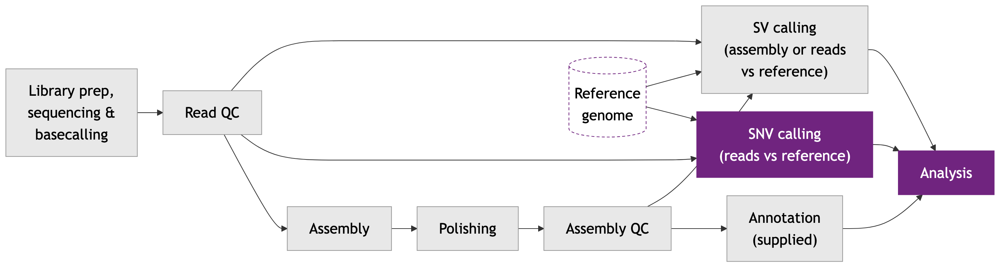

# Module 5

## Lecture

<object data="content-files/Module_5_HTG_Van-2611.pdf#toolbar=0navpanes=0" type="application/pdf" width="100%" height="600px">
  <p>Unable to render PDF. <a href="content-files/Module_5_HTG_Van-2611.pdf">Download the PDF</a>.</p>
</object>

<a href="content-files/Module_5_HTG_Van-2611.pdf" target="_blank" rel="noopener">Open slides in a new tab</a>

## Lab

*From Reads to Variants, and What They Do to Genes*

### Introduction: Which Positions Differ from the Reference?

In Labs 3 and 4 you built a genome from scratch (**de novo**). In this lab you ask a different question about the same wild yeast isolate (*BAL_1a*, run **ERR8562432**): at which positions does it differ from the lab reference strain S288C? A single-base difference is a **single-nucleotide variant (SNV)**. You will:

- **call** variants by comparing your raw reads with the reference genome (**medaka**),
- **filter** out the weak calls (**bcftools**) and count what is left,
- predict what each variant does to a gene (**snpEff**),
- **lift over** the variants (translate their coordinates) onto the annotated assembly we supply,
- look at two variants in the reads, in **IGV**, and ask whether they could matter.

**The case.** The wolf (our isolate, *BAL_1a*) and the corgi (the lab-bred reference strain, S288C) are two strains of the same species. At which positions does the wolf differ from the corgi, and do any differences touch genes for ethanol fermentation? For the case we follow two genes linked to fermentation: *ADH1* (makes ethanol from acetaldehyde) and *GPD2* (glycerol-3-phosphate dehydrogenase, needed for normal growth without oxygen).

The lab has these parts:

- **Part 0:** recap, which reads and which reference
- **Part 1:** call variants with medaka
- **Part 2:** filter and count the variants
- **Part 3:** snpEff, the effect of each variant
- **Part 4:** liftover onto the supplied assembly
- **Part 5:** prepare the files and look at two real variants in IGV
- **Part 6:** wrap-up

#### Where we are in the workflow



This lab covers the highlighted stages: **SNV calling** (reads against the reference) and **analysis** of the variants.

### Your Paths

The same table as in Labs 3 and 4, with the locations this lab uses. Everything under `WORK` is yours alone. Everything else belongs to the instructor and is shared read-only.

| Name | Value | Notes |
|---|---|---|
| `WORK` (yours) | `/scratch/$USER/yeast_workshop` | Created by script 01 in Lab 3 |
| Conda (the instructor's) | `source /project/60004/shared/conda/bin/activate <env>` | This lab uses `medaka_env` and `crossmap_env` |
| snpEff | `-c /project/60004/shared/databases/snpEff/snpEff.config`, database `R64-1-1.105` | Loaded with `module load StdEnv/2023 snpeff/5.2` |
| Reads | `$WORK/data/ERR8562432.fastq.gz` | Downloaded in Lab 3 (script 02) |
| Reference FASTA | `$WORK/data/Saccharomyces_cerevisiae.R64-1-1.dna.toplevel.fa` | Downloaded in Lab 3 (script 02) |
| Supplied assembly | `/project/60004/shared/supplied/polished/ERR8562432_consensus.fasta` | Read-only. The **instructor's** polished assembly, the one the annotation belongs to (see Part 4) |
| Supplied annotation | `/project/60004/shared/supplied/annotations/ERR8562432_funannotate.gff3` | Read-only. Matches the supplied assembly, not a student's own |
| Variant results | `$WORK/results/ERR8562432/variants/` | Where this lab writes its files |
| Fallback results | `/project/60004/shared/fallback/` | In the workshop's shared project folder. Used if a job fails. |

::: {.callout type="red" title="**Login node or compute node?**"}
As before: scripts marked **login node** run with `bash <script>.sh`, and compute jobs are submitted with `sbatch`. Save each script with `nano` in `/scratch/$USER/yeast_workshop/scripts/`, exactly as in Lab 3 (paste, Ctrl+O, Enter, Ctrl+X).
:::

### Part 0: Recap, Which Reads and Which Reference?

Variant calling needs two inputs:

- the **reads** (your raw nanopore reads from Lab 3), and
- the **reference genome**, S288C (Ensembl R64-1-1), which you downloaded in Lab 3.

Note what we do *not* use here: the assembly from Lab 4. A variant is a difference between the reads and the reference, so we go back to the reads. If we compared the assembly with the reference instead, any error left in the assembly would look like a variant. The assembly returns in Part 4, for the annotation.

The steps of this lab are:

1. **medaka** aligns the reads to the reference and calls the variants, giving a **VCF** file.
2. **bcftools** filters the VCF and counts the records.
3. **snpEff** adds the predicted effect of each variant on the genes.
4. **CrossMap** translates the variants onto the supplied assembly, which has an annotation.
5. **IGV** shows the reads at the variants.

::: {.callout type="blue" title="**Check before you continue**"}
Your Lab 3 downloads must exist. Type this in the terminal. You should see the reads file (about 400 MB) and the reference `.fa` file (about 12 MB).

**`check the inputs (type in the terminal)`**

```bash
ls -lh /scratch/$USER/yeast_workshop/data/
```

If a file is missing, ask an instructor.
:::

### Part 1: Calling Variants with medaka

#### Step 1: Run medaka_variant

**medaka** was your polisher in Lab 4. Its `medaka_variant` command does something different with the same kind of neural network: it aligns the reads to a reference and calls the **variants**. A variant is a difference from the reference. `medaka_variant` is a **haploid** caller: it assumes one copy of each chromosome, so it cannot report a position as heterozygous. That suits *BAL_1a*, a monosporic isolate (grown from a single spore) that is a **homozygous diploid** (ScRAP strain table: ploidy 2n, homozygous): its two genome copies carry the same base at almost every site, so a one-allele model fits (see Part 5). 

As in Lab 4, medaka tries to read the basecaller model from the read names. Ours do not record it, so your log will say `WARNING: Failed to detect a model version, will use default: 'r1041_e82_400bps_sup_variant_v5.0.0'`, and medaka uses that default model, which is made for newer R10.4.1 flow cells. This is the workshop pipeline's command, so we keep it. Bear the mismatch in mind when you judge the indel calls in Part 2. 

- **What:** aligns the reads to the S288C reference and calls variants with medaka.
- **Why:** to list every position where *BAL_1a* differs from the reference.
- **Expected output:** a folder `results/ERR8562432/variants/` with, among other files, `medaka.vcf` (the variant calls) and `calls_to_ref.bam` (the reads aligned to the reference). The folder also holds `medaka.sorted.vcf`, `medaka.annotated.vcf` and a large `consensus_probs.hdf` (about 490 MB). It runs for about 4-11 minutes (workshop cluster test run, 2026-10-18: 7 min 57 s with 4 CPUs, peak memory 8.7 GB of the 12000M requested).

A **BAM** file is the binary file that stores an alignment (reads placed on reference coordinates). The script runs `rm -rf` and `mkdir -p` on the output folder first, so that a rerun starts clean. On a first run medaka will still print `Warning: Output … already exists, may use old results.`; that is expected and harmless, because the script creates the folder first and it is empty.

Save as `10_medaka_variant.sh` with `nano` in your `scripts/` folder, as in Lab 3, and submit it.

**`10_medaka_variant.sh`**

```bash
#!/bin/bash
#SBATCH --job-name=medaka_variant
#SBATCH --account=def-sponsor00
#SBATCH --cpus-per-task=4
#SBATCH --mem=12000M
#SBATCH --time=0:30:00
#SBATCH --output=/scratch/%u/yeast_workshop/logs/%x_%j.out
#SBATCH --error=/scratch/%u/yeast_workshop/logs/%x_%j.err
set -e
WORK=/scratch/$USER/yeast_workshop
cd "$WORK"

# Activate the conda environment that contains medaka
source /project/60004/shared/conda/bin/activate medaka_env

# Start with a clean output folder
rm -rf "$WORK/results/ERR8562432/variants"
mkdir -p "$WORK/results/ERR8562432/variants"

# medaka_variant: align reads to a reference and call variants
# -i : the reads
# -r : the reference genome
# -o : the folder for the results
# -t : number of CPUs (the number Slurm gave us)
medaka_variant \
  -i "$WORK/data/ERR8562432.fastq.gz" \
  -r "$WORK/data/Saccharomyces_cerevisiae.R64-1-1.dna.toplevel.fa" \
  -o "$WORK/results/ERR8562432/variants" \
  -t $SLURM_CPUS_PER_TASK

echo "Variant calling finished. Main outputs:"
echo "$WORK/results/ERR8562432/variants/medaka.vcf"
echo "$WORK/results/ERR8562432/variants/calls_to_ref.bam"
```

::: {.callout type="blue" collapsible="true" title="What each argument does"}
`#SBATCH` lines and set-up: see Lab 3, script 04. Only new arguments are listed here.

| Argument | What it does | Why this value |
|---|---|---|
| `source /project/60004/shared/conda/bin/activate medaka_env` | See Lab 3, script 04 (`source`, conda environment). | `medaka_env` holds medaka, the same environment as Lab 4's polishing. |
| `rm -rf "$WORK/results/ERR8562432/variants"` | See the box for script 07 in Lab 4 (the troubleshooting box). | A rerun starts clean; medaka reuses existing outputs otherwise (medaka help, `-f`: "default will reuse existing outputs"). |
| `mkdir -p` | See Lab 3, script 01. | Makes the empty output folder again after the `rm`. |
| `medaka_variant` | "Haploid variant calling via neural networks." | It aligns the reads to the reference and calls the variants; it is a haploid caller, which suits a homozygous diploid (Part 1 text). |
| `-i "$WORK/data/ERR8562432.fastq.gz"` | `-i`: fastx input basecalls (required). | The raw reads from Lab 3 (script 02). |
| `-r "$WORK/data/Saccharomyces_cerevisiae.R64-1-1.dna.toplevel.fa"` | `-r`: fasta reference sequence (required). | The S288C reference from Lab 3 (script 02). |
| `-o "$WORK/results/ERR8562432/variants"` | `-o`: output folder (default: `medaka`). | Puts `medaka.vcf` and `calls_to_ref.bam` in your `results/` folder. |
| `-t $SLURM_CPUS_PER_TASK` | `-t`: number of threads with which to create features (default: 1). `$SLURM_CPUS_PER_TASK`: see Lab 3, script 04. | Passes the 4 CPUs Slurm gave the job. |
| Not used: `-m` | `-m`: the medaka model (default: `r1041_e82_400bps_sup_variant_v5.0.0`). If not provided, "and automatic choice [sic] will be attempted based on the contents of the input file". | As in the workshop pipeline, no model is given; the log will say that it used the default (Part 1 text). In the workshop cluster test run the log said it failed to detect a model version and used the default `r1041_e82_400bps_sup_variant_v5.0.0` (2026-10-18). |

:::

**`submit and check (type in the terminal)`**

```bash
cd /scratch/$USER/yeast_workshop/scripts
sbatch 10_medaka_variant.sh
squeue -u $USER
```

If the state is `PD` (pending), your job is waiting for a free node; this is normal. While it runs, go on to Step 2. Check the log later with `less /scratch/$USER/yeast_workshop/logs/medaka_variant_<jobid>.out`.

::: {.callout type="red" title="**If your job failed**"}
Tell an instructor. You can copy a finished set of results from the fallback location (the workshop's shared project folder) and carry on:

**`copy the fallback variant results`**

```bash
cp -r /project/60004/shared/fallback/variants /scratch/$USER/yeast_workshop/results/ERR8562432/
```
:::

#### Step 2: Read a VCF record (while medaka runs)

A **VCF** (Variant Call Format) file is a tab-separated text file with one line per variant. Lines starting with `##` describe the file (the header), the line starting with `#CHROM` names the columns, and every other line is a variant:

| Column | Name | Meaning |
|---|---|---|
| 1 | `CHROM` | The chromosome (`XV` is chromosome 15) |
| 2 | `POS` | The position on that chromosome |
| 3 | `ID` | An identifier, `.` when there is none |
| 4 | `REF` | The base(s) in the reference |
| 5 | `ALT` | The base(s) in your sample (the **alternate** allele) |
| 6 | `QUAL` | **QUAL**: Phred-scaled confidence that the variant is real (the same scale as read quality in Lab 3; QUAL 20 means a 1% chance that it is wrong) |
| 7 | `FILTER` | `PASS`, or the name of a filter the variant failed |
| 8 | `INFO` | Extra information |
| 9 | `FORMAT` | The names of the per-sample fields in column 10 |
| 10 | sample | The values, e.g. `1:45` for `GT:GQ` |

`GT` is the **genotype**: the alleles that the sample carries. `GT=0` would mean the reference allele, `GT=1` the alternate allele. `GQ` is the confidence in the genotype.

While your job runs, look at a finished VCF from the fallback location. These commands only read a file, so they are safe on the login node. `grep '^##'` keeps the header lines; `grep -v '^##'` removes them; `head -n 4` shows the first four lines.

**`read the first VCF records (type in the terminal)`**

```bash
# 1. A few header lines (they describe the fields)
grep '^##' /project/60004/shared/fallback/variants/medaka.vcf | head -n 6

# 2. The column names line and the first three variants
grep -v '^##' /project/60004/shared/fallback/variants/medaka.vcf | head -n 4
```

**Question 1:** Take the first variant under the column names line. What are its position, REF base, ALT base and QUAL? What does `GT` say, and what does QUAL tell you about how much to trust it?

::: {.callout type="blue" collapsible="true" title="Answer"}
Your values are read from your screen. As an example, the first variant under the column names line in the workshop cluster test run is `I  63  .  T  C  4.154  PASS  .  GT:GQ  1:4`: on chromosome I at position 63, the reference has T and the sample has C. `GT=1` means that the sample carries the alternate allele (C). A QUAL of about 4 means roughly a 40% chance that the call is wrong (10^-0.4), so it is a weak call, close to a guess. medaka still writes `PASS` in the FILTER column, and the `QUAL >= 20` filter in Part 2 removes this record. For contrast, the first record that survives that filter is `I  91  .  T  A  44.781  PASS  .  GT:GQ  1:45`, which has about a 1-in-30,000 chance of being wrong, a confident call. Read your own values from your screen: the positions and alleles of your calls should match these, but the QUAL and GQ values can differ slightly between runs (they differed in some records between medaka 2.1.1 and 2.2.2).
:::

**Question 2:** Look at the genotypes in the first records. Every one is `GT=1`, never `0/1`, and there is no column for read depth or for the fraction of reads that carry the variant. What does this tell you about the type of caller, and what can this VCF *not* tell you?

::: {.callout type="blue" collapsible="true" title="Answer"}
`GT=1` (a single allele, not a pair like `0/1`) is the notation for a **haploid** genotype. `medaka_variant` is a haploid caller: it assumes one copy of each chromosome, so each position is either the reference or the alternate allele. The consequence is that this file cannot report **heterozygosity** (two different alleles in one individual), and `medaka.vcf` does not record how many reads support each allele (the header declares only `GT` and `GQ`). medaka also writes `medaka.annotated.vcf`, which adds read depth (`DP`) and the reads supporting each allele (`SR`); we filter the plain `medaka.vcf`, as in the workshop pipeline. In Part 5 you count the reads yourself in IGV. For *BAL_1a*, a homozygous diploid (ScRAP: 2n, homozygous), both copies carry the same base, so `GT=1` is a fitting model (Part 5). 

:::

### Part 2: Filtering and Counting the Variants

#### Step 1: Filter with bcftools

Check that medaka finished before you continue: `squeue -u $USER` is empty, and this lists `medaka.vcf` and `calls_to_ref.bam`:

**`check the medaka outputs (type in the terminal)`**

```bash
ls -lh /scratch/$USER/yeast_workshop/results/ERR8562432/variants/
```

A raw VCF from nanopore reads contains weak calls. We keep the variants with `QUAL >= 20` (at most about a 1% chance of being wrong) using **bcftools**, a standard toolkit for VCF files. `bcftools filter -i 'QUAL >= 20'` *includes* only the records that pass this test. `bcftools stats` then writes a summary table that includes the counts of SNVs and indels, and the transition/transversion ratio (see Question 5).

- **What:** filters `medaka.vcf` to the variants with QUAL of at least 20, and summarises the result.
- **Why:** to remove low-confidence calls before any interpretation.
- **Expected output:** `filtered.vcf` and `filtered_stats.txt` in the `variants/` folder. It takes seconds.

The input must be named exactly: `medaka.vcf` is the file that medaka's `medaka_variant` writes the variant calls to, before sorting and annotating them. The script checks that the file exists and stops with a message if it does not.

**`11_filter_variants.sh`**

```bash
#!/bin/bash
#SBATCH --job-name=filter_variants
#SBATCH --account=def-sponsor00
#SBATCH --cpus-per-task=2
#SBATCH --mem=4000M
#SBATCH --time=0:10:00
#SBATCH --output=/scratch/%u/yeast_workshop/logs/%x_%j.out
#SBATCH --error=/scratch/%u/yeast_workshop/logs/%x_%j.err
set -e
WORK=/scratch/$USER/yeast_workshop
cd "$WORK"

# bcftools is a cluster module
module purge
module load StdEnv/2023 gcc/12.3 bcftools/1.22

VARDIR="$WORK/results/ERR8562432/variants"
IN="$VARDIR/medaka.vcf"

# Stop with a clear message if the input is missing
if [ ! -s "$IN" ]; then
  echo "ERROR: $IN not found. These files exist:"
  ls "$VARDIR"
  exit 1
fi

# bcftools filter: keep only the records that pass the test
# -i 'QUAL >= 20' : include variants with QUAL of at least 20
# -o              : the output file
bcftools filter -i 'QUAL >= 20' -o "$VARDIR/filtered.vcf" "$IN"

# bcftools stats: a summary table of the filtered variants
bcftools stats "$VARDIR/filtered.vcf" > "$VARDIR/filtered_stats.txt"

# Count the records before and after filtering (lines that do not start with #)
echo "Records before filtering: $(grep -vc '^#' "$IN")"
echo "Records after filtering:  $(grep -vc '^#' "$VARDIR/filtered.vcf")"

echo "Filtering finished. Main outputs:"
echo "$VARDIR/filtered.vcf"
echo "$VARDIR/filtered_stats.txt"
```

::: {.callout type="blue" collapsible="true" title="What each argument does"}
`#SBATCH` lines and set-up: see Lab 3, script 04. Only new arguments are listed here.

| Argument | What it does | Why this value |
|---|---|---|
| `module purge` | See the box for script 08 in Lab 4. | Starts from a clean set of modules. |
| `module load StdEnv/2023 gcc/12.3 bcftools/1.22` | `module load` switches on cluster software (see Lab 3, script 04). | The standard environment first, then bcftools at the version installed on the workshop cluster. |
| `VARDIR=`, `IN=` | `name=value` stores a value in a variable (see Lab 3, script 04). | Short names for the folder and the input file, so each path is written once. |
| `if [ ! -s "$IN" ]; then ... fi` | `if ... then ... fi` runs the lines inside only if the test is true. `-s file` is true if the file exists and has a size greater than zero; `!` reverses the test (Bash manual). So the block runs when `medaka.vcf` is missing or empty.  | If the input is missing, you get a message and a list of the files, and the script stops (Part 2 text). |
| `ls "$VARDIR"` | "List information about the FILEs (the current directory by default)." | Shows which files do exist when the input is missing. |
| `exit 1` | `exit [n]`: exit the shell, returning a status of n to the shell's parent. A non-zero exit status indicates failure (Bash manual). | Stops the script here with a failure status.   |
| `bcftools filter` | "Apply fixed-threshold filters." | It keeps or removes records by a rule. |
| `-i 'QUAL >= 20'` | `-i, --include EXPR`: include only sites for which the expression is true. | QUAL 20 means at most about a 1% chance that the call is wrong (Part 2 text). |
| `-o "$VARDIR/filtered.vcf"` | `-o, --output FILE`: write output to a file (the default is standard output). | Saves the passing records as `filtered.vcf`. |
| `bcftools stats` | "Parses VCF or BCF and produces stats." | The summary table of SNVs, indels and Ts/Tv that Questions 4 and 5 read. The `>` sends it to a file (see Lab 3, script 04). |
| `grep -vc '^#'` | `-v, --invert-match`: select non-matching lines. `-c, --count`: print only a count of selected lines. | Header lines start with `#`, so the count is the number of variant records (Part 2 text). |
| `$(...)` inside `echo` | Command substitution: the output of the command inside `$( )` takes its place in the line (Bash manual). | Puts the count into the printed line. |

:::

**`submit and check (type in the terminal)`**

```bash
cd /scratch/$USER/yeast_workshop/scripts
sbatch 11_filter_variants.sh
squeue -u $USER
```

#### Step 2: Read the counts and the stats

When it finishes, read the two counts at the end of the log, and the summary lines of the stats file (`grep '^SN'` keeps the summary-number lines; the `grep -A1 '^# TSTV'` command prints the transition/transversion section, whose last line holds the numbers):

**`read the results (type in the terminal)`**

```bash
tail -n 6 /scratch/$USER/yeast_workshop/logs/filter_variants_*.out
grep '^SN' /scratch/$USER/yeast_workshop/results/ERR8562432/variants/filtered_stats.txt
grep -A1 '^# TSTV' /scratch/$USER/yeast_workshop/results/ERR8562432/variants/filtered_stats.txt
```

The `SN` lines count the record types: **SNPs** (bcftools' word for single-base changes; we call them SNVs), **MNPs** (multi-base substitutions, where adjacent bases change together; **MNVs**) and **indels** (small insertions or deletions, under 50 bp).

::: {.callout type="red" title="**If your job failed**"}
Tell an instructor, then copy the finished files from the fallback location (the workshop's shared project folder):

**`copy the fallback filtered files`**

```bash
cp /project/60004/shared/fallback/variants/filtered* /scratch/$USER/yeast_workshop/results/ERR8562432/variants/
```
:::

**Question 3:** How many records were there before and after filtering? What fraction did the filter remove, and what does it tell you about the raw calls?

::: {.callout type="blue" collapsible="true" title="Answer"}
Before filtering: **226,529** records. After filtering: **135,199** records, so about 40% were removed (workshop cluster test run, medaka 2.2.2; `bcftools stats`; your numbers should match closely, because you run the same command). The filter removes the calls that medaka itself is least sure of. Nanopore reads are only about 87% accurate (Lab 3), so some of the weak calls will be sequencing errors that the reads could not outvote, and we cannot tell the true variants from the errors among them. Raising the threshold removes more errors, but also more true variants: QUAL 20 is a common compromise, not a law. 
:::

**Question 4:** How many of the filtered records are SNVs, MNVs and indels? Which kind dominates? The reference is 12,157,105 bp long: roughly how many bases apart are the variants?

::: {.callout type="blue" collapsible="true" title="Answer"}
**112,269 SNVs**, **14,458 MNVs** and **8,472 indel records** (bcftools lists 7,819 as `indels` and 653 as `others`; together 135,199; workshop cluster test run, `bcftools stats` on `filtered.vcf`). The 653 "others" are records that are neither a pure SNV, MNV nor a clean insertion or deletion (for example a change that mixes a substitution with an indel).  SNVs dominate, about 83% of all records. 12,157,105 ÷ 135,199 is about 90, so on average there is one variant every ~90 bp: *BAL_1a* differs from S288C by about 1% of its bases. Two cautions: (1) indel calls from these reads are the least trustworthy kind, because nanopore reads make errors in homopolymers (runs of the same base) that look like small insertions and deletions, and medaka's default model here is not matched to our R9.4.1 reads (Part 1) ; (2) 90 bp is an average: variants are not evenly spread.
:::

**Question 5:** What is the transition/transversion ratio (Ts/Tv) in the `TSTV` line? A **transition** is a change within the purines (A↔G) or within the pyrimidines (C↔T); a **transversion** is any other single-base change. If every base change were equally likely, what ratio would you expect, and what do you conclude?

::: {.callout type="blue" collapsible="true" title="Answer"}
**Ts/Tv = 2.98**: 84,059 transitions and 28,210 transversions (`bcftools stats` on `filtered.vcf`, workshop cluster test run; the two add up to the 112,269 SNVs). For random changes, each base can change into one transition and two transversions, so the ratio would be about **0.5**. A ratio far above 0.5 is the signature of real variants, because mutations that are transitions are biologically more frequent than transversions. A set of calls made up mostly of random sequencing errors would drift towards 0.5. So 2.98 supports the claim that most filtered SNVs are real. 
:::

### Part 3: snpEff, What Does Each Variant Do?

A list of positions does not say what the variants *do*. **snpEff** compares each variant with the **gene annotation** of the reference (where the genes are) and predicts its **effect**, such as a changed amino acid or a premature stop. It labels each effect with an **impact**:

| Impact | Meaning | Examples |
|---|---|---|
| **HIGH** | Likely to disrupt the protein | `stop_gained`, `frameshift_variant`, `start_lost` |
| **MODERATE** | Changes the protein, with an effect that is unknown | `missense_variant` (one amino acid is replaced) |
| **LOW** | Probably no change to the protein | `synonymous_variant` (a different codon for the same amino acid) |
| **MODIFIER** | Outside the coding sequence | `upstream_gene_variant`, `intergenic_region` |

These are *predictions* from the sequence alone. They do not say that the protein is really damaged. This is where the case gets specific: which of the wolf's differences touch genes?

#### Step 1: Run snpEff

- **What:** annotates the filtered variants with snpEff, using the database `R64-1-1.105` (the S288C annotation, Ensembl release 105).
- **Why:** to know which variants fall in genes and what they change.
- **Expected output:** `annotated.vcf` (the same variants, with an `ANN` field in the `INFO` column) in the `variants/` folder, and two summary files, `snpEff_summary.html` and `snpEff_genes.txt`. snpEff writes these two into the **working directory**; the script goes to `$WORK` first, so they appear directly in `/scratch/$USER/yeast_workshop/`. It takes under a minute.

**`12_snpeff.sh`**

```bash
#!/bin/bash
#SBATCH --job-name=snpeff
#SBATCH --account=def-sponsor00
#SBATCH --cpus-per-task=2
#SBATCH --mem=4000M
#SBATCH --time=0:15:00
#SBATCH --output=/scratch/%u/yeast_workshop/logs/%x_%j.out
#SBATCH --error=/scratch/%u/yeast_workshop/logs/%x_%j.err
set -e
WORK=/scratch/$USER/yeast_workshop
# snpEff writes snpEff_summary.html and snpEff_genes.txt into the current folder,
# so we go to $WORK first
cd "$WORK"

# snpEff is a cluster module
module purge
module load StdEnv/2023 snpeff/5.2

VARDIR="$WORK/results/ERR8562432/variants"

# java -jar snpEff.jar : run snpEff
# -c : the configuration file (tells snpEff where the databases are)
# R64-1-1.105 : the database (S288C annotation, Ensembl release 105)
# last item : the filtered variants
# > : save the annotated VCF (snpEff prints it to the screen otherwise)
java -jar $EBROOTSNPEFF/snpEff.jar \
  -c /project/60004/shared/databases/snpEff/snpEff.config \
  R64-1-1.105 \
  "$VARDIR/filtered.vcf" > "$VARDIR/annotated.vcf"

echo "snpEff finished. Main outputs:"
echo "$VARDIR/annotated.vcf"
echo "$WORK/snpEff_summary.html"
echo "$WORK/snpEff_genes.txt"
```

::: {.callout type="blue" collapsible="true" title="What each argument does"}
`#SBATCH` lines and set-up: see Lab 3, script 04. Only new arguments are listed here.

| Argument | What it does | Why this value |
|---|---|---|
| `module purge` | See the box for script 08 in Lab 4. | Starts from a clean set of modules. |
| `module load StdEnv/2023 snpeff/5.2` | `module load` switches on cluster software (see Lab 3, script 04). | snpEff at the version installed on the workshop cluster. |
| `java -jar` | `java [options] -jar <jarfile>.jar [args...]`: execute a jar file. | snpEff is a Java program shipped as a `.jar` file.  |
| `$EBROOTSNPEFF/snpEff.jar` | The path to the snpEff program file. `$EBROOTSNPEFF` is a variable the cluster module sets; the exact command is the one used on the workshop cluster (EasyBuild documentation lists `EBROOT<name>` variables); on the workshop cluster, after `module load snpeff/5.2`, the command `java -jar $EBROOTSNPEFF/snpEff.jar -version` printed the snpEff version. | The module sets the variable, so the script does not need the install path. |
| `-c /project/60004/shared/databases/snpEff/snpEff.config` | `-c, -config`: specify config file. | The script comment says it tells snpEff where the databases are; the instructor's copy is shared. |
| `R64-1-1.105` | `genome_version` in the usage line `snpEff [eff] [options] genome_version [input_file]`. | The database: the S288C annotation, Ensembl release 105 (Part 3 text). |
| `"$VARDIR/filtered.vcf"` | `input_file` (the variants file; the default is STDIN). | The variants that passed the QUAL filter in script 11. |
| `> "$VARDIR/annotated.vcf"` | `>` sends output to a file (see Lab 3, script 04). The default output format is VCF (`-o <format>`). | The script comment says snpEff prints the annotated VCF to the screen otherwise. |
| No argument: the summary files | `-s, -stats, -htmlStats`: create the HTML summary file; the default is `snpEff_summary.html`. snpEff's documentation says it also writes `snpEff_genes.txt`, a tab-separated table of statistics per gene, in the directory where snpEff is run. | Written into the current folder, which is why the script goes to `$WORK` first (Part 3 text). |

:::

**`submit and check (type in the terminal)`**

```bash
cd /scratch/$USER/yeast_workshop/scripts
sbatch 12_snpeff.sh
squeue -u $USER
```

::: {.callout type="red" title="**If your job failed**"}
Tell an instructor, then copy the finished files from the fallback location (the workshop's shared project folder):

**`copy the fallback snpEff results`**

```bash
cp /project/60004/shared/fallback/variants/annotated.vcf /scratch/$USER/yeast_workshop/results/ERR8562432/variants/
cp /project/60004/shared/fallback/snpEff_summary.html /project/60004/shared/fallback/snpEff_genes.txt /scratch/$USER/yeast_workshop/
```
:::

#### Step 2: Read one annotated record

When the job has finished, look at one record. `cut -f8` keeps the INFO column (column 8), where snpEff put its `ANN` field. The fields of `ANN` are separated by `|`: the changed allele, the effect, the impact, the gene name, the gene ID, and so on. A variant that touches several genes has several `ANN` entries separated by commas.

**`look at one annotated record (type in the terminal)`**

```bash
# the first 3 variants that snpEff calls a premature stop (stop_gained)
grep -v '^#' /scratch/$USER/yeast_workshop/results/ERR8562432/variants/annotated.vcf | grep -m 3 'stop_gained' | cut -f1,2,4,5,6

# the first 5 HIGH-impact variants: chromosome, position and the first ANN entry
grep -v '^#' /scratch/$USER/yeast_workshop/results/ERR8562432/variants/annotated.vcf | grep -m 5 '|HIGH|' | cut -f1,2,8 | cut -c1-200
```

#### Step 3: Copy the summary report to your laptop

snpEff also wrote an HTML report. Run `scp` on your **laptop**, as before (`YOUR_USER` is the same placeholder as before and the host is `cbw.c3.ca`; Windows users can use MobaXterm or WinSCP).

**`scp_example (run on your laptop)`**

```bash
scp YOUR_USER@cbw.c3.ca:/scratch/YOUR_USER/yeast_workshop/snpEff_summary.html .
```

Open `snpEff_summary.html` in your browser. Look at the tables "Number of effects by impact" (or "Count by impact") and "Number of effects by type and region".

**Question 6:** How many HIGH-impact variants are there? Compare with MODERATE, LOW and MODIFIER. Why is the HIGH group the one to look at first?

::: {.callout type="blue" collapsible="true" title="Answer"}
Counting each variant once, by its first (most severe listed) effect, in your `annotated.vcf` (workshop cluster test run): **HIGH 2,586**, **MODERATE 23,963**, **LOW 47,411** and **MODIFIER 61,239** (they add up to 135,199). In `snpEff_summary.html` ("Number of effects by impact"): **HIGH 2,637, MODERATE 24,357, LOW 48,314, MODIFIER 841,499**, for 916,807 effects across 135,199 variants (snpEff 5.2, workshop cluster test run, 2026-10-18). The report counts every *effect* of every variant: one variant near several genes has several effects, so these numbers are larger than the first-effect counts. HIGH is only about 2% of the variants, but each one is predicted to disrupt a protein (a stop codon, a frameshift or a lost start codon), so these are the candidates most likely to change what the organism does. Remember that this is a prediction.
:::

**Question 7:** In the "by type and region" table, which effect is the most common? What does it say about where most variants lie? Among the HIGH-impact variants, which type of effect is the most frequent, and why should you be cautious about it with nanopore reads?

::: {.callout type="blue" collapsible="true" title="Answer"}
By first effect (your `annotated.vcf`, workshop cluster test run), the largest groups are `upstream_gene_variant` (59,137), `synonymous_variant` (47,223) and `missense_variant` (23,677). Most variants lie outside the coding sequences (`upstream_gene_variant`: in yeast's compact genome almost every non-coding variant is within a few kb upstream of some gene) or change no amino acid. If mutations were random, about three of every four changes in a coding sequence would alter an amino acid. Here synonymous changes outnumber missense ones 2 to 1. Natural selection (purifying selection) has removed most of the variants that change proteins, while silent ones are tolerated.  The report's "by type and region" table counts every effect, so its order differs: `upstream_gene_variant` (395,086) and `downstream_gene_variant` (382,698) lead, because each variant is "upstream" or "downstream" of every gene within 5 kb, and yeast genes are packed closely. Then come `intergenic_region` (50,861), `synonymous_variant` (48,170) and `missense_variant` (24,157). By region, EXON has 86,883 effects and INTRON only 1,083 (workshop cluster test run, snpEff 5.2, the same 135,199 calls). The same message holds: most effects fall outside coding sequences, and silent changes outnumber missense ones. Among the HIGH-impact variants the most frequent first effect is **`frameshift_variant`: 2,122 of 2,586**, then `stop_gained` (172) (workshop cluster test run). This is the caution: nanopore reads make insertion and deletion errors in homopolymers, and such errors cause frameshifts. Many frameshift calls are therefore likely to be sequencing errors, and a substitution that creates a stop codon is the more trustworthy HIGH-impact call. 
:::

**Question 8:** Pick one gene from your HIGH-impact list (use the `grep` commands above). Find it on the *Saccharomyces* Genome Database (**SGD**, yeastgenome.org) by typing its name or its systematic name (such as `YAL059W`) in the search box. What does the gene do, and does the predicted effect make sense for that gene? Does the variant type (stop or frameshift) look more or less reliable to you?

::: {.callout type="blue" collapsible="true" title="Answer"}
The answer depends on the gene you chose. What the answer should contain: the gene's function in one line from the SGD summary, the variant effect from the `ANN` field (for example `p.Arg6*`, meaning that the amino acid at position 6 is replaced by a stop), and a judgement. A stop very near the start of the protein would remove almost all of it; a stop near the end may leave most of the protein intact. A frameshift in a homopolymer is a candidate for a sequencing error. Worked example: **GPD2** (YOL059W), which you will look at in Part 5. [SGD S000005420](https://www.yeastgenome.org/locus/S000005420): "NAD-dependent glycerol 3-phosphate dehydrogenase"; gpd2Δ mutants show impaired anaerobic growth. Our variant is `stop_gained`, p.Glu339*: the stop falls at codon 339 of 440, so the last ~100 amino acids are lost. That could reduce GPD2 function; it is not proof of an effect. For instance, your annotated VCF has `stop_gained` calls at `I:36,524` (ECM1, YAL059W, p.Arg6*) and `I:118,305` (FUN30, YAL019W, p.Lys1130*) (workshop cluster test run): the function of each must be read from SGD.
:::

### Part 4: Liftover onto the Supplied Assembly

So far, every coordinate is on the **reference** (S288C, chromosomes `I` to `XVI`). The annotation that we supplied (Lab 4) describes the **instructor's assembly**, with contigs named `contig_1`, `contig_2`, and so on. To see a variant together with the annotation of the assembly, you must convert its position from the reference to the assembly. This is called **liftover**. It places each call, with its snpEff annotation, on the coordinates of the isolate's own assembly, so you can see it next to the gene models made on that assembly. On its own assembly a true SNV is no longer a difference: the assembly was built from the same reads, so it already carries the variant base. The VCF describes the wolf in the corgi's coordinates. Liftover moves each difference onto the wolf's own map, its assembly. Three tools work together:

1. **minimap2** aligns the assembly to the reference and writes a **PAF** file (minimap2's text format for pairwise alignments: one line per aligned block).
2. **paf2chain** turns the PAF into a **chain file**, the "coordinate dictionary": for each block it says "reference position X is assembly position Y".
3. **CrossMap** reads the chain file and rewrites every variant at its new position.

#### Step 1: Run the liftover

- **What:** lifts the annotated VCF from the reference onto the supplied assembly.
- **Why:** to place the variants and their snpEff annotation on the coordinates of the assembly that has the gene annotation.
- **Expected output:** in `results/ERR8562432/variants/liftover/`: `ref_vs_denovo.paf`, `ref_to_denovo.chain`, `lifted.vcf` and `lifted.vcf.unmap` (the variants that could not be lifted). It takes under a minute.

We use the **supplied** assembly rather than your own from Lab 4, because the annotation belongs to it. The variants were called against the reference, so they are the same whichever assembly you lift them onto. The script first copies the supplied assembly into your own folder, because CrossMap writes an index file (`.fai`) next to the assembly it reads, and you cannot write into the workshop's shared project folder.

**`13_liftover.sh`**

```bash
#!/bin/bash
#SBATCH --job-name=liftover
#SBATCH --account=def-sponsor00
#SBATCH --cpus-per-task=2
#SBATCH --mem=4000M
#SBATCH --time=0:10:00
#SBATCH --output=/scratch/%u/yeast_workshop/logs/%x_%j.out
#SBATCH --error=/scratch/%u/yeast_workshop/logs/%x_%j.err
set -e
WORK=/scratch/$USER/yeast_workshop
cd "$WORK"

# Conda environment with minimap2, paf2chain and CrossMap
source /project/60004/shared/conda/bin/activate crossmap_env

REF="$WORK/data/Saccharomyces_cerevisiae.R64-1-1.dna.toplevel.fa"
VARDIR="$WORK/results/ERR8562432/variants"
OUT="$VARDIR/liftover"
mkdir -p "$OUT"

# Copy the supplied assembly into your folder (CrossMap writes an index file next to it)
cp /project/60004/shared/supplied/polished/ERR8562432_consensus.fasta "$OUT/"
ASM="$OUT/ERR8562432_consensus.fasta"

# 1. minimap2 : align the assembly to the reference
# -c       : compute the detailed alignment
# -x asm5  : preset for two genomes that are very similar
minimap2 -cx asm5 "$REF" "$ASM" > "$OUT/ref_vs_denovo.paf"

# 2. paf2chain : turn the PAF into a chain file (the coordinate dictionary)
paf2chain -i "$OUT/ref_vs_denovo.paf" > "$OUT/ref_to_denovo.chain"

# 3. CrossMap vcf : move every variant to its position on the assembly
# inputs, in order: the chain file, the VCF to convert, the new assembly, the output
CrossMap vcf "$OUT/ref_to_denovo.chain" \
  "$VARDIR/annotated.vcf" \
  "$ASM" \
  "$OUT/lifted.vcf"

echo "Liftover finished. Main outputs:"
echo "$OUT/lifted.vcf"
echo "$OUT/lifted.vcf.unmap"
```

::: {.callout type="blue" collapsible="true" title="What each argument does"}
`#SBATCH` lines and set-up: see Lab 3, script 04. Only new arguments are listed here.

| Argument | What it does | Why this value |
|---|---|---|
| `source /project/60004/shared/conda/bin/activate crossmap_env` | See Lab 3, script 04. | `crossmap_env` holds minimap2, paf2chain and CrossMap. |
| `REF=`, `VARDIR=`, `OUT=`, `ASM=` | `name=value` stores a value in a variable (see Lab 3, script 04). | Short names for the paths used below. |
| `mkdir -p "$OUT"` | See Lab 3, script 01. | Makes the `liftover/` folder. |
| `cp /project/60004/shared/supplied/polished/ERR8562432_consensus.fasta "$OUT/"` | "Copy SOURCE to DEST, or multiple SOURCE(s) to DIRECTORY." | CrossMap writes an index file next to the assembly, and you cannot write into the workshop's shared project folder (Part 4 text). |
| `minimap2 -cx asm5` | `-c`: output CIGAR in PAF. `-x STR`: preset, always applied before other options; `asm5`: assembly-to-reference mapping for about 0.1% sequence divergence. (`-cx` is `-c` and `-x` written together.) | paf2chain needs alignments with a CIGAR string (its README names `minimap2 -c`). `asm5` is the preset in the workshop pipeline, although this isolate differs by about 1% (see Question 10). |
| `"$REF" "$ASM"` | minimap2 usage: `minimap2 [options] <target.fa> [query.fa]`. | The reference is the target and the assembly is the query. |
| `> "$OUT/ref_vs_denovo.paf"` | Without `-a`, minimap2 writes PAF (the default output); `>` sends it to a file (see Lab 3, script 04). | The PAF is the input of the next step. |
| `paf2chain -i "$OUT/ref_vs_denovo.paf"` | "Generate a CHAIN format file from a PAF format file." `-i, --input <INPUT>`: input PAF file. | Makes the chain file, the coordinate dictionary of Part 4. The chain goes to a file with `>`. |
| `CrossMap vcf` | Usage: `CrossMap vcf [options] input.chain input.vcf refgenome.fa out_vcf`. | The four items, in order, are listed in the next rows. |
| `"$OUT/ref_to_denovo.chain"` | `input.chain`: the chain file, which "describes pairwise alignments between two genomes". | The chain made by paf2chain. |
| `"$VARDIR/annotated.vcf"` | `input.vcf`: the input VCF. | The snpEff-annotated variants from script 12. |
| `"$ASM"` | `refgenome.fa`: chromosome sequences of the target assembly in FASTA format. | The assembly the variants are moved onto. |
| `"$OUT/lifted.vcf"` | `out_vcf`: the output VCF file. CrossMap also writes the records it could not convert to a file with the ending `.unmap` (CrossMap documentation). | The lifted variants. |

:::

**`submit and check (type in the terminal)`**

```bash
cd /scratch/$USER/yeast_workshop/scripts
sbatch 13_liftover.sh
squeue -u $USER
```

#### Step 2: Count the lifted variants and look at them

When it has finished, count the variants that were lifted and the ones that were not (`grep -vc '^#'` counts the lines that do not start with `#`; `wc -l` counts all lines):

**`count the lifted variants (type in the terminal)`**

```bash
grep -vc '^#' /scratch/$USER/yeast_workshop/results/ERR8562432/variants/liftover/lifted.vcf
wc -l /scratch/$USER/yeast_workshop/results/ERR8562432/variants/liftover/lifted.vcf.unmap
tail -n 5 /scratch/$USER/yeast_workshop/logs/liftover_*.out

# the first five lifted records: columns 1-6 (chromosome, position, ID, REF, ALT, QUAL)
grep -v '^#' /scratch/$USER/yeast_workshop/results/ERR8562432/variants/liftover/lifted.vcf | head -n 5 | cut -f1-6
```

::: {.callout type="red" title="**If your job failed**"}
Tell an instructor, then copy the finished liftover folder from the fallback location (the workshop's shared project folder):

**`copy the fallback liftover results`**

```bash
cp -r /project/60004/shared/fallback/liftover /scratch/$USER/yeast_workshop/results/ERR8562432/variants/
```
:::

**Question 9:** What percentage of the 135,199 variants was lifted? Is that a good result? Then look at the last command's output: most records have nothing in the ALT column. Why? What would a lifted SNV that still has an ALT base mean?

::: {.callout type="blue" collapsible="true" title="Answer"}
**110,766 of 135,199, which is 81.9%** (we counted 110,766 variant lines in `lifted.vcf`, workshop cluster test run; the other 24,433 failed to lift, which is 18.1%). For the same job on the older, noisy R7.3 dataset (a fragmented assembly with only 43.7% of the genes) only 4.3% were lifted, so 81.9% shows how much a good assembly gives. About four in five variants can be placed on the assembly with its annotation, but nearly one in five is lost, so any list built on the lifted file is incomplete.

**The empty ALT.** CrossMap rewrites REF as the base of the *assembly* at the new position. Our assembly was built from the same reads, so at a true SNV it already carries the isolate's base. REF then equals the old ALT, and CrossMap drops the ALT. Of the 107,802 lifted SNVs, 107,629 (99.8%) look like this, which is a good cross-check that the assembly and the variant calls agree. The 173 SNVs that keep an ALT are places where the assembly and the reads disagree, and are candidates for errors left in the assembly. Indels are different: CrossMap lifts only the first base of REF, so deletions also lose their ALT, and multi-base changes look like insertions. Use the lifted file for positions and for the `ANN` text, not for indel alleles. Most lifted records therefore no longer describe a difference, on the isolate's own assembly. In the words of the case: on the wolf's own map, the wolf's base *is* the reference, so there is nothing left to list as an ALT. (Workshop cluster test run, CrossMap 0.7.3; review of the CrossMap code.) 
:::

**Question 10:** Why can a variant fail to lift over? Think about what the chain file contains.

::: {.callout type="blue" collapsible="true" title="Answer"}
The chain file only has entries for the blocks where the assembly **aligned** to the reference. A variant whose reference position lies outside an aligned block has no "address" on the assembly and cannot be moved. That happens where the assembly is missing sequence that the reference has (the isolate lacks it, or the assembler left it out: repeats, the ribosomal DNA array, chromosome ends), and where the two genomes differ so much that minimap2 could not align them. Also, the preset `-x asm5` is meant for genomes that differ by well under 1%, but *BAL_1a* differs from S288C by about 1%, so alignments are broken more often in diverged regions, which probably adds to the failures (this is why Lab 4's bonus and Lab 6 use `asm10`). A third failure type in CrossMap's code is `Fail(Multiple_hits)`: the position maps to more than one place, as in repeats and duplicated regions; the PAF from `minimap2 -cx asm5` includes secondary alignments.

In the workshop cluster test run, `lifted.vcf.unmap` has 24,458 lines: 25 header lines and 24,433 records. Of these records, 23,857 are `Fail(Unmap)` (no aligned block covers the position) and 576 are `Fail(Multiple_hits)`. So multiple hits are a small share (about 2%); most failures are positions outside the aligned blocks. 
:::

### Part 5: Looking at Real Variants in IGV

Two of the 135,199 variants are in genes that students of fermentation and stress know well. Both sit on chromosome XV, about 58 kb apart. You will check each with your own eyes: the predicted effect, and the reads behind it.

| Gene | Locus (IGV) | Change (reference > sample) | snpEff effect |
|---|---|---|---|
| GPD2 (YOL059W) | `XV:218,140` | G > T | `stop_gained` (HIGH), p.Glu339* |
| ADH1 (YOL086C) | `XV:159,763` | A > G | `missense_variant` (MODERATE), p.Cys278Arg |

#### Step 1: Download the annotation of the reference (login node)

Reference annotation (where the genes are, on S288C coordinates) comes from **Ensembl**, as a GFF3 file. It is the same kind of file as in Lab 4. The snpEff database uses Ensembl release 105, and this GFF3 is release 113; the genome is the same and the gene models differ little, so you may see small differences.

::: {.callout type="red" title="**Login node**"}
This is a download, so it runs on the **login node**, with `bash`, not with `sbatch`.
:::

**`14a_download_gff3.sh`**

```bash
#!/bin/bash
# Downloads the Ensembl R64-1-1 (release 113) gene annotation. Run on the login node with: bash 14a_download_gff3.sh
set -e
WORK=/scratch/$USER/yeast_workshop
mkdir -p "$WORK/data"

# wget: download a file; -nc: do not download it again if it is already there
wget -nc -P "$WORK/data/" https://ftp.ensembl.org/pub/release-113/gff3/saccharomyces_cerevisiae/Saccharomyces_cerevisiae.R64-1-1.113.gff3.gz

# gunzip -f: unpack it (-f lets you rerun the script)
gunzip -f "$WORK/data/Saccharomyces_cerevisiae.R64-1-1.113.gff3.gz"

echo "Downloaded:"
ls -lh "$WORK/data/Saccharomyces_cerevisiae.R64-1-1.113.gff3"
```

::: {.callout type="blue" collapsible="true" title="What each argument does"}
Set-up lines (`set -e`, `WORK=`, `mkdir -p`): see Lab 3, script 04. This script has no `#SBATCH` lines because it runs on the login node, with `bash`.

| Argument | What it does | Why this value |
|---|---|---|
| `wget -nc -P "$WORK/data/" https://ftp.ensembl.org/...gff3.gz` | See Lab 3, script 02 (`wget`, `-nc`, `-P`). | The URL is the Ensembl release 113 gene annotation of S288C (R64-1-1), the same release as the reference FASTA from Lab 3 (Lab 3, script 02). |
| `gunzip -f` | See Lab 3, script 02. | Unpacks the `.gz` file so IGV can read the GFF3; `-f` makes a rerun safe. |
| `ls -lh` | See Lab 3, script 02. | Shows that the unpacked file exists and its size. |

:::

**`run on the login node`**

```bash
cd /scratch/$USER/yeast_workshop/scripts
bash 14a_download_gff3.sh
```

#### Step 2: Cut out the region and the files for your laptop

The reads-to-reference BAM is about 0.5-1 GB, and the annotated VCF about 90 MB, too much to copy to a laptop over Wi-Fi. We cut out the region of chromosome XV that holds both genes, **XV:150,000-230,000** (80 kb). **samtools** is the standard toolkit for BAM files: `samtools view -b` writes the reads in a region into a new BAM, and `samtools index` writes the `.bai` index. The same script uses `awk` (a text-processing tool) to keep only the VCF lines in the region of interest, in the same way as a filter.

- **What:** cuts the BAM, the annotated VCF and the lifted VCF down to the regions of the two genes.
- **Why:** so that you can copy small files to your laptop and open them quickly in IGV.
- **Expected output:** a folder `results/ERR8562432/igv/` with `XV_150000_230000.bam` (+ `.bai`), `annotated_XV_150000_230000.vcf` and `lifted_contig_10_region.vcf`. It takes under a minute.

The lifted region is `contig_10:840,000-920,000` of the supplied assembly, where both genes are lifted to (Part 5, Step 5). The script also makes the `.fai` index of the reference FASTA that IGV needs (if you did the bonus of Lab 4, this just refreshes the file).

**`14b_prepare_igv.sh`**

```bash
#!/bin/bash
#SBATCH --job-name=prepare_igv
#SBATCH --account=def-sponsor00
#SBATCH --cpus-per-task=2
#SBATCH --mem=4000M
#SBATCH --time=0:10:00
#SBATCH --output=/scratch/%u/yeast_workshop/logs/%x_%j.out
#SBATCH --error=/scratch/%u/yeast_workshop/logs/%x_%j.err
set -e
WORK=/scratch/$USER/yeast_workshop
cd "$WORK"

# samtools is a cluster module
module purge
module load StdEnv/2023 gcc/12.3 samtools/1.22.1

VARDIR="$WORK/results/ERR8562432/variants"
OUT="$WORK/results/ERR8562432/igv"
REF="$WORK/data/Saccharomyces_cerevisiae.R64-1-1.dna.toplevel.fa"
mkdir -p "$OUT"

# 1. samtools index: the index lets us pull out one region (written next to the BAM)
samtools index "$VARDIR/calls_to_ref.bam"

# 2. samtools view -b : write the reads of one region into a new BAM file
#    region XV:150000-230000 holds both GPD2 and ADH1
samtools view -b -o "$OUT/XV_150000_230000.bam" "$VARDIR/calls_to_ref.bam" XV:150000-230000
samtools index "$OUT/XV_150000_230000.bam"

# 3. awk: keep the header lines (starting with #) and the variants of one region
#    $1 is the chromosome column, $2 the position column
awk '/^#/ || ($1=="XV" && $2>=150000 && $2<=230000)' \
  "$VARDIR/annotated.vcf" > "$OUT/annotated_XV_150000_230000.vcf"
# 3b. awk: the lifted variants of the contig_10 region, made readable for IGV
#     CrossMap leaves ALT empty where the assembly already has the sample's base;
#     we write "." there (no alternate base) and keep the first 8 columns only
awk 'BEGIN{FS=OFS="\t"} /^##/{print; next} /^#CHROM/{print $1,$2,$3,$4,$5,$6,$7,$8; next}
     $1=="contig_10" && $2>=840000 && $2<=920000 {if ($5=="") $5="."; print $1,$2,$3,$4,$5,$6,$7,$8}' \
  "$VARDIR/liftover/lifted.vcf" > "$OUT/lifted_tmp.vcf"
# sort: put the records in position order (the contig is reversed relative to chromosome XV)
grep '^#' "$OUT/lifted_tmp.vcf" > "$OUT/lifted_contig_10_region.vcf"
grep -v '^#' "$OUT/lifted_tmp.vcf" | sort -k2,2n >> "$OUT/lifted_contig_10_region.vcf"
rm "$OUT/lifted_tmp.vcf"

# 4. samtools faidx : the index of the reference FASTA, which IGV needs
samtools faidx "$REF"

echo "IGV files ready. Main outputs:"
ls -lh "$OUT"
```

::: {.callout type="blue" collapsible="true" title="What each argument does"}
`#SBATCH` lines and set-up: see Lab 3, script 04. Only new arguments are listed here.

| Argument | What it does | Why this value |
|---|---|---|
| `module purge` | See the box for script 08 in Lab 4. | Starts from a clean set of modules. |
| `module load StdEnv/2023 gcc/12.3 samtools/1.22.1` | `module load` switches on cluster software (see Lab 3, script 04). | samtools at the version installed on the workshop cluster. |
| `VARDIR=`, `OUT=`, `REF=` | `name=value` stores a value in a variable (see Lab 3, script 04). | Short names for the three paths. |
| `samtools index` | Makes an index of a BAM file; `-b, --bai`: BAI-format index (the default). Also in Lab 4's bonus script. | The index lets samtools pull out one region, and IGV needs it next to the BAM. |
| `samtools view -b -o "$OUT/XV_150000_230000.bam" "$VARDIR/calls_to_ref.bam" XV:150000-230000` | `-b, --bam`: output BAM. `-o, --output FILE`: write output to FILE (default: standard output). The input BAM comes next, then `[region ...]` in the form `chr3:1000-2000`. | Cuts out the reads on chromosome XV between 150,000 and 230,000, a region that holds both GPD2 and ADH1 (Part 5 text). |
| `awk '/^#/ ...' file > out` | `awk 'program' file`: the usage line in the awk help. The script comment says: keep the header lines (starting with `#`) and the variants of one region; `$1` is the chromosome column, `$2` the position column.  | Makes a small VCF for the region, so you can copy it to your laptop (Part 5 text). |
| `awk 'BEGIN{FS=OFS="\t"} ...'` (step 3b) | `BEGIN{...}` runs once, before the first line is read. `FS` is the field separator for reading and `OFS` the output field separator for printing; both are set to a tab here, the VCF separator (gawk manual). The script comment says: write `.` where ALT is empty and keep the first 8 columns only. | CrossMap leaves ALT empty where the assembly already has the sample's base (Question 9); IGV needs a value there.  |
| `grep '^#'` and `grep -v '^#'` | `-v, --invert-match`: select non-matching lines. | The first keeps the header lines, the second the variant lines; the header is written first, then the sorted variants. |
| `sort -k2,2n` | `-k, --key=KEYDEF`: sort via a key; the key gives a field number (origin 1). `-n, --numeric-sort`: compare according to string numerical value. | Sorts the records by column 2 (position), as numbers (the contig is reversed relative to chromosome XV). |
| `>>` | Appends the output to the end of a file, which is created if it does not exist (`>` would empty it first; Bash manual). | Adds the sorted variants below the header already written. |
| `rm "$OUT/lifted_tmp.vcf"` | `rm` removes files (see the box for script 08 in Lab 4). | Deletes the temporary file. |
| `samtools faidx "$REF"` | `faidx <file.fa>`: index a FASTA file; the index name defaults to `file.fa.fai` (`--fai-idx`). Also in Lab 4's bonus script.  | IGV needs the `.fai` next to the reference (Part 5 text). |
| `ls -lh "$OUT"` | See Lab 3, script 02. | Lists the files that the script made. |

:::

**`submit and check (type in the terminal)`**

```bash
cd /scratch/$USER/yeast_workshop/scripts
sbatch 14b_prepare_igv.sh
squeue -u $USER
```

::: {.callout type="red" title="**If your job failed**"}
Tell an instructor, then copy the finished files from the fallback location (the workshop's shared project folder):

**`copy the fallback IGV files`**

```bash
cp -r /project/60004/shared/fallback/igv /scratch/$USER/yeast_workshop/results/ERR8562432/
```
:::

#### Step 3: Copy the files to your laptop

From a **laptop** terminal, copy the region files, the reference and its index, the Ensembl GFF3, the supplied assembly and the supplied annotation into one folder (IGV finds an index only if it sits next to the file; `YOUR_USER` is the same placeholder as before and the host is `cbw.c3.ca`).

**`scp_example (run on your laptop)`**

```bash
mkdir igv_lab5
cd igv_lab5
# the quotes stop your laptop (zsh on a Mac) from trying to expand the *
scp 'YOUR_USER@cbw.c3.ca:/scratch/YOUR_USER/yeast_workshop/results/ERR8562432/igv/*' .
scp 'YOUR_USER@cbw.c3.ca:/scratch/YOUR_USER/yeast_workshop/data/Saccharomyces_cerevisiae.R64-1-1.dna.toplevel.fa*' .
scp 'YOUR_USER@cbw.c3.ca:/scratch/YOUR_USER/yeast_workshop/data/Saccharomyces_cerevisiae.R64-1-1.113.gff3' .
scp 'YOUR_USER@cbw.c3.ca:/project/60004/shared/supplied/polished/ERR8562432_consensus.fasta' .
scp 'YOUR_USER@cbw.c3.ca:/project/60004/shared/supplied/annotations/ERR8562432_funannotate.gff3' .
```

#### Step 4: The reference view, GPD2 and ADH1

In **IGV**:

1. **Genomes > Load Genome from File**, and choose `Saccharomyces_cerevisiae.R64-1-1.dna.toplevel.fa`.
2. **File > Load from File**, and choose, together: `Saccharomyces_cerevisiae.R64-1-1.113.gff3` (the genes), `XV_150000_230000.bam` (the reads), `annotated_XV_150000_230000.vcf` (the variants).
3. Reads are long, so open **View > Preferences > Alignments**, set **Visibility range threshold (kb)** to `100` and Save.
4. Type `XV:218,140` in the locus box and press Enter. Zoom in until you see the individual bases (a window of 50-100 bp). You see the gene track, the reads and, above, the variant as a coloured box.
5. Click the variant box: the pop-up shows the VCF record, including the `ANN` field. Click the grey coverage bar above the reads at the variant position: the pop-up counts the reads that carry each base (A, C, G, T). Then repeat with `XV:159,763`.

**Question 11:** At each locus, how many reads cover the position, and how many of them carry the alternate base called in the VCF? What do the few reads with a different base look like?

::: {.callout type="blue" collapsible="true" title="Answer"}
Counted in `calls_to_ref.bam` (workshop cluster test run; the instructor's separate alignment with `bcftools mpileup` gives the same counts) : at **GPD2, XV:218,140**, 27 reads cover the site: **22 carry T (the alternate base)**, 1 carries G (the reference base), 2 carry A and 2 carry C (22 of 27 = 82%). At **ADH1, XV:159,763**, 34 reads: **29 carry G (the alternate base)** and 5 carry A (the reference base) (29 of 34 = 85%). So most reads support each variant, from about 27-34 reads in total. The few reads with another base are **sequencing errors**: these reads are about 87% accurate on average (they peak at Q9, Lab 3), which means about 13% of their bases are wrong, so even at a true variant 10-20% of the reads are expected to disagree.
:::

**Question 12:** The VCF genotype is `GT=1` at both loci. Is this variant homozygous or heterozygous? Why is `GT=1` the right model for this isolate, and what would you expect to see in the reads at a heterozygous site in a diploid?

::: {.callout type="blue" collapsible="true" title="Answer"}
**Homozygous** means both copies carry the same allele, **heterozygous** that they differ. *BAL_1a* is a **homozygous diploid**: the ScRAP strain table lists it as ploidy 2n and homozygous. It was grown from a single spore, and its two genome copies carry the same base at almost every site. So `GT=1`, a single alternate allele, is a fitting model, and `medaka_variant` is a haploid caller. In the reads such a site shows nearly all reads with the same base (here 82% and 85%; the rest are sequencing errors). A **heterozygous** site in a diploid would show two alleles at roughly half of the reads each; that is a pattern that `medaka_variant` cannot report. 
:::

**Question 13 (the real-variant question):** For each of the two genes, look at the snpEff effect in the VCF record, the position of the variant in the gene track and the read support (Question 11). Explain why such a variant *could* matter. Look both genes up on SGD, and say what you would do next to find out whether the variant has an effect.

::: {.callout type="blue" collapsible="true" title="Answer"}
**GPD2 / YOL059W (`XV:218,140`, G>T, QUAL 39).** snpEff predicts `stop_gained` (HIGH), p.Glu339*: the codon for amino acid 339 of 440 becomes a stop codon (your `annotated.vcf`, workshop cluster test run, 2026-10-18). The stop removes about the last 100 amino acids of the 440, so the protein is truncated and this **could reduce GPD2 function**. [SGD S000005420](https://www.yeastgenome.org/locus/S000005420) describes GPD2 as an NAD-dependent glycerol-3-phosphate dehydrogenase, and reports that a deletion of the gene (*gpd2*Δ) shows impaired anaerobic growth. So this is a variant in a gene associated with glycerol production and with growth without oxygen. GPD1 is a **paralog** of GPD2 (a related gene from an ancient duplication), so a loss of GPD2 may be partly covered by GPD1; the overall effect is not known. The read support is 22 of 27 reads (T), so the reads support the call well. Next to it, at 218,142, is a second change in the same codon (G>A, called 'synonymous' on its own). Together they make TAA, still a stop codon. snpEff judges each variant separately, so always look at neighbours. 

**ADH1 / YOL086C (`XV:159,763`, A>G, QUAL 49).** snpEff predicts `missense_variant` (MODERATE), p.Cys278Arg: amino acid 278 of 348 changes from cysteine to arginine (your `annotated.vcf`, workshop cluster test run, 2026-10-18). [SGD S000005446](https://www.yeastgenome.org/locus/S000005446) describes ADH1 as the fermentative alcohol dehydrogenase, which converts acetaldehyde to ethanol. This is a variant in a gene associated with fermentation. A missense variant *could* alter how the enzyme works, but MODERATE only means "changes the protein, effect unknown": nothing here shows that it changes ethanol production. The read support is 29 of 34 reads (G).

**For both:** we say "a variant in a gene associated with…", not "the cause of" anything. The call is from a **haploid** model (`GT=1`), a fitting model because every copy of *BAL_1a*'s genome carries the same base (a homozygous diploid; ScRAP: 2n, homozygous), and the measured reads (82% and 85% carry the alternate base; the rest are sequencing errors of about 13% at Q9) fit a true variant. To test the effect you would need experiments, for example measuring growth or ethanol and glycerol production, or putting the variant in a reference strain. 

**For the case:** the wolf carries a predicted stop in *GPD2* and a missense change in *ADH1*. These are differences in genes associated with fermentation. Whether they change how the wolf ferments is a hypothesis; measuring ethanol and glycerol would test it.
:::

#### Step 5: The assembly view, with the supplied annotation

Now look at the same two variants on the **assembly**, together with the annotation that was made on it. Open a **new IGV session** (File > New Session), then:

1. **Genomes > Load Genome from File**, and choose `ERR8562432_consensus.fasta` (the supplied assembly).
2. **File > Load from File**, and choose `ERR8562432_funannotate.gff3` and `lifted_contig_10_region.vcf`.
3. Go to `contig_10:912,069` (ADH1: the lifted position of `XV:159,763`), then to `contig_10:854,047` (GPD2: the lifted position of `XV:218,140`).

You should see the funannotate gene models as in the previous lab, and the lifted variants on top. Liftover placed each call, with its snpEff annotation, on the isolate's own coordinates: the `ANN` text in the VCF record is still the effect predicted on the reference. Remember Question 9: the ALT column shows `.` (no alternate base) for most records, because the assembly already carries the isolate's base. 

Two things to notice:

- **ADH1 is split in two.** The funannotate model `FUN_003391-T1` has two CDS pieces, `contig_10:910,903-911,054` and `911,252-912,284`, drawn as two blocks joined by a thin line (an "intron"). ADH1 is not expected to contain an intron (Lab 4, Question 5). The lifted ADH1 variant is in the second piece.
- **GPD2: look closely.** The variant at `contig_10:854,047` does **not** fall in a coding block of the funannotate model `FUN_003357` (`contig_10:853,739-854,388`, reverse strand). It falls in the thin line between its two pieces, a predicted 44-bp "intron". GPD2 has no intron in S288C. The gene predictor most likely invented this intron to step over the premature stop codon and a nearby one-base error in the assembly (a missing base in a run of T), because gene finders avoid stop codons in the middle of a gene. eggNOG matched this model, and a second one, `FUN_003358`, to YOL059W (GPD2's systematic name), and gave them the preferred name GPD1, the paralog. The whole gene, 1,323 bp in S288C, is cut into pieces. On this assembly, the annotation hides exactly the variant we are studying: an annotation is only as good as the assembly under it (Lab 4).

### Part 6: Wrap-Up

::: {.callout type="red" title="**Checklist**"}
1. `10_medaka_variant.sh` finished: `variants/medaka.vcf` and `calls_to_ref.bam` exist.
2. `11_filter_variants.sh` finished: `filtered.vcf` has about 135,000 records.
3. `12_snpeff.sh` finished: `annotated.vcf` and `snpEff_summary.html` exist.
4. `13_liftover.sh` finished: `liftover/lifted.vcf` exists.
5. You looked at GPD2 and ADH1 in IGV.
:::

What you learned: variant calling compares **reads** with a **reference**. The raw list needs filtering (QUAL), the Ts/Tv ratio is a quick check, and snpEff turns positions into predicted effects. About 2% of the calls (HIGH impact) are predicted to break a protein, but many of them are frameshifts that nanopore reads can make by error. Liftover places the variants and their annotation on the isolate's own assembly, where a true SNV is no longer a difference, and the reads in IGV are the final check: look at the reads before you trust a variant.

### What's Next

In **Lab 6** we look for larger differences, **structural variants** (SVs), by aligning the assembly to the reference. This is where the second line of questioning, stress response, comes in: does the wolf lack, or carry, large pieces of DNA that the corgi does not?
