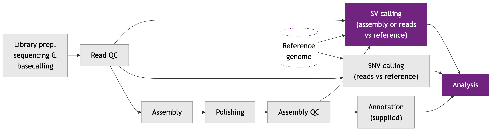

# Module 6

## Lecture

<object data="content-files/Module_6_HTG_Van-2611.pdf#toolbar=0navpanes=0" type="application/pdf" width="100%" height="600px">
  <p>Unable to render PDF. <a href="content-files/Module_6_HTG_Van-2611.pdf">Download the PDF</a>.</p>
</object>

<a href="content-files/Module_6_HTG_Van-2611.pdf" target="_blank" rel="noopener">Open slides in a new tab</a>

## Lab

*Big Differences Between the Assembly and the Reference*

### **Introduction: What Is Different at the Scale of Genes?**

In Lab 5 you found **single-nucleotide variants (SNVs)**, one-base differences between your reads and the reference. In this lab you look for much bigger differences between the wild yeast isolate (*BAL_1a*, run **ERR8562432**) and the lab reference strain S288C: **structural variants (SVs)**, differences of **50 bp or more**. The main types are **deletions** (DEL: sequence in the reference that the sample lacks), **insertions** (INS: extra sequence in the sample), **inversions** (INV: a segment flipped around) and **duplications** (DUP).

**The case.** The last line of questioning: stress response. Which large pieces of DNA does the wolf (our isolate, *BAL_1a*) lack or carry, compared with the corgi (the lab-bred reference strain, S288C)?

SNV calling compared *reads* with the reference. Here we compare the *assembly* from Lab 4 with the reference, because a long contig crosses a whole deletion or insertion in one piece. You will:

- **align** the assembly to the reference (a BAM file; the same script as the Lab 4 bonus),
- **call** SVs from that alignment with **SVIM-asm**,
- **filter** the deletions and **count** the SVs by type and size with **bcftools**,
- look at one real deletion, in a gene associated with copper and cadmium resistance, in **IGV**.

The lab has these parts:

- **Part 0:** recap, why the assembly this time
- **Part 1:** align the assembly to the reference
- **Part 2:** call SVs with SVIM-asm
- **Part 3:** filter and count the SVs
- **Part 4:** prepare the files and look at one deletion in IGV
- **Part 5:** wrap-up of the whole pipeline

#### **Where we are in the workflow**



This lab covers the highlighted stages: **SV calling** (here, the polished assembly against the reference) and **analysis** of the SVs.

### **Your Paths**

The same table as in Labs 3 to 5, with the locations this lab uses. Everything under `WORK` is yours alone. Everything else is in the workshop's shared project folder and is read-only.

| Name | Value | Notes |
|---|---|---|
| `WORK` (yours) | `/scratch/$USER/yeast_workshop` | Created by script 01 in Lab 3 |
| Conda (the instructor's) | `source /project/60004/shared/conda/bin/activate <env>` | This lab uses `svimasm_env` |
| Reference FASTA | `$WORK/data/Saccharomyces_cerevisiae.R64-1-1.dna.toplevel.fa` | Downloaded in Lab 3 (script 02) |
| Reference annotation | `$WORK/data/Saccharomyces_cerevisiae.R64-1-1.113.gff3` | Ensembl GFF3 from Lab 5 (script 14a) |
| Your polished assembly | `$WORK/results/ERR8562432/polishing/consensus.fasta` | From Lab 4 (script 07) |
| Assembly vs reference BAM | `$WORK/results/ERR8562432/asm_vs_ref/asm_vs_ref.sorted.bam` | The Lab 4 bonus output, or made in Part 1 |
| SV results | `$WORK/results/ERR8562432/sv/` | Where this lab writes its files |
| Fallback results | `/project/60004/shared/fallback/` | In the workshop's shared project folder. Used if a job fails. |

::: {.callout type="red" title="**Login node or compute node?**"}
As before: scripts marked **login node** run with `bash <script>.sh`, and compute jobs are submitted with `sbatch`. Save each script with `nano` in `/scratch/$USER/yeast_workshop/scripts/`, exactly as in Lab 3 (paste, Ctrl+O, Enter, Ctrl+X).
:::

### **Part 0: Recap, Why the Assembly This Time?**

In Lab 5 we avoided the assembly, because an error left in it would look like a variant. For SVs the situation is reversed. A nanopore read is on average about 19 kb long (448 Mb in 22,964 reads, Lab 3), and half of the bases are in reads over 30 kb; and an SV caller that works on reads needs several reads that each carry the difference. A contig is hundreds of kb long, and it carries the whole difference in one piece. **SVIM-asm** reads the alignment of a contig to the reference and reports where the contig has extra or missing sequence. The price: if the assembler got something wrong, the "SV" is an assembly error. That is why we later check the reads (Part 4).

::: {.callout type="blue" title="**Check before you continue**"}
Your Lab 4 polished assembly and the Lab 5 annotation file must exist. You should see `consensus.fasta` (about 12 MB) and the `.gff3` file.

**`check the inputs (type in the terminal)`**

```bash
ls -lh /scratch/$USER/yeast_workshop/results/ERR8562432/polishing/consensus.fasta
ls -lh /scratch/$USER/yeast_workshop/data/
```

If a file is missing, ask an instructor.
:::

### **Part 1: Align the Assembly to the Reference**

#### **Step 1: Do you already have the alignment?**

SVIM-asm needs the assembly aligned to the reference, as a sorted and indexed **BAM**. This is script **A**, the same script as the bonus at the end of Lab 4. Check whether you made it:

**`check for the Lab 4 bonus output (type in the terminal)`**

```bash
ls -lh /scratch/$USER/yeast_workshop/results/ERR8562432/asm_vs_ref/
```

- If you see `asm_vs_ref.sorted.bam` and `asm_vs_ref.sorted.bam.bai`, you did the Lab 4 bonus. **Skip the script below and go to Part 2.**
- If the folder does not exist, save the script below as `align_assembly_to_reference.sh` and submit it.

- **What:** aligns the polished assembly to the S288C reference with **minimap2**, sorts the alignment with **samtools** and indexes it. The script also indexes the reference (`.fai`) for IGV.
- **Why:** each contig is laid out along the chromosome it matches, so that gaps and extra sequence become visible.
- **Expected output:** `results/ERR8562432/asm_vs_ref/asm_vs_ref.sorted.bam` and `.bai`, and the reference `.fai`. It takes under a minute.

The settings are the ones explained in the Lab 4 bonus: `-x asm10` for about 1% difference, and `--cs -r2k` as recommended for SVIM-asm.

**`align_assembly_to_reference.sh`**

```bash
#!/bin/bash
#SBATCH --job-name=align_asm
#SBATCH --account=def-sponsor00
#SBATCH --cpus-per-task=4
#SBATCH --mem=8000M
#SBATCH --time=0:20:00
#SBATCH --output=/scratch/%u/yeast_workshop/logs/%x_%j.out
#SBATCH --error=/scratch/%u/yeast_workshop/logs/%x_%j.err
set -e
WORK=/scratch/$USER/yeast_workshop
cd "$WORK"

# minimap2 aligns sequences; samtools sorts and indexes the result
module purge
module load StdEnv/2023 gcc/12.3 minimap2/2.30 samtools/1.22.1

REF="$WORK/data/Saccharomyces_cerevisiae.R64-1-1.dna.toplevel.fa"
ASM="$WORK/results/ERR8562432/polishing/consensus.fasta"
OUT="$WORK/results/ERR8562432/asm_vs_ref"
mkdir -p "$OUT"

# minimap2: align the assembly (ASM) to the reference (REF)
# -a        : write a SAM text alignment (the | sends it straight to samtools)
# -x asm10  : preset for assembly-to-reference with about 1% difference
# --cs -r2k : settings recommended for SVIM-asm
# -t        : number of CPUs (the number Slurm gave us)
# samtools sort: order the alignments by position and write a BAM file
minimap2 -a -x asm10 --cs -r2k -t $SLURM_CPUS_PER_TASK "$REF" "$ASM" \
  | samtools sort -o "$OUT/asm_vs_ref.sorted.bam" -

# Index the BAM (.bai) and the reference (.fai) so that IGV can read them
samtools index "$OUT/asm_vs_ref.sorted.bam"
samtools faidx "$REF"

echo "Alignment finished. Main outputs:"
echo "$OUT/asm_vs_ref.sorted.bam"
echo "$OUT/asm_vs_ref.sorted.bam.bai"
echo "$REF.fai"
```

::: {.callout type="blue" collapsible="true" title="What each argument does"}
`#SBATCH` lines and set-up: see Lab 3, script 04. This is the same box as under the Lab 4 bonus script, repeated here because that bonus was optional; only new arguments are listed.

| Argument | What it does | Why this value |
|---|---|---|
| `module purge` | See the box for script 08 in Lab 4. | Starts from a clean set of modules. |
| `module load StdEnv/2023 gcc/12.3 minimap2/2.30 samtools/1.22.1` | `module load` switches on cluster software (see Lab 3, script 04). | The standard environment first, then the two tools at the versions installed on the workshop cluster. |
| `REF=`, `ASM=`, `OUT=` | `name=value` stores a value in a variable (see Lab 3, script 04). | Short names for the three paths used below, so each path is written once. |
| `minimap2 -a` | `-a`: output in the SAM format (PAF by default). | `samtools` reads SAM from the pipe and writes a BAM. |
| `-x asm10` | `-x`: a preset, always applied before other options. `asm5`/`asm10`/`asm20`: assembly-to-reference mapping for about 0.1%/1%/5% sequence divergence. | About 1% difference between this isolate and S288C (see the text above the script). |
| `--cs` | `--cs[=STR]`: output the `cs` tag (`short` if STR is absent). | Recommended for SVIM-asm, which is used in this lab (see the text above the script). |
| `-r2k` | `-r NUM[,NUM]`: chaining/alignment bandwidth and long-join bandwidth (default 500,20000). `2k` means 2,000. | Recommended for SVIM-asm, which is used in this lab.  |
| `-t $SLURM_CPUS_PER_TASK` | `-t INT`: number of threads (default 3). | Uses the 4 CPUs Slurm gave the job. |
| `"$REF" "$ASM"` | minimap2 usage: `minimap2 [options] <target.fa> [query.fa]`. | The reference is the target and the assembly is the query. |
| &#124; (pipe) | Sends the output of one command into the next (see Lab 3, script 04). | The SAM goes straight into `samtools sort` without a temporary file. |
| `samtools sort -o "$OUT/asm_vs_ref.sorted.bam" -` | `sort` sorts alignments (by position in the default setting). `-o FILE`: write the final output to FILE rather than standard output. The `-` at the end names the input.  | A sorted BAM is what IGV and the index need. |
| `samtools index "$OUT/asm_vs_ref.sorted.bam"` | `index`: makes an index of a BAM file. `-b, --bai`: BAI-format index (the default). | The `.bai` lets IGV jump to any region.  |
| `samtools faidx "$REF"` | `faidx <file.fa>`: index a FASTA file; the index is `file.fa.fai` by default. | The `.fai` lets IGV read the reference.  |

:::

**`submit and check (type in the terminal)`**

```bash
cd /scratch/$USER/yeast_workshop/scripts
sbatch align_assembly_to_reference.sh
squeue -u $USER
```

::: {.callout type="red" title="**If your job failed**"}
Tell an instructor, then copy the finished files from the fallback location (in the workshop's shared project folder):

**`copy the fallback alignment`**

```bash
mkdir -p /scratch/$USER/yeast_workshop/results/ERR8562432
cp -r /project/60004/shared/fallback/asm_vs_ref /scratch/$USER/yeast_workshop/results/ERR8562432/
```
:::

#### **Step 2: What is in the alignment?**

An assembly-to-reference BAM has one record per aligned *piece* of a contig, not one per read. A contig that matches the reference in several blocks gives several records: one **primary** alignment and, for the other blocks, **supplementary** alignments. **Secondary** alignments are the alternative places where a stretch of a contig also matches (repeats). `samtools flagstat` counts them. It only reads a file, so it is safe on the login node.

**`count the alignment records (type in the terminal)`**

```bash
module load StdEnv/2023 gcc/12.3 samtools/1.22.1
samtools flagstat /scratch/$USER/yeast_workshop/results/ERR8562432/asm_vs_ref/asm_vs_ref.sorted.bam
```

**Question 1:** How many records are there in total, and how many are primary? How does the primary number compare with the number of contigs in your assembly (Lab 4)? What does the large number of supplementary records tell you about how the contigs align to the reference?

::: {.callout type="blue" collapsible="true" title="Answer"}
In the workshop cluster test run (2026-10-18; minimap2 2.30, `-a -x asm10 --cs -r2k`, `samtools flagstat`) the BAM has **146** records: **18 primary**, **108 supplementary** and **20 secondary**. The 18 primary records match the 18 contigs of the assembly in the cluster test run, one per contig. Your numbers will differ a little, because your own assembly is not identical. The 108 supplementary records mean that most contigs do not align in one block: they are chains of blocks, each separated from the next by a break where the alignment stops (for example where the isolate has extra or missing sequence, or where the two genomes are too different to align). These breaks are the places where SVIM-asm looks for SVs. (You saw them as blocks on chromosome IV in the Lab 4 bonus.)
:::

### **Part 2: Calling SVs with SVIM-asm**

#### **Step 1: Run SVIM-asm**

**SVIM-asm** is a tool that finds SVs from an assembly aligned to a reference. It reads the CIGAR strings (the record of matches, insertions and deletions inside each alignment) and the breaks between blocks, and writes a **VCF** file, the same text format as in Lab 5. We use its **haploid** mode, the mode for a single assembly. *BAL_1a* is a homozygous diploid (ScRAP strain table: ploidy 2n, homozygous), so its two copies are the same and one consensus assembly loses nothing. (A diploid mode exists, but it needs two separate, phased assemblies, one per haplotype; ours is a single consensus.)

- **What:** finds SVs of at least 50 bp in the assembly-to-reference alignment.
- **Why:** to list the large differences between *BAL_1a* and S288C.
- **Expected output:** a folder `results/ERR8562432/sv/svimasm_out/` with `variants.vcf` (the SV calls), a log file and a plot of the SV sizes. It runs for under a minute.

**`15_svimasm.sh`**

```bash
#!/bin/bash
#SBATCH --job-name=svimasm
#SBATCH --account=def-sponsor00
#SBATCH --cpus-per-task=1
#SBATCH --mem=8000M
#SBATCH --time=0:20:00
#SBATCH --output=/scratch/%u/yeast_workshop/logs/%x_%j.out
#SBATCH --error=/scratch/%u/yeast_workshop/logs/%x_%j.err
set -e
WORK=/scratch/$USER/yeast_workshop
cd "$WORK"

# Activate the conda environment that contains SVIM-asm
source /project/60004/shared/conda/bin/activate svimasm_env

REF="$WORK/data/Saccharomyces_cerevisiae.R64-1-1.dna.toplevel.fa"
BAM="$WORK/results/ERR8562432/asm_vs_ref/asm_vs_ref.sorted.bam"
OUT="$WORK/results/ERR8562432/sv/svimasm_out"

# Stop with a clear message if the alignment is missing
if [ ! -s "$BAM" ]; then
  echo "ERROR: $BAM not found. Run align_assembly_to_reference.sh first."
  exit 1
fi

# Start clean: SVIM-asm creates the output folder itself
rm -rf "$OUT"
mkdir -p "$WORK/results/ERR8562432/sv"

# svim-asm haploid : call SVs on one (collapsed) assembly
# --min_sv_size 50 : report only differences of at least 50 bp (the definition of an SV)
# then, in order  : the output folder, the sorted BAM, the reference FASTA
svim-asm haploid --min_sv_size 50 "$OUT" "$BAM" "$REF"

echo "SVIM-asm finished. Main output:"
echo "$OUT/variants.vcf"
```

::: {.callout type="blue" collapsible="true" title="What each argument does"}
`#SBATCH` lines and set-up: see Lab 3, script 04. Only new arguments are listed here.

| Argument | What it does | Why this value |
|---|---|---|
| `source /project/60004/shared/conda/bin/activate svimasm_env` | See Lab 3, script 04 (`source`, conda environment). | `svimasm_env` holds SVIM-asm. The version used to write this lab is 1.0.3; the cluster's `svimasm_env` also reports 1.0.3. |
| `REF=`, `BAM=`, `OUT=` | `name=value` stores a value in a variable (see Lab 3, script 04). | Short names for the reference, the alignment and the output folder, so each path is written once. |
| `if [ ! -s "$BAM" ]; then ... exit 1 ... fi` | See the box for script 11 in Lab 5 (`if`, `-s`, `!`, `exit`). | If the alignment is missing or empty, you get a message and the script stops. |
| `rm -rf "$OUT"` | See the box for script 07 in Lab 4 (troubleshooting box). | A rerun starts clean. The SVIM-asm help says that existing files in the output folder are overwritten and that a missing folder is created. |
| `mkdir -p "$WORK/results/ERR8562432/sv"` | `-p`: no error if the folder exists; make parent folders as needed (see the box for script 01 in Lab 3). | The parent folder `sv/` exists before SVIM-asm creates `svimasm_out` inside it.  |
| `svim-asm haploid` | `svim-asm haploid` is the mode for one (haploid) query assembly; the usage line is `svim-asm haploid [options] working_dir bam_file genome`. The `diploid` mode instead takes two haplotype assemblies, each aligned to the reference (SVIM-asm README). | Part 2 text: the mode for a single assembly. *BAL_1a* is a homozygous diploid, so one consensus assembly loses nothing. |
| `--min_sv_size 50` | "Minimum SV size to detect (default: 40)." | 50 bp is the definition of an SV used in this lab, so the default of 40 is raised to 50. |
| `"$OUT"` | `working_dir`: "Working and output directory. Existing files in the directory are overwritten. If the directory does not exist, it is created." | The folder that receives `variants.vcf`. |
| `"$BAM"` | `bam_file`: the alignment of the query assembly to the reference; "needs to be coordinate-sorted and indexed". | The sorted, indexed BAM from `align_assembly_to_reference.sh`. |
| `"$REF"` | `genome`: the reference genome file that the assembly was aligned to (FASTA). | The same S288C FASTA used for the alignment. |

:::

**`submit and check (type in the terminal)`**

```bash
cd /scratch/$USER/yeast_workshop/scripts
sbatch 15_svimasm.sh
squeue -u $USER
```

::: {.callout type="red" title="**If your job failed**"}
Tell an instructor, then copy the finished SV results from the fallback location (in the workshop's shared project folder):

**`copy the fallback SV results`**

```bash
mkdir -p /scratch/$USER/yeast_workshop/results/ERR8562432/sv
cp -r /project/60004/shared/fallback/sv/svimasm_out /scratch/$USER/yeast_workshop/results/ERR8562432/sv/
```
:::

#### **Step 2: Read one SV record**

The VCF has the same layout as in Lab 5 (`CHROM`, `POS`, `ID`, `REF`, `ALT`, `QUAL`, `FILTER`, `INFO`, then `FORMAT` and the sample). For an SV, the `INFO` column carries three fields:

| `INFO` field | Meaning |
|---|---|
| `SVTYPE` | The type: `DEL`, `INS`, `INV`, `DUP` |
| `SVLEN` | The length change in bp: negative for a deletion, positive for an insertion |
| `END` | The last position of the SV on the reference |

For a deletion, `REF` holds the deleted sequence, which can be thousands of bases long. The next command prints one record without the `REF` and `ALT` columns (`cut -f1-3,6-10` keeps columns 1-3 and 6-10). The record is found by its position, because the ID number depends on each student's assembly. `grep -v '^#'` drops the header lines (the lines that start with `#`). `awk` then keeps only the records on chromosome VIII that start between positions 212,000 and 216,500 (`$1` is the chromosome column and `$2` the position column). The `|` passes the result on to `cut`. The window is wide on purpose: the assembler (Flye) is not deterministic, and in a tandem repeat the start of the deletion can shift a little between runs. This window holds exactly one record.

**`read one SV record (type in the terminal)`**

```bash
grep -v '^#' /scratch/$USER/yeast_workshop/results/ERR8562432/sv/svimasm_out/variants.vcf | awk '$1=="VIII" && $2>=212000 && $2<=216500' | cut -f1-3,6-10
```

**Question 2:** Read the record. On which chromosome and at what position is it? What are its `SVTYPE`, `SVLEN` and `END`? How long is the SV, and how do you get that from `POS` and `END`? What is in the `QUAL` column, and what does `GT` say?

::: {.callout type="blue" collapsible="true" title="Answer"}
Record in the workshop cluster test run, 2026-10-18: `VIII  213953  svim_asm.DEL.95  .  PASS  SVTYPE=DEL;END=215953;SVLEN=-2000  GT  1/1`. It is a **deletion** (`SVTYPE=DEL`) on chromosome VIII, from position 213,953 to `END=215,953`. `SVLEN=-2000`: the sample has **2,000 bp less** than the reference (the minus sign means a deletion); 215,953 − 213,953 = 2,000. `QUAL` is `.`: SVIM-asm gives no quality score, so (unlike Lab 5) you cannot filter on QUAL; `FILTER=PASS` is the quality flag here. In haploid mode SVIM-asm writes `1/1` for every call: it is a fixed placeholder, not a measurement, and it does not mean a diploid homozygous genotype (compare `GT=1` in Lab 5). Your coordinates should be the same or very close, because the reference is the same and the assembly is similar, but the ID number (`DEL.95` here) can differ in your run, which is why the command above finds the record by position.
:::

### **Part 3: Filtering and Counting the SVs**

#### **Step 1: Filter the deletions and count by type**

SVIM-asm labels every SV with its type. The chosen SV for this lab is a deletion, so we keep only the records with `SVTYPE="DEL"` using **bcftools** (`bcftools view -i` *includes* the records that match a test), and count all records by type: `bcftools query -f '%INFO/SVTYPE\n'` prints one SV type per record, `sort` groups them and `uniq -c` counts each group.

- **What:** writes the deletions to their own VCF and counts all SVs by type.
- **Why:** to see what kinds of SVs the assembly contains, and to prepare a small file for IGV.
- **Expected output:** `deletions.vcf` and `sv_counts_by_type.txt` in the `sv/` folder. It takes seconds.

Do not add a QUAL filter: the `QUAL` column is empty for these calls.

**`16_filter_svs.sh`**

```bash
#!/bin/bash
#SBATCH --job-name=filter_svs
#SBATCH --account=def-sponsor00
#SBATCH --cpus-per-task=2
#SBATCH --mem=4000M
#SBATCH --time=0:10:00
#SBATCH --output=/scratch/%u/yeast_workshop/logs/%x_%j.out
#SBATCH --error=/scratch/%u/yeast_workshop/logs/%x_%j.err
set -e
WORK=/scratch/$USER/yeast_workshop
cd "$WORK"

# bcftools is a cluster module
module purge
module load StdEnv/2023 gcc/12.3 bcftools/1.22

SVDIR="$WORK/results/ERR8562432/sv"
IN="$SVDIR/svimasm_out/variants.vcf"

# Stop with a clear message if the input is missing
if [ ! -s "$IN" ]; then
  echo "ERROR: $IN not found. Run 15_svimasm.sh first."
  exit 1
fi

# bcftools view -i : include only the records that match the test
# SVTYPE="DEL"     : deletions only
bcftools view -i 'SVTYPE="DEL"' -o "$SVDIR/deletions.vcf" "$IN"

# Count all SVs by type:
# bcftools query prints one SVTYPE per record; sort groups them; uniq -c counts each group
bcftools query -f '%INFO/SVTYPE\n' "$IN" | sort | uniq -c > "$SVDIR/sv_counts_by_type.txt"

echo "SVs by type:"
cat "$SVDIR/sv_counts_by_type.txt"
echo "Deletions kept: $(grep -vc '^#' "$SVDIR/deletions.vcf")"

echo "Filtering finished. Main outputs:"
echo "$SVDIR/deletions.vcf"
echo "$SVDIR/sv_counts_by_type.txt"
```

::: {.callout type="blue" collapsible="true" title="What each argument does"}
`#SBATCH` lines and set-up: see Lab 3, script 04. Only new arguments are listed here.

| Argument | What it does | Why this value |
|---|---|---|
| `module purge` | See the box for script 08 in Lab 4. | Starts from a clean set of modules. |
| `module load StdEnv/2023 gcc/12.3 bcftools/1.22` | `module load` switches on cluster software (see Lab 3, script 04). | The standard environment first, then bcftools at the version installed on the workshop cluster. |
| `SVDIR=`, `IN=` | `name=value` stores a value in a variable (see Lab 3, script 04). | Short names for the SV folder and the input VCF, so each path is written once. |
| `if [ ! -s "$IN" ]; then ... exit 1 ... fi` | See the box for script 11 in Lab 5 (`if`, `-s`, `!`, `exit`). | If the VCF is missing or empty, you get a message and the script stops. |
| `bcftools view` | "VCF/BCF conversion, view, subset and filter VCF/BCF files." | Writes the records that pass the filter below. |
| `-i 'SVTYPE="DEL"'` | `-i, --include EXPR`: select sites for which the expression is true. In an expression, a string constant is written in double quotes and `==` (same as `=`) compares (bcftools manual, EXPRESSIONS). | Keeps deletions only; the chosen SV of this lab is a deletion. |
| `-o "$SVDIR/deletions.vcf"` | `-o, --output FILE`: output file name (the default is standard output). | Saves the deletions as `deletions.vcf`, the file for IGV. |
| `bcftools query -f '%INFO/SVTYPE\n'` | `bcftools query`: "Extracts fields from VCF/BCF file and prints them in user-defined format". `-f, --format STRING`: the format string (the help says "see man page for details"; the manual lists `%INFO/TAG`: any tag in the INFO column, and `\n`: new line). | Prints the type of every SV, one per line, so the types can be counted. |
| `sort` | "Write sorted concatenation of all FILE(s) to standard output"; with no FILE, it reads standard input. | Puts identical types next to each other, because `uniq` only merges lines that are next to each other. |
| `uniq -c` | "Filter adjacent matching lines from INPUT"; `-c, --count`: prefix lines by the number of occurrences. The uniq help adds: "uniq does not detect repeated lines unless they are adjacent. You may want to sort the input first". | Gives each type once, with its count. |
| &#124; (pipe) and `>` | See Lab 3, script 04. | The types flow from `bcftools query` through `sort` and `uniq` into `sv_counts_by_type.txt`. |
| `cat "$SVDIR/sv_counts_by_type.txt"` | "Concatenate FILE(s) to standard output." | Shows the counts at the end of the log. |
| `grep -vc '^#'` and `$(...)` inside `echo` | See the box for script 11 in Lab 5. | Header lines start with `#`, so the count is the number of deletion records. |

:::

**`submit and check (type in the terminal)`**

```bash
cd /scratch/$USER/yeast_workshop/scripts
sbatch 16_filter_svs.sh
squeue -u $USER
```

When it has finished, read the counts at the end of the log:

**`read the counts (type in the terminal)`**

```bash
tail -n 8 /scratch/$USER/yeast_workshop/logs/filter_svs_*.out
```

::: {.callout type="red" title="**If your job failed**"}
Tell an instructor, then copy the finished files from the fallback location (in the workshop's shared project folder):

**`copy the fallback SV files`**

```bash
cp /project/60004/shared/fallback/sv/deletions.vcf /project/60004/shared/fallback/sv/sv_counts_by_type.txt /scratch/$USER/yeast_workshop/results/ERR8562432/sv/
```
:::

**Question 3:** How many SVs did SVIM-asm call, and how many of each type? Compare with the 135,199 variant records of Lab 5 (112,269 of them SNVs). What does this tell you about SVs?

::: {.callout type="blue" collapsible="true" title="Answer"}
**296 SVs: 152 deletions, 143 insertions and 1 inversion** (`bcftools query | sort | uniq -c` on `variants.vcf` from the workshop cluster test run, 2026-10-18; there are no duplications). Your numbers should be close; counts can differ by a few between assemblies (the instructor's benchmark assembly, built with different Flye and medaka settings, gave 297: 155 deletions, 141 insertions and 1 inversion). Deletions and insertions are about equally common, and inversions are rare (the one inversion has `FILTER=incomplete_inversion`, not `PASS`: only one of its two breakpoints is supported, so treat it with caution). There are more than 450 times fewer SV records than variant records (296 against 135,199), but they are much bigger. In the instructor's analysis of the benchmark assembly (297 calls), the deletions and insertions add up to about **354,000 bp** (200,798 bp deleted and 153,606 bp inserted; summed from `SVLEN`; the inversion has no `SVLEN`), against 112,269 single-base SNVs in Lab 5. Most of those bases (about 292,000 of 354,000, 82%) lie in the 43 SVs of 5 kb or more, which are mostly Ty elements (Question 4), not genes. So a few events affect many bases. 
:::

#### **Step 2: Count by size**

The sizes are in the `SVLEN` field. The next command prints the type and the size of every SV, and `awk` (a text-processing tool) sorts them into size classes. It uses the absolute length, so deletions and insertions are comparable. The one inversion has no `SVLEN`, so it is not counted here. Load bcftools first, as in the earlier login-node commands.

**`count the SVs by size class (type in the terminal)`**

```bash
module load StdEnv/2023 gcc/12.3 bcftools/1.22
bcftools query -f '%INFO/SVTYPE\t%INFO/SVLEN\n' /scratch/$USER/yeast_workshop/results/ERR8562432/sv/svimasm_out/variants.vcf | awk -F'\t' '$2!="."{l=$2<0?-$2:$2; b=(l<100)?"1: 50-99":(l<500)?"2: 100-499":(l<1000)?"3: 500-999":(l<5000)?"4: 1000-4999":(l<10000)?"5: 5000-9999":"6: 10000+"; c[$1" "b]++} END{for(k in c)print k, c[k]}' | sort -k2,2 -k1,1
```

Each output line is: type, size class, number of SVs.

**Question 4:** In which size classes do most SVs lie? Look at the 5,000-9,999 bp class: which type dominates it? Ty retrotransposons (jumping DNA elements, about 6 kb long) are common in yeast; what could a cluster of SVs near 5.9 kb mean?

::: {.callout type="blue" collapsible="true" title="Answer"}
Counts in the workshop cluster test run, 2026-10-18 (type: size classes 50-99 / 100-499 / 500-999 / 1,000-4,999 / 5,000-9,999 / 10,000+): **DEL** 42 / 79 / 1 / 3 / 25 / 2 (152); **INS** 26 / 90 / 8 / 3 / 13 / 3 (143); the single **INV** has no `SVLEN`, so your `awk` table shows 169 SVs in the 100-499 class and 295 SVs in total. Most SVs are small: 68 are 50-99 bp and 169-170 are 100-499 bp, together about 237 of 296 (80%). The 5,000-9,999 class holds 38 SVs, **25 deletions and 13 insertions**, many of them about 5.9 kb long. A cluster of SVs of the same size is the signature of a repeat element that is present in one genome and absent in the other. **23 of the 25 deletions of 5-10 kb overlap a Ty transposable element annotated in S288C** (for example, in the instructor's benchmark run, `svim_asm.DEL.2`, I:160,232-166,162, 5,930 bp, and `DEL.115`, XII:215,073-221,004, 5,931 bp; `sv_gene_overlaps.tsv`, `sv_context.tsv`): S288C (the corgi) has Ty elements at sites where this assembly (the wolf) has none (deletions relative to S288C). Ty content varies between strains (the ScRAP abstract speaks of "the dynamics of telomere length and transposable elements"); this does not tell us which genome gained or lost them.  The insertions cannot be checked this way, because the inserted sequence is not in the reference annotation. 
:::

**Question 5 (back to Lab 4):** In the Lab 4 bonus you saw chromosome IV as a chain of blocks, with breaks at about IV:384,006, 519,725, 535,825 and 646,879, and a contig about 51 kb shorter than the stretch of the reference it covers. List the SVs on chromosome IV between 380,000 and 525,000. Does any of them sit at a break? Do the SVs on chromosome IV explain the 51 kb?

**`SVs on chromosome IV, 380-525 kb (type in the terminal)`**

```bash
grep -v '^#' /scratch/$USER/yeast_workshop/results/ERR8562432/sv/svimasm_out/variants.vcf | awk '$1=="IV" && $2>=380000 && $2<=525000' | cut -f1-3,8
```

::: {.callout type="blue" collapsible="true" title="Answer"}
In the workshop cluster test run, the SVs in this window are `DEL.19` (IV:384,443, 90 bp), `DEL.20` (384,850, 180 bp), `DEL.21` (434,417, 322 bp), `DEL.22` (437,143, 375 bp), `DEL.23` (476,362, 489 bp), `INS.23` (488,882, 5,423 bp), `DEL.24` and `DEL.25` (505,554 and 513,253, about 335 bp each), `DEL.26` (519,950, 67 bp) and `DEL.27` (520,470, 334 bp). The ID numbers can differ in your run. These are differences *inside* aligned blocks of the contig. **None of the four breaks is itself an SV call.** At each break the contig carries its own stretch of sequence (about 0.4 to 5 kb) that does not align to the reference. SVIM-asm reports a deletion between two blocks only when the contig continues with almost nothing in between (50 bp or less by default), so it skips places where the two genomes simply have different sequence. Two of the breaks (about 514-519 kb and 645-651 kb) sit on Ty elements annotated in S288C. In the benchmark assembly, over the whole of chromosome IV, SVIM-asm lists 28 deletions (30,175 bp) and 4 insertions (6,488 bp), a net loss of about **23.7 kb**: roughly half of the 51 kb shortfall. From the alignment, about 9.7 kb more is net small indels under 50 bp (possibly leftover nanopore homopolymer errors, an inference) and about 18.7 kb lies in the uncalled breaks. (The SV IDs are from the workshop cluster test run; the break positions and the chromosome-IV totals are from the benchmark assembly (`variants.vcf` and `asm_vs_ref.sorted.bam`); your assembly's breaks may differ.) 
:::

### **Part 4: Looking at One Real Deletion in IGV**

Copper is a stress clue. The corgi carries two CUP1 units; how many does the wolf carry? One of the 152 deletions is in a region that yeast biologists know well: the **CUP1** locus on chromosome VIII. The reference S288C has two tandem copies of an about 2 kb unit that contains the gene *CUP1* (**CUP1-1** and **CUP1-2**). SVIM-asm reports a **2,000 bp deletion** at VIII:213,953-215,953, which overlaps CUP1-2. We say "a deletion in a gene associated with copper and cadmium resistance". We do not say that it is the cause of anything.

| Item | Value |
|---|---|
| SV | `svim_asm.DEL.95` (ID in the workshop cluster test run), VIII:213,953-215,953, 2,000 bp deletion |
| Region to view | `VIII:205,000-225,000` |
| Gene | CUP1-2 (YHR055C), [SGD S000001097](https://www.yeastgenome.org/locus/S000001097) |

#### **Step 1: Prepare the files for your laptop (optional: the reads)**

Your assembly BAM is small, because it holds only a few hundred alignments, so you can copy it whole. The deletion VCF is small too. The Ensembl GFF3 and the reference come from Lab 5 and Lab 3. If you did not run Lab 5 script 14a, run it now (on the login node, `bash 14a_download_gff3.sh`, as in Lab 5).

Optionally, you can also look at your **reads** around the deletion, from the Lab 5 file `calls_to_ref.bam` (your reads aligned to the reference by medaka). The whole file is too large to copy, so the script below cuts out the region of this lab. It needs the Lab 5 outputs. Skip it if you did not run Lab 5, or if it fails.

- **What:** cuts the reads in `VIII:205000-225000` out of the Lab 5 reads BAM.
- **Why:** to compare the assembly's evidence with the reads' evidence for the same deletion.
- **Expected output:** `results/ERR8562432/igv_sv/VIII_205000_225000.bam` (+ `.bai`). It takes under a minute.

**`17_prepare_igv_sv.sh`**

```bash
#!/bin/bash
#SBATCH --job-name=prepare_igv_sv
#SBATCH --account=def-sponsor00
#SBATCH --cpus-per-task=2
#SBATCH --mem=4000M
#SBATCH --time=0:10:00
#SBATCH --output=/scratch/%u/yeast_workshop/logs/%x_%j.out
#SBATCH --error=/scratch/%u/yeast_workshop/logs/%x_%j.err
set -e
WORK=/scratch/$USER/yeast_workshop
cd "$WORK"

# samtools is a cluster module
module purge
module load StdEnv/2023 gcc/12.3 samtools/1.22.1

READS="$WORK/results/ERR8562432/variants/calls_to_ref.bam"
OUT="$WORK/results/ERR8562432/igv_sv"
mkdir -p "$OUT"

# Stop with a clear message if the Lab 5 reads BAM is missing
if [ ! -s "$READS" ]; then
  echo "ERROR: $READS not found. This needs the Lab 5 output (script 10)."
  exit 1
fi

# samtools index: lets us pull out one region (the index is written next to the BAM)
samtools index "$READS"

# samtools view -b : write the reads of one region into a new BAM file
samtools view -b -o "$OUT/VIII_205000_225000.bam" "$READS" VIII:205000-225000
samtools index "$OUT/VIII_205000_225000.bam"

echo "IGV files ready. Main outputs:"
ls -lh "$OUT"
```

::: {.callout type="blue" collapsible="true" title="What each argument does"}
`#SBATCH` lines and set-up: see Lab 3, script 04. Only new arguments are listed here.

| Argument | What it does | Why this value |
|---|---|---|
| `module purge` | See the box for script 08 in Lab 4. | Starts from a clean set of modules. |
| `module load StdEnv/2023 gcc/12.3 samtools/1.22.1` | `module load` switches on cluster software (see Lab 3, script 04). | samtools at the version installed on the workshop cluster. |
| `READS=`, `OUT=` | `name=value` stores a value in a variable (see Lab 3, script 04). | Short names for the Lab 5 reads BAM and the output folder. |
| `mkdir -p "$OUT"` | See the box for script 01 in Lab 3. | The output folder exists before samtools writes into it. |
| `if [ ! -s "$READS" ]; then ... exit 1 ... fi` | See the box for script 11 in Lab 5 (`if`, `-s`, `!`, `exit`). | If the Lab 5 reads BAM is missing, you get a message and the script stops. |
| `samtools index "$READS"` | Makes an index of a BAM file; `-b, --bai`: BAI-format index (the default). See also the box for script 14b in Lab 5. | The index lets samtools pull out one region. |
| `samtools view -b -o "$OUT/VIII_205000_225000.bam" "$READS" VIII:205000-225000` | `-b, --bam`: output BAM. `-o, --output FILE`: write output to FILE (default: standard output). The input BAM comes next, then `[region ...]` in the form `chr3:1000-2000`. See also the box for script 14b in Lab 5. | Cuts out the reads on chromosome VIII between 205,000 and 225,000, the region of the CUP1 deletion (Part 4 text). |
| `samtools index "$OUT/VIII_205000_225000.bam"` | As above. | IGV needs the index next to the BAM. |
| `ls -lh "$OUT"` | See Lab 3, script 02. `-l`: use a long listing format. `-h, --human-readable`: with `-l` and `-s`, print sizes like 1K 234M 2G etc. | Shows the new files and their sizes. |

:::

**`submit and check (type in the terminal)`**

```bash
cd /scratch/$USER/yeast_workshop/scripts
sbatch 17_prepare_igv_sv.sh
squeue -u $USER
```

#### **Step 2: Copy the files to your laptop**

From a **laptop** terminal, copy the assembly BAM and its index, the deletions VCF, the reference and its index, the Ensembl GFF3 and (optional) the reads region into one folder (the host is `cbw.c3.ca`; `YOUR_USER` is the same placeholder as before).

**`scp_example (run on your laptop)`**

```bash
mkdir -p igv_lab6
cd igv_lab6
# the quotes stop your laptop (zsh on a Mac) from trying to expand the *
scp 'YOUR_USER@cbw.c3.ca:/scratch/YOUR_USER/yeast_workshop/results/ERR8562432/asm_vs_ref/asm_vs_ref.sorted.bam*' .
scp 'YOUR_USER@cbw.c3.ca:/scratch/YOUR_USER/yeast_workshop/results/ERR8562432/sv/deletions.vcf' .
scp 'YOUR_USER@cbw.c3.ca:/scratch/YOUR_USER/yeast_workshop/data/Saccharomyces_cerevisiae.R64-1-1.dna.toplevel.fa*' .
scp 'YOUR_USER@cbw.c3.ca:/scratch/YOUR_USER/yeast_workshop/data/Saccharomyces_cerevisiae.R64-1-1.113.gff3' .
# optional (needs script 17):
scp 'YOUR_USER@cbw.c3.ca:/scratch/YOUR_USER/yeast_workshop/results/ERR8562432/igv_sv/VIII_205000_225000.bam*' .
```

#### **Step 3: The assembly view**

In **IGV**:

1. **Genomes > Load Genome from File**, and choose `Saccharomyces_cerevisiae.R64-1-1.dna.toplevel.fa`.
2. **File > Load from File**, and choose, together: `Saccharomyces_cerevisiae.R64-1-1.113.gff3` (the genes), `asm_vs_ref.sorted.bam` (the assembly) and `deletions.vcf` (the SVs).
3. Contigs are very long "reads", so open **View > Preferences > Alignments**, set **Visibility range threshold (kb)** to `2000` and Save, as in the Lab 4 bonus.
4. Type `VIII:205,000-225,000` in the locus box and press Enter. You see the gene track, the contig as one long alignment and, above, the deletion as a coloured box. Gaps in an alignment are drawn as a black line.
5. Click the deletion box to read its VCF record, and click the genes to read their names. Zoom in on the genes `CUP1-1` (YHR053C) and `CUP1-2` (YHR055C).

**Question 6:** What does the assembly alignment look like across the region? How long is the gap in the contig, and which genes does it span? Which gene copies lie outside the gap?

::: {.callout type="blue" collapsible="true" title="Answer"}
The contig covering this region (`contig_24` in the benchmark assembly, `contig_7` in the workshop cluster test run; yours may have another name; one alignment with mapping quality 60 in the benchmark assembly) runs through the whole 20-kb window, with a **2,000 bp gap** (CIGAR `2000D`) at VIII:213,953-215,953, matching the SV record (`asm_vs_ref.sorted.bam` of the benchmark assembly queried with samtools; the workshop cluster test run's SV call has the same position and size, `svim_asm.DEL.95`, VIII:213,953, END 215,953, SVLEN -2000, but the `2000D` CIGAR itself was seen only in the benchmark BAM). The reference genes inside the gap (`sv_gene_overlaps.tsv`; Ensembl 113 coordinates) are **CUP1-2 / YHR055C (214,533-214,718)**, YHR054C (213,185-214,249, a minus-strand gene, so its 5′ end is overlapped), YHR054W-A (214,508-214,702), the non-coding gene RUF5-2, and the 3′ end of **RSC30 / YHR056C (215,183-217,834)**. **CUP1-1 / YHR053C (212,535-212,720)** lies to the left of the gap and is present. The two CUP1 copies are 1,998 bp apart (212,535 and 214,533), about the size of the deleted stretch, which is why the deletion looks like "one unit of the repeat is missing". Small black ticks elsewhere in the alignment are short deletions under 50 bp, which are not SVs.
:::

**Question 7 (the real-variant question):** Look at the deletion, the genes it overlaps and CUP1-2 on SGD ([S000001097](https://www.yeastgenome.org/locus/S000001097)). Explain why a change in the number of *CUP1* copies *could* matter for a yeast strain. What is uncertain about exactly which sequence is missing?

::: {.callout type="blue" collapsible="true" title="Answer"}
**What the data show.** In the assembly of *BAL_1a*, a 2,000 bp stretch of the reference is missing at VIII:213,953-215,953 (SVIM-asm, `svim_asm.DEL.95`, ID in the workshop cluster test run). It lies 213,952 bp from the chromosome end, outside the rDNA, not near the end of a contig and with no Ty or LTR feature in it (`sv_context.tsv`).

**Why it could matter.** [SGD S000001097](https://www.yeastgenome.org/locus/S000001097) describes CUP1-2 as a metallothionein that binds copper and mediates resistance to high concentrations of copper and cadmium, and says that the locus is variably amplified in different strains, with two copies, CUP1-1 and CUP1-2, in S288C. The reference has two tandem copies of an about 2 kb unit; this assembly has one unit fewer. A strain with **fewer copies** of a gene for copper and cadmium detoxification **could** tolerate less copper or cadmium, and a strain with more copies more. So this is a **deletion in a gene associated with** copper and cadmium resistance, a **copy-number variant (CNV)**, a type of SV. The reads (Question 8) show the deletion in every read that spans the repeat, as expected for a homozygous diploid isolate (ScRAP: 2n, homozygous). Whether *BAL_1a* really is less tolerant is not known from this data; that needs a growth test on copper or cadmium. Nobody has shown here that this SV causes any phenotype.

**What is uncertain.** In a tandem repeat, the repeat units are nearly identical, so the exact position of the missing unit is ambiguous: the caller places the deletion over CUP1-2 and about 770 bp into the 3′ end of RSC30 (the deletion ends at 215,953; RSC30 starts at 215,183), but any identical unit could be "the" missing one. **Do not read this as RSC30 being truncated.** The Ensembl/SGD description of YHR054C calls it a partial duplicate of RSC30, and it starts exactly 1,998 bp (one unit) before RSC30's 3′ end, so each unit carries a copy of that RSC30 segment and the one remaining unit very likely keeps RSC30 intact. A second caution is that assemblers often *collapse* tandem repeats, so an assembly can have fewer copies than the real genome; the reads are the check (Question 8).

**For the case:** the wolf has one CUP1 unit where the corgi has two: a deletion in a gene associated with copper and cadmium resistance. Whether the wolf tolerates less copper is a hypothesis; a growth test on copper would answer it.
:::

**Question 8 (assembly versus reads):** The assembly was built from the same reads, so it is not independent evidence. If you made script 17's files, load `VIII_205000_225000.bam`, look at the reads across the deletion and click the grey coverage bar (not a single read) to read the counts. How many reads cross the region, and do they show the 2 kb missing? A second caller, **Sniffles2**, was run by the instructor on the reads (not a lab step) and reported a deletion nearby. What did it report, and how does it compare with SVIM-asm?

::: {.callout type="blue" collapsible="true" title="Answer"}
**Sniffles2 on the reads** (instructor's run): `Sniffles2.DEL.73S7`, VIII:214,098, a **1,995 bp deletion** (flagged `IMPRECISE`), 145 bp from SVIM-asm's start, so the two callers agree on type and size. It reports 17 supporting reads, VAF 0.47 and genotype 0/1, which looks like half the reads. **The reads themselves show otherwise.** In the instructor's alignment (minimap2 `map-ont`), all 32 reads that span the whole CUP1 repeat carry a gap of about 2 kb, and none lacks it. The gap sits at different places in different reads, anywhere between 212.3 and 214.3 kb. The two repeat units are almost identical, so the aligner can put "the missing unit" at any offset. Sniffles2 counted only the 17 reads whose gap was near 214.1 kb. This is a typical problem for read-based callers in tandem repeats, not evidence that half the cells differ. In IGV you see the same thing: staggered black deletion lines and a coverage dip (to about 6-18 reads) rather than a gap to zero. The isolate is a homozygous diploid (ScRAP: 2n, homozygous), and all spanning reads agree, so the data fit one unit fewer than in S288C. In `calls_to_ref.bam` on the workshop cluster (test run, 2026-10-18), **44** primary reads overlap VIII:212,000-216,500 and **32** of them span it. **All 32** carry deletions totalling at least 1,500 bp in the window (2,085-2,325 bp when all deletions are counted). In **29** reads the gap is one deletion of 1,984-2,010 bp; in **3** reads the aligner splits it into two deletions (`ERR8562432.21030`: 1,330 + 657 bp; `ERR8562432.12487`: 1,935 + 59 bp; `ERR8562432.2969`: 1,558 + 431 bp). So all 32 spanning reads carry the gap, as in the instructor's alignment. The region file `VIII_205000_225000.bam` holds **68** reads. Your numbers may differ a little. **Concordance in general:** in the instructor's run on the benchmark assembly (297 SVIM-asm calls), 274 calls (92.3%) have a Sniffles2 call of the same type within 1,000 bp and similar size. This is a lower bound and a sanity check, not a truth set, and it is not independent evidence: the assembly was built from the same reads. Only a laboratory test (copy number by PCR or sequencing of the locus, and a growth test) would show a real difference in copy number and in phenotype. 
:::

### **Part 5: Wrap-Up of the Whole Pipeline**

::: {.callout type="red" title="**Checklist**"}
1. `asm_vs_ref.sorted.bam` and its `.bai` exist (script A, or the Lab 4 bonus).
2. `15_svimasm.sh` finished: `sv/svimasm_out/variants.vcf` has about 296 records.
3. `16_filter_svs.sh` finished: `deletions.vcf` and `sv_counts_by_type.txt` exist.
4. You looked at the CUP1 deletion in IGV, in the assembly and (optional) the reads.
:::

**Question 9:** Look back over the results of this workshop (Labs 3 to 6). For each stage (reads, assembly, polishing and assembly QC, SNVs, SVs), give one number you obtained and say what question it answers. Which evidence did you have to check against the raw reads, and why?

::: {.callout type="blue" collapsible="true" title="Answer"}
Values from Labs 3 to 5 and from the workshop cluster test run (2026-10-18) for Lab 6: **reads**: 22,964 reads, 448,028,488 bases, about 37× coverage and only about 87% accuracy (ENA, sequali; Lab 3): are the data good enough? **Assembly**: 18 contigs, N50 792,905 bp (polished assembly, QUAST, Lab 4; workshop cluster test run): how contiguous is the genome? **Assembly QC**: BUSCO 99.7% complete: is the gene content complete? **SNVs**: 135,199 variant records after filtering (Lab 5): which bases differ from S288C? **SVs**: 296 calls (152 deletions, 143 insertions, 1 inversion; Lab 6): which large pieces are gained or lost? Everything found in an assembly or in a variant list was checked back against reads: SNVs in IGV (Lab 5, 82-85% of reads carried the alternate base), the missing CUP1 unit against the reads here. The reason is that each step can introduce errors: reads have about 13% error, the assembler can collapse repeats and a caller can misplace breakpoints in repeats, and a tandem repeat such as CUP1 is where all three problems meet. 
:::

**Question 10 (case review):** In three sentences, what did you learn about the wolf compared with the corgi, and what can you *not* conclude from one wild strain and one lab strain? When you have written your answer, the instructor will show the case-review slide.

::: {.callout type="blue" collapsible="true" title="Answer"}
A model answer, one point per sentence:

- **What we learned.** The wolf's (*BAL_1a*) reads were good enough to use (Lab 3) and gave an assembly of about 18 contigs with 99.7% of BUSCO genes complete (Lab 4). It differs from the corgi (S288C) at roughly 1% of its bases (Lab 5), including a predicted stop in *GPD2* and a missense change in *ADH1*, both genes associated with fermentation; it carries one *CUP1* unit fewer than S288C, in a gene associated with copper and cadmium resistance, and lacks Ty elements that S288C carries (Lab 6). ScRAP reports 98.49% identity between this isolate's assembly and the reference (about 1.5% difference): the same order of magnitude as our rough estimate, though the two numbers are measured differently.
- **What we cannot conclude.** These are candidate differences, not causes: they do not show that the wolf ferments differently or tolerates less copper. With one wild strain and one lab strain we cannot tell a lab or wild adaptation from a difference that is private to one strain or neutral. And neither strain is "pure": about 88% of S288C descends from a wild fig isolate (EM93), and the wolf has been grown in labs since it was collected.
- **Next steps.** Test growth on copper and measure ethanol and glycerol; compare more strains; and check the small indels with the Illumina run of the same sample, ERR8603864 (paired-end, 150-bp reads), because nanopore indel calls are the least trustworthy kind (Lab 5). 
:::

What you learned: SVs are differences of 50 bp or more. An assembly-based caller such as SVIM-asm finds them from the alignment of the assembly to the reference, and reports types, sizes and coordinates in a VCF. Most SVs are small (under 500 bp), a cluster near 5.9 kb points to Ty elements, and a deletion in a tandem repeat such as CUP1 changes a gene's copy number. A call is a hypothesis: check it against the reads, and say "a deletion in a gene associated with...", not "the cause of".

### **What's Next**

That is the end of the pipeline: from raw nanopore reads to a polished, annotated assembly, to SNVs and SVs against the reference. The case review (Question 10) closes the case. Please fill in the workshop survey. You keep access to the cluster for two weeks, so you can repeat any step or try the bonus tasks.
